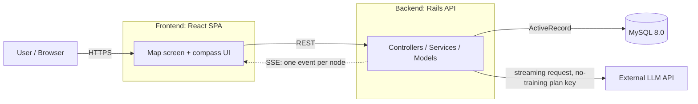
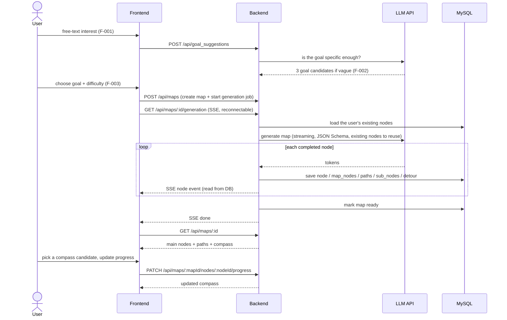

---
paths:
  - "backend/**"
  - "frontend/**"
  - "cli/**"
---

# Overall Architecture

Design as defined in `docs/basic-design.md` sections 2 and 6. Nothing below is implemented yet; when implementing, follow these decisions unless the design docs are updated first. Frontend and backend internals are in `frontend.md` and `backend.md`. Domain terms (マップ, ノード, 道, メインノード, サブノード, 寄り道, 元ノード, 既知ノード, …) follow `GLOSSARY.md`; decisions behind the model are in `docs/adr/`.

## System diagram

- The frontend talks only to the backend. Only the backend calls the LLM API and holds its key.
- Map generation is streamed: LLM tokens → backend buffers until one node is complete → save to DB → one SSE event to the frontend.
- Generation runs as a background job (ActiveJob `:async`), detached from the request, and continues when the client disconnects. The job only writes to the DB; the SSE endpoint reads saved nodes from the DB, so it can be reconnected any time (`docs/basic-design.md` section 6.4.6, ADR 0004).

## Main flow (basic-design 6.1)

