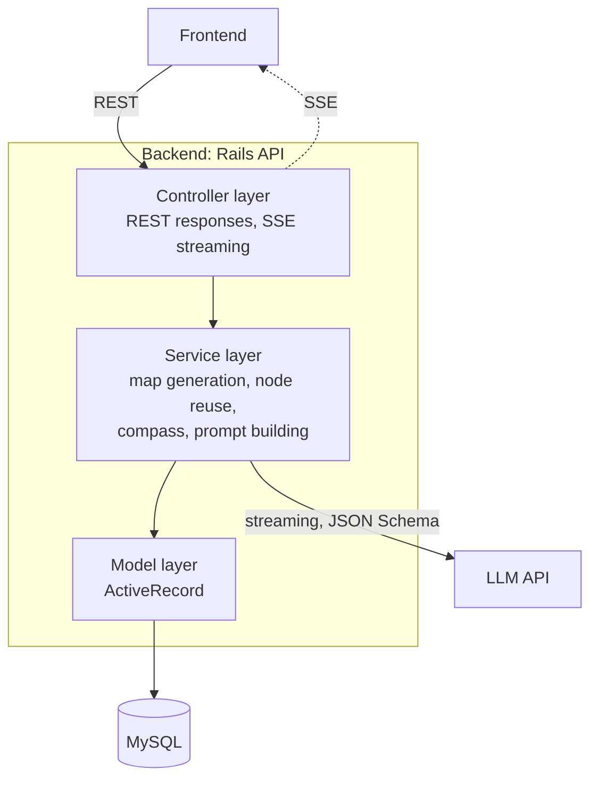
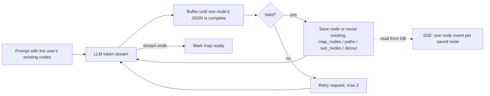

---
paths:
  - "backend/**"
---

# Backend Architecture

Ruby on Rails 7.1 in API mode. Design from `docs/basic-design.md` sections 2.3, 6 and 7. Not implemented yet (no Rails app has been generated).

## Layers

| Layer | Responsibility |
| :--- | :--- |
| Controller | Accepts API requests and returns normal or SSE responses. No business logic. |
| Service | Business logic and all LLM API calls. |
| Model | MySQL access through ActiveRecord. |

## Map generation pipeline

The pipeline runs in a background job (ActiveJob `:async`) started by `POST /api/maps`, not in the SSE request, so it continues when the client disconnects (`docs/basic-design.md` section 6.4.6, ADR 0004):

- Save one node per transaction. Lock the `maps` row first (`SELECT … FOR UPDATE`); if the map is gone, close the LLM stream, log, and stop quietly; if it is no longer `generating`, stop without saving. Update `maps.generation_heartbeat_at` after each save.
- On an exception, set `status = failed` and `generation_error_code`. Log the details; never store the exception message.
- Pass only the map to the job, never the key as an argument (ActiveJob serializes and logs job arguments); see `llm-integration.md` for which key is used and when it is read.
- A `generating` map whose heartbeat is older than the limit (5 minutes to start with) is set to `failed` / `timed_out` by the SSE loop and by map-reading APIs.
- The SSE controller never receives nodes from the job. On every connection it sends all saved nodes, then polls the DB for new ones, and ends with `done`, `error` or `deleted`.

See `llm-integration.md` for LLM call rules and `../meta/error.md` for failure handling.

## API endpoints

Shapes (parameters, request and response JSON, status codes, error codes, SSE event `data`) are defined in `api/openapi.yaml`; behaviour in `docs/basic-design.md` section 7.1, reasons in `docs/design-doc.md` section 4.6. Change both in the same change. Backend tests check requests and responses against `api/openapi.yaml` with `committee` (basic-design section 8).

| Endpoint | Purpose |
| :--- | :--- |
| `GET /api/maps` / `POST /api/maps` | List / create maps (F-012). `GET` sorts by `updated_at` desc, then `id` desc. `POST` takes the goal, difficulty, and `origin_node_id` or `detour_id` (F-017, F-006), creates the map as `generating` and starts the generation job (F-011). |
| `DELETE /api/maps/:id` / `GET /api/maps/:id/deletion_preview` | Delete a map (also while `generating`; locks the `maps` row first) / preview what deletion affects. |
| `POST /api/goal_suggestions` | Goal candidates for vague input (F-002). Called before the map exists. |
| `GET /api/maps/:id/generation` (SSE) | Watch generation (F-011): all saved nodes as `node` events, then new ones, then `done`, `error` or `deleted`. Reconnectable; no `Last-Event-ID`. |
| `GET /api/maps/:id` | `status` and `error`, main nodes, paths, detour entrances, origin links, and `compass` (only when `ready`). |
| `GET /api/maps/:mapId/nodes/:nodeId` | Node detail: summary, progress, this map's detour, other maps it appears in. |
| `GET /api/nodes/:id/sub_nodes` | Drill-down (F-007): sub nodes and the paths among them (shared, no map). |
| `PATCH /api/maps/:mapId/nodes/:nodeId/progress` | Update progress (F-010); appends a `map_progress_events` row for that map and updates `started_map_id`; returns `compass` and `origin_completion_suggestion`. |
| `GET /api/nodes?q=&map_id=` | Existing-node suggestions for editing (F-018): the user's nodes whose title matches, with `already_main` and `inside` for that map. |
| `POST` / `PATCH` / `DELETE /api/maps/:mapId/nodes[/:nodeId]`, `POST` / `DELETE /api/maps/:mapId/paths` | Map edits (F-018): place or remove a main node, change importance, add or remove a path. Return the same body as `GET /api/maps/:id`. |
| `PATCH /api/nodes/:id`, `POST` / `DELETE /api/nodes/:id/sub_nodes`, `POST` / `DELETE /api/nodes/:id/sub_node_paths` | Shared edits (F-018): title and summary, sub nodes, paths among sub nodes. Take the acting `map_id`. |
| `POST /api/auth/:provider`, `GET /api/auth/:provider/callback` | Web login with `google` / `github` through omniauth (F-019). The callback finds or creates the user, adds a `web_sessions` row, sets the Cookie and redirects to `FRONTEND_ORIGIN` + `return_to`. |
| `GET /api/session` / `DELETE /api/session` | Current user and `csrf_token` (`401` with `csrf_token` when logged out) / log out this device only. |
| `POST /api/auth/cli_login_requests`, `POST /api/auth/cli_login_requests/token` | CLI login by device code (basic-design 7.4), no auth: create a login request (`name` → `device_code`, `user_code`, `verification_uri`, `expires_in`, `interval`) / poll for the token with `device_code`. |
| `POST /api/auth/cli_login_requests/lookup` / `approve` / `deny` | S-03, Web login (Cookie session) only: show the request's `name` and `created_at` / approve / deny, by `user_code`. |
| `DELETE /api/auth/tokens/current` | CLI logout: revoke the token used for the request. |
| `GET /api/llm_providers` | Providers and model candidates for a learner's own key (F-020): implemented providers only, models from a config file. |
| `GET` / `PUT` / `DELETE /api/llm_credential` | A learner's own LLM key (F-020): status (`provider`, `model`, `api_key_last4`, `verified_at`, or `null`) / verify, then save (`422 api_key_invalid` / `model_not_available`, `502 llm_api_error`; nothing saved on failure) / delete, back to the service's key. `PUT` and `DELETE` accept the Cookie session only (Bearer → `401`, so the CLI cannot change the setting); `GET` accepts both. Never returns the key. |

## Authentication (F-019, `docs/basic-design.md` section 7.3)

- Identify the user by the Cookie session (`web_sessions`) or a Bearer token (`api_tokens`). If the `Authorization` header is present, use only the Bearer token. Everything except the login endpoints (`/api/auth/:provider`, its callback, `cli_login_requests` create and `…/token`) returns `401` without a user.
- Find the user by `user_identities (provider, provider_uid)`, never by email. Without one, merge into the user whose `email` equals the provider's **verified** email (Google `email_verified`, any GitHub `verified` email; prefer the primary one when creating a user), else create the user. No verified email → no login (`/login?error=email_not_verified`).
- Session: random token in the Cookie, only its SHA-256 in `token_digest`; expires 30 days after the last recorded use and is extended on use (write `last_used_at` / `expires_at` only when `last_used_at` is a day old or more). Logout deletes only that row.
- Token lifetime (basic-design 7.4): `expires_at` = issue time + 30 days. On a Bearer-authenticated request, only when `last_used_at` is NULL or a day old or more, set `last_used_at` = now and `expires_at` = now + 30 days. No absolute limit. Past `expires_at` → `401 token_expired`; no matching row (wrong or revoked) → `401 invalid_token`. Never delete expired rows (`api_tokens`, `web_sessions`, `cli_login_requests`); cleanup is open (design-doc section 6).
- Cookies (login and Rails session): no `Domain`, `HttpOnly`, `SameSite=Lax`, `Secure` except in development. Re-enable `ActionDispatch::Cookies` and `ActionDispatch::Session::CookieStore` (and include `ActionController::Cookies` / `ActionController::RequestForgeryProtection`) for omniauth's `state`, PKCE (Google) and `return_to`; reset that session after login.
- Cookie-session POST / PATCH / DELETE: check the Rails CSRF token and that `Origin` equals `FRONTEND_ORIGIN`, else `403 invalid_csrf`. Bearer requests and the unauthenticated `cli_login_requests` create and `…/token` skip both. CORS (`rack-cors`) allows only `FRONTEND_ORIGIN` with credentials.
- `return_to`: accept only paths starting with `/` and not `//`; otherwise `/maps`. The redirect origin is always `FRONTEND_ORIGIN`.

## CLI login (device code, `docs/basic-design.md` sections 7.1 and 7.4)

- The CLI never handles passwords. `cli_login_requests` stores only the SHA-256 of `device_code`; `user_code` is `XXXX-XXXX` from `BCDFGHJKLMNPQRSTVWXZ`, single use. Requests expire after 10 minutes; `interval` is 5 seconds.
- `verification_uri` is `FRONTEND_ORIGIN` + `/cli/activate` and never contains `user_code` (prevents phishing an approval of someone else's login).
- `…/token` returns `400` with `code` `authorization_pending`, `slow_down` (polled within `interval` of `last_polled_at`; still updates it), `access_denied`, or `expired_token` (expired, already `consumed`, or unknown `device_code`). When `approved`, lock the row, create the `api_tokens` row (with the request's `name`) and set `consumed` in one transaction; return `token` and `expires_at` once. Never store a plaintext token.
- `lookup` / `approve` / `deny` accept only the Cookie session (Bearer → `401`) with the CSRF and `Origin` checks. Normalize `user_code` (trim, upper-case, hyphen optional). An unknown, expired or non-`pending` request → `404 invalid_user_code`. `approve` sets `user_id` and `approved`, `deny` sets `denied`; both return `204`.

## Core algorithms

- **Node reuse (F-015, basic-design 6.4)**: the LLM reuses the user's existing nodes by ID instead of duplicating them (see `llm-integration.md` for the prompt and save-merge rules). For a map made from an origin node, its new main nodes also become sub nodes of the origin node. Never reuse another user's nodes.
- **Compass (F-013, basic-design 6.6)**: over the map's main nodes, recomputed on every progress update, never stored.
  - Current position: derived from `map_progress_events` of that map (ADR 0005). For each placement (`map_node_id` not NULL) take the latest event; drop `reset`; the newest remaining `started` / `completed` is the current position. Events are only added by progress updates made from that map, and are never deleted when a node is removed.
  - Known node: `completed`, or `in_progress` with `started_map_id` set to another map (`NULL` counts as this map).
  - Candidates: not completed, not known, and every incoming `map_paths` source is completed or known. Sort by `importance_score` desc, then `id`. Return all of them.
  - Goal reached: at least one main node and every main node completed (an empty map is never goal reached); return `is_goal_reached: true` and empty `candidates`. Never auto-complete the origin node; return a suggestion instead.
  - Sub node progress is recorded but ignored by the compass.
- **Drill-down (F-007)**: sub nodes come from `sub_nodes` and are the same in every map.
- **Difficulty (F-003)**: ライト / スタンダード / ディープ map to `max_depth`, `node_count_target` (a range, validated) and a sub node count guide (basic-design 6.3).
- **`maps.updated_at` (basic-design 5.5)**: touch it on every side effect made through that map, even when the `maps` row itself does not change: generation (each node save, `status` changes including `timed_out`), progress updates from that map, and edits from that map (map edits and shared edits with that `map_id`). Never on reads. When shared data (`nodes`, `sub_nodes`, `sub_node_paths`, `progress_statuses`) changes through another map (shared edits, progress updates, sub nodes added by reuse in generation, an origin node's sub nodes changed by its map, nodes deleted with another map), never touch the other maps that contain those nodes: a map the learner is not working in must not become the latest. Do not propagate touches from shared tables to `maps` (no `touch: true` across them); touch only the acting map explicitly. The map list and the redirect to the latest map use it.
- **Map deletion**: cascade `map_nodes`, `map_paths`, `detours`, `map_progress_events`; delete a node only when no map and no node references it.
- **Editing (F-018, basic-design 6.7)**: only from a `ready` map (`409 map_not_ready`); lock the `maps` row first. Reject edits that make `map_paths`, `sub_node_paths` or `sub_nodes` cyclic with `422 cycle` and the cycle; never fix them silently. Removing a main node deletes its paths and detour (no rewiring), sets its events' `map_node_id` to NULL, and deletes nodes left unreferenced by the map-deletion rule. Edits that reach other maps or delete nodes with progress return `409 confirmation_required` until resent with `confirmed=true`. Importance high / mid / low is stored as 0.9 / 0.5 / 0.1. In a map made from an origin node, placing or removing a main node also changes the origin node's sub nodes.

## Environment

- Rails `database.yml` reads `DB_HOST`, `DB_USER`, `DB_PASSWORD` and `DB_NAME`, which Compose maps from the MySQL values in `.env`.
- The three `ACTIVE_RECORD_ENCRYPTION_*` keys in `.env` come from `bin/rails db:encryption:init`. They encrypt learners' own LLM keys; losing them makes stored keys unreadable (`docs/basic-design.md` section 7.2).
