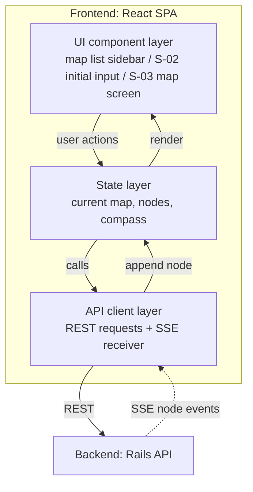
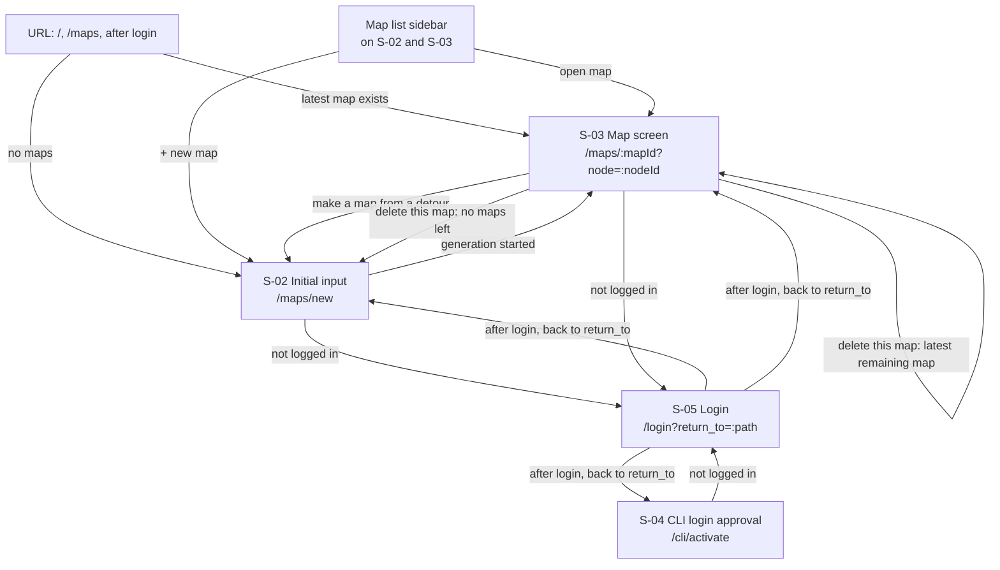

# Frontend Architecture

React SPA. Design from `docs/basic_design.md` sections 2.2 and 3, and `docs/design_doc.md` section 4.4. Not implemented yet; the directory layout and libraries (router, state management, graph rendering) are not chosen. Ask the user before adding any npm package.

## Layers

| Layer | Responsibility |
| :--- | :--- |
| UI components | Screens and user input. Never calls the backend directly. |
| State | App state shared across screens (current map, nodes, compass). |
| API client | All backend communication, including receiving the SSE stream for map generation. |

## Screens

Details: `docs/design_doc.md` section 4.4.

There is no map list screen; the map list is a sidebar. `/`, `/maps` and a login without `return_to` only redirect: to S-03 of the map with the latest `updated_at`, or to S-02 with 「最初のマップを作りましょう」 if there are no maps.

## Rules

- **There is no linear roadmap view.** Do not build one, and do not sort nodes into a single order on the client.
- **Render streamed nodes one at a time.** S-02 calls `POST /api/maps` (creates the map and starts generation) and moves to S-03 at once. S-03 connects to `GET /api/maps/:id/generation`. Each SSE `node` event carries one complete node; store nodes keyed by ID (upsert, since every connection resends all saved nodes) and draw it immediately. If the connection drops without a terminal event, reconnect with the same `GET`; generation keeps running on the backend. Reused nodes arrive already filled in (F-009). Show the compass only after `done`.
- **Generation status**: on opening S-03, branch on `status` from `GET /api/maps/:id`: `generating` → draw saved nodes and connect to the SSE, no compass; `failed` → draw saved nodes, no compass, show an amber warning icon with `error.message` and a delete button (delete and make again; no retry in place). Only S-02 starts generation. In the sidebar, show a spinner for `generating` and the amber warning icon for `failed` (also distinct in shape), each with an `aria-label` (「作成中」「作成に失敗」) and no visible text badge.
- **Map screen**: first draw only main nodes, with titles and paths only (no `summary` until a node is selected). Center the initial view on the current position and its surroundings. Selecting a node opens the detail panel (`GET /api/maps/:mapId/nodes/:nodeId`) and keeps the selection in `?node=`.
- **Drill-down (F-007)**: fetch `GET /api/nodes/:id/sub_nodes` and expand the sub nodes as a graph inside that node. For an origin node, move to its map instead.
- **Marks**: shared nodes get a "common with other maps" mark; origin nodes a "has a map inside" mark; a main node that is also inside another main node of the same map (`also_inside`) gets an "also inside 'A'" mark (ADR 0006). A detour without a map appears only in the detail panel; once a map is made from it, draw a dashed dead-end entrance from its main node. Detour entrances have no progress.
- **Navigation between maps**: browser back plus a "← back to previous map" link. No breadcrumb (shared nodes give a map several parents).
- **Compass**: mark the current position (none = start point) and point at every candidate. Use `compass` (`current_node_id`, `candidates` sorted by `importance_score`, `is_goal_reached`) from the backend as-is; never derive it on the client. Highlight the first candidate. Any node can be started, not only candidates. After a progress update, use the `compass` returned by `PATCH /api/maps/:mapId/nodes/:nodeId/progress`; if it returns `origin_completion_suggestion`, ask whether to complete the origin node.
- **Editing (F-018, `docs/design_doc.md` sections 4.2.10 and 4.4)**: offer editing only on `ready` maps. Add a main node from the map; while the title is typed, list `GET /api/nodes?q=&map_id=` results: `already_main` ones are shown but not selectable, ones with `inside` are selectable with an "also inside 'A'" note; choosing none creates a new node (summary optional). Edit title and summary, remove from the map, change importance (high / mid / low), and edit sub nodes and their paths from the detail panel; draw or remove a path by selecting two nodes. On `409 confirmation_required`, show the affected maps and the nodes with progress that will be deleted, and resend with `confirmed=true` only if the learner agrees. On `422 cycle`, show `message` and leave the map unchanged. Use the map or node returned by the edit as-is; never validate cycles or decide cleanup on the client. A map with no main nodes shows 「メインノードがありません．ノードを追加してください」.
- **First visit**: on the user's first S-03 only, show three skippable hints (current position, compass, select a node).
- **Map list sidebar (F-012, `docs/design_doc.md` section 4.4)**: shown on S-02 and S-03 only (not S-04 / S-05). Contents: 「＋ 新しいマップ」 (to S-02) on top, then map titles in `GET /api/maps` order with the open map highlighted, plus the generation status icons. No origin / detour notes, no delete button, no progress (those notes go under the map title on S-03). Wide screens (≥ 768px): place it beside the map and shrink the map area, never overlay (an overlay would shift the initial view and "fit all", and hide nodes from interaction); keep the view center when toggling; the map stays fully usable while it is open. Narrow screens: overlay without dimming, the visible part of the map stays usable, and close it only when a map is chosen. Open / close only with the ☰ button and the close button inside (not `Esc` or outside clicks); no focus trap; ☰ has `aria-expanded`. Keep the open state in `localStorage`, separately for wide and narrow screens, across screens and reloads; default open on wide, closed on narrow, and use the defaults if `localStorage` fails.
- **Map list and view sync**: fetch `GET /api/maps` every 30 seconds only while the sidebar is open and `document.visibilityState === 'visible'`; fetch once at once when the sidebar opens and when the tab comes back to the front (even if closed). On tab focus, also refetch `GET /api/maps/:id` for the open map. Syncing an open S-03 otherwise is #24.
- **Map deletion**: from 「このマップを削除」 in the S-03 top menu. Show `GET /api/maps/:id/deletion_preview` first and warn that nodes started in this map stay in progress in the other maps. A `generating` map can be deleted too; add 「作成中です．削除すると作成も止まります」 to the confirmation. After deleting in this tab, go silently to S-03 of the remaining map with the latest `updated_at`, or S-02 if none. A map deleted elsewhere (other tab, CLI) is noticed by the SSE `deleted` event, a `404`, or by diffing each fetched map list against the previous one (ignoring maps deleted in this tab); stay on the current screen and show one notice listing all such maps. If the open map was deleted, move by the same rule first, then show the notice (`docs/design_doc.md` section 4.4).
- **Login (F-019, `docs/design_doc.md` section 4.6)**: on start, call `GET /api/session`; on `401`, go to S-05 `/login?return_to=<current path>`. S-05 has only 「Google でログイン」 and 「GitHub でログイン」, each a form POST to the backend's `/api/auth/google` / `/api/auth/github` carrying the CSRF token and `return_to`. Show 「確認済みのメールアドレスが必要です」 for `?error=email_not_verified`. Every `fetch` uses `credentials: 'include'` and every POST / PATCH / DELETE sends `X-CSRF-Token` (from `GET /api/session`); the SSE uses `new EventSource(url, { withCredentials: true })`. Never store a session token in JS (the login Cookie is `HttpOnly`).
- **CLI login approval (S-04, `docs/design_doc.md` section 4.4)**: one input for the code shown by `campass login`; never prefill it from the URL. On submit, call `POST /api/auth/cli_login_requests/lookup` and show the device `name` (「名前のない端末」 if null) and start time (`created_at`) with 「許可」 / 「拒否」 and a note to deny if the learner did not run `campass login` themselves. Then call `…/approve` or `…/deny` and show 「ログインを許可しました．ターミナルに戻ってください」 or 「ログインを拒否しました」. On `404 invalid_user_code`, show 「コードが正しくないか，期限が切れています」 and let the learner retry.
- The frontend never holds or receives the LLM API key or the OAuth secrets.
