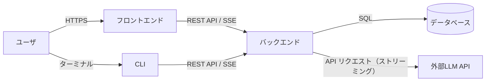
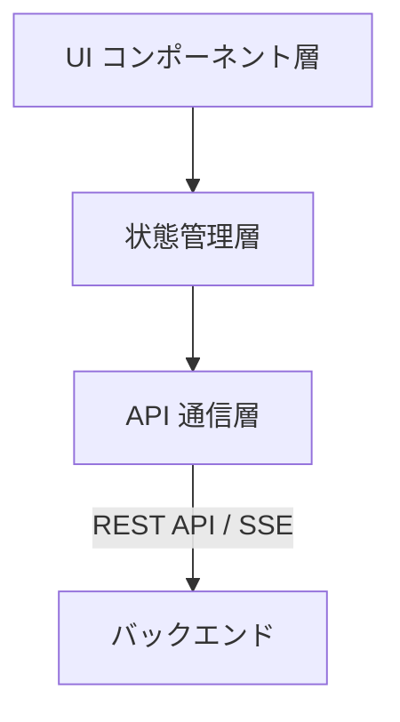
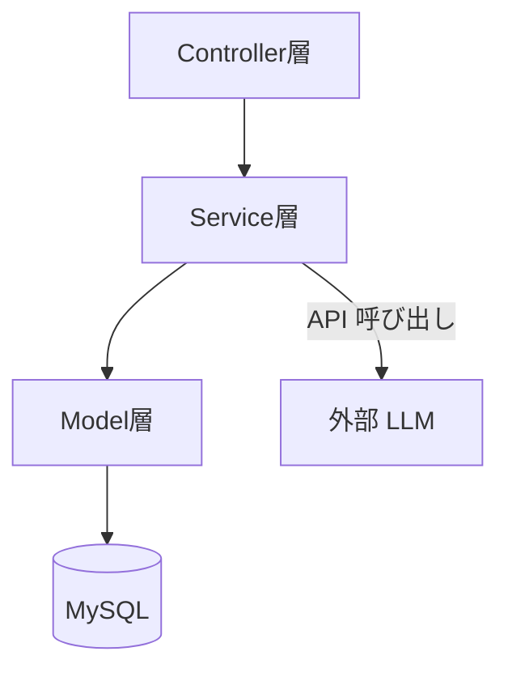
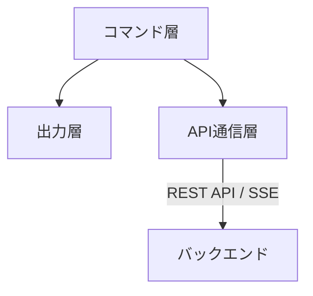
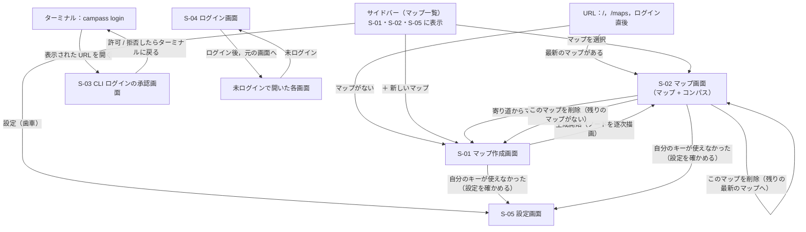
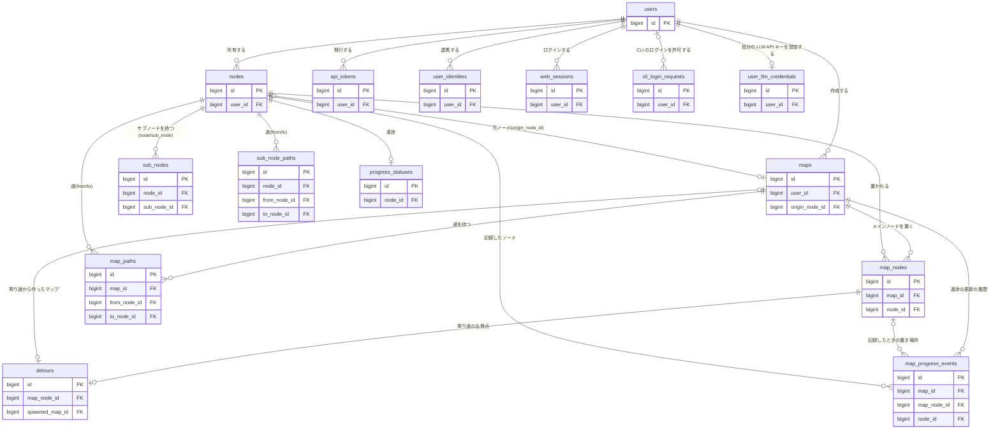

# 基本設計書：Campass

## 1. 文書概要

### 1.1 はじめに

本書は，「要件定義書（ReqDef.md）」の機能要件・非機能要件をどう実現するかの仕様を，具体的に定めるものである．システム構成，画面，CLI，データベース，処理，外部インターフェース（API，LLM，認証），テストの仕様を記載する．

* 仕様だけを書き，その仕様にした理由は書かない．理由が必要な箇所は「（理由：Design Doc x.y）」として Design Doc（`design_doc.md`）の該当の節を示す．
* 用語は `GLOSSARY.md` に従う．

### 1.2 改訂履歴

| バージョン | 日付 | 概要 | 変更者 |
| :--- | :--- | :--- | :--- |
| v1.0.0 | 2026/07/13 | 新規作成 | 池田 琉俊 |
| v1.1.0 | 2026/10/06 | 星座型ビューを「学習マップ」に改称し，コンパス（F-013）を画面設計に追加 | 池田 琉俊 |
| v1.2.0 | 2026/10/06 | 一本道ビューを廃止し，S-03 を学習マップのみの画面に変更．syllabus_nodes の order_index を廃止し importance_score を追加 | 池田 琉俊 |
| v1.3.0 | 2026/10/06 | 4章を概要（ER図・テーブル一覧）のみとし，カラム定義は Design Doc 4.1.2 を正とする形に変更（`syllabus_edges`，`progress_statuses`，アセスメント関連テーブルを ER図に追加）．5.1 のストリーミング方式を SSE に統一 | 池田 琉俊 |
| v1.4.0 | 2026/10/06 | CLI クライアント（F-014）を追加．2.1 の全体構成に CLI を追加し，2.4 CLI構成，3.5 CLIコマンド一覧を新設．認証トークン用の `api_tokens` を ER図・テーブル一覧に追加 | 池田 琉俊 |
| v1.5.0 | 2026/10/08 | 用語を GLOSSARY.md に合わせて整理（ノートブック・学習マップ・シラバスを「マップ」に統一）．ノードをユーザーの持ち物としてマップ間で共有する構成に合わせ，画面一覧・遷移図・URL，CLIコマンド，ER図・テーブル一覧を更新．クロスノートブックリンクと Embedding API 連携（5.2）を廃止 | 池田 琉俊 |
| v1.6.0 | 2026/10/09 | 前提知識アセスメント（ReqDef F-004）の廃止に合わせ，CLI構成（2.4），画面一覧（3.1），CLIコマンド一覧（3.5），ER図・テーブル一覧（4章），マップ生成API連携（5.1）からアセスメントを削除 | 池田 琉俊 |
| v1.7.0 | 2026/10/09 | 生成中に接続が切れても生成を続ける方式（Design Doc 4.2.9）に合わせ，CLIコマンド一覧（3.5）に `campass delete` を追加し，マップ生成API連携（5.1）を更新 | 池田 琉俊 |
| v1.8.0 | 2026/10/09 | ノードの編集（ReqDef F-018）を追加．S-03 の概要（3.1）と CLIコマンド一覧（3.5）に編集を追記．現在地を進捗の履歴から導出する方式（Design Doc 4.2.8，ADR 0005）に合わせ，ER図とテーブル一覧（4章）から `maps.current_node_id` を削除して `map_progress_events` を追加 | 池田 琉俊 |
| v1.9.0 | 2026/10/11 | リポジトリを `backend/`・`frontend/`・`cli/` に分けた構成に合わせ，2.5 リポジトリ構成を新設 | 池田 琉俊 |
| v1.10.0 | 2026/10/11 | Google / GitHub でのログイン（ReqDef F-019）を追加．画面一覧（3.1）と画面遷移図（3.3）に S-05 ログイン画面を追加し，ER図・テーブル一覧（4章）に `user_identities` と `web_sessions` を追加して `users` の認証用カラムを削除．5.5 ログイン連携を新設．S-04 を CLI のログインの承認画面のために空けていることを 3.1 に注記 | 池田 琉俊 |
| v1.11.0 | 2026/10/11 | CLI のログインをデバイスコード方式（Design Doc 4.5.4）に決定．画面一覧（3.1）と画面遷移図（3.3）に S-04 CLI ログインの承認画面を追加して 3.1 の S-04 の注記を削除し，CLIコマンド一覧（3.5）の `campass login` を更新．ER図・テーブル一覧（4章）に `cli_login_requests` を追加 | 池田 琉俊 |
| v1.12.0 | 2026/10/11 | CLI の配布とビルドの方針（Design Doc 4.5.1，4.5.8）に合わせ，2.4 の CLI の依存を標準ライブラリと cobra に改め，CLIコマンド一覧（3.5）に `campass version` と `campass completion` を追加 | 池田 琉俊 |
| v1.13.0 | 2026/10/11 | マップ一覧画面（S-01）を廃止し，マップ一覧を S-02・S-03 に出すサイドバーに変更（Design Doc 4.4）．画面一覧（3.1）にサイドバーと `/`・`/maps`・ログイン直後の転送を追加し，S-03 にマップの注記と削除を移した．画面遷移図（3.3）とCLIコマンド一覧（3.5）の対応画面を整合 | 池田 琉俊 |
| v1.14.0 | 2026/10/12 | 5.4 を「オプトアウト設定」から「学習に使わせない API のプラン」に変更．リクエストに設定を付けることをやめ，本番のサービスでは学習に使わない契約のプランのキーだけを使うとした | 池田 琉俊 |
| v1.15.0 | 2026/10/12 | 自分の LLM API キーの設定（ReqDef F-020）を追加．画面一覧（3.1）と画面遷移図（3.3）に S-06 設定画面を追加し，サイドバーを S-06 にも出して下に設定の入口を置いた．ER図・テーブル一覧（4章）に `user_llm_credentials` を追加．APIキー管理方式（5.3）に利用者のキーの扱いを，学習に使わせない API のプラン（5.4）に利用者のキーが対象外であることを追記 | 池田 琉俊 |
| v2.0.0 | 2026/10/12 | 本書を仕様の正とし，Design Doc は理由だけを書く形に役割を分けた（#46）．Design Doc から，テーブル定義（Design Doc 4.1.2 → 5章），処理（4.2 → 6章），API の振る舞い（4.3.1 → 7.1），LLM API（4.3.2 → 7.2），画面の振る舞い（4.4 → 3章），CLI（4.5 → 4章，7.4），Web の認証（4.6 → 7.3），テスト方針（7章 → 8章）を移した．ReqDef 6章の技術スタックを 2.6 に移した．章立てを変え，CLI 設計を4章として独立させた．仕様そのものは変えていない | 池田 琉俊 |
| v2.1.0 | 2026/10/14 | 3章を「共通仕様（3.1）」と「画面ごとの詳細仕様（3.2）」の構成に改め，画面に見えるものと操作だけを書く形にした．画面の裏の処理は 6.8 フロントエンドの処理に移し，画面と API の対応は 7.1 の表の列にした．S-02 を「マップ作成画面」に改め，廃止した S-01 を詰めて画面IDを S-01〜S-05 に振り直した（旧 S-02〜S-06）．CLI の出力を JSON にし，対話をなくした（2.4，4章，7.4，8章）．2.5 リポジトリ構成を削除し，技術スタック（2.5）に依存ライブラリを加えた．5.1 から並び順の記述を削除した．6.7 生成ジョブを 6.4.6 に統合して 6.4 を小節に分け，6.6 を現在地（6.6.1）とコンパス（6.6.2）に分けて擬似コードを規則の箇条書きにした．これに伴い旧 6.8・6.9 を 6.7・6.8 に繰り上げた．6.2 の擬似コードを箇条書きにし，6.1 を各節への参照だけの短い流れにした | 池田 琉俊 |
| v2.2.0 | 2026/10/23 | 既知ノードを他のマップで完了したノードだけにした（6.6.2，#53）．`progress_statuses.started_map_id` を削除し（5.2，5.3，5.4，6.6.1，7.1），マップ削除の前の「このマップで学習を始めたノード」の注意をやめた（3.2.2.8，5.6）．7.1 の `deletion_preview` の説明と，8章のコンパス・進捗更新・マップ削除のテストを合わせて直した | 池田 琉俊 |
| v2.3.0 | 2026/10/23 | 形が決まっていなかった API を決め，食い違いを直した（#43）．7.1 に `POST /api/goal_suggestions`（`attempt` で何回目の入力かを送る），`GET /api/maps/:id/deletion_preview`，`GET /api/nodes/:id/sub_nodes` の形と，成功のステータスコード，`confirmed=true` をクエリで送ること，見つからない値（`404 not_found`）と不正な値（`400 invalid_request`）のエラーを追加し，`GET /api/maps` の `error` を `failed` でなければ `null` とした．元ノードと寄り道の注記をやめ（3.1.3，3.2.2.1），`GET /api/maps` と `GET /api/maps/:id` から `origin` と `detour_start` を削除した．6.2 と 6.8 に `attempt` の数え方を，4.3〜4.5 に `campass goals` の `--attempt` と出力を，7.3 にログインの Cookie の名前を追加 | 池田 琉俊 |
| v2.4.0 | 2026/10/23 | 8章にテスト用のデータベース（`db` の中に置くこと，名前，権限の与え方）を追加（#37） | 池田 琉俊 |
| v2.4.1 | 2026/10/24 | 6.4.6 のノードの保存に，既存ノードの再利用で共有のノードに足すサブノードとサブノード間の道もノード1つ分のトランザクションに含むこと，マップが削除されていた，または `generating` でなくなっていたときは共有のノードにも何も足さないことを明記（#38）．仕様そのものは変えていない | 池田 琉俊 |
| v2.4.2 | 2026/10/24 | 6.6.2 のコンパス候補の条件を，既知ノードを使わずに「完了」だけで書き，小見出し「既知ノード」を外した．8章のコンパスのテストの記述を合わせて直した（#54）．仕様そのものは変えていない | 池田 琉俊 |
| v2.5.0 | 2026/10/24 | 生成中に再利用したノードを，既知ノードだけでなく進捗に関係なく最初から描かれた状態で現れるようにした（3.2.2.4）．7.1 の `NodeEvent` の `progress` の説明を，既知ノードを他のマップで完了したノードだけにした定義（#53）に合わせて直した（#54） | 池田 琉俊 |

---

## 2. システム構成

### 2.1 全体構成



| サブシステム | 役割 |
| :--- | :--- |
| フロントエンド | React によるSPA．マップ（コンパス付き）などのUIを担当． |
| CLI | Go によるコマンドラインクライアント（F-014）．フロントエンドと同じバックエンドAPIを利用し，業務ロジックとAPIキーを持たない（4章）． |
| バックエンド | Ruby on Rails によるAPIサーバー．業務ロジック（マップの生成，ノードの再利用，コンパスの導出，編集の検証），LLM APIキー（サービスのキーと，利用者が設定したキー）の秘匿管理，マップのデータの永続化を担当． |
| データベース | MySQL．マップ，ノード，ユーザー進捗等を永続保持． |
| 外部LLM API | マップのデータとゴール候補の生成を担当．バックエンドだけが呼ぶ（7.2）． |


### 2.2 フロントエンド構成



| レイヤー | 役割 |
| :--- | :--- |
| UI コンポーネント層 | 画面表示・ユーザー操作の受付．マップ作成画面，マップ画面等の各画面と，マップ一覧のサイドバーを構成する．バックエンドを直接呼ばない． |
| 状態管理層 | 画面をまたいで参照するアプリケーション状態（現在のマップ，ノード，コンパス等）を保持・更新する． |
| API 通信層 | バックエンド API へのリクエスト送信，およびストリーミングレスポンス（マップの逐次生成）の受信を担当する． |

### 2.3 バックエンド構成



| レイヤ | 役割 |
| :--- | :--- |
| Controller層 | フロントエンドと CLI からのAPIリクエストを受け付け，レスポンス（通常/ストリーミング）を返却する．業務ロジックを持たない． |
| Service層 | マップ生成・ノードの再利用・コンパスの導出・編集の検証等のビジネスロジックを担当し，外部LLM APIとの連携を行う．マップの生成は，リクエストから切り離したバックグラウンドジョブで行う（6.4.6）． |
| Model層 | ActiveRecordを通じてMySQLとのデータ入出力を担当する． |

### 2.4 CLI構成



| レイヤー | 役割 |
| :--- | :--- |
| コマンド層 | サブコマンドと引数・フラグの解析を担当する．対話入力は持たない（4.1）． |
| API通信層 | バックエンド API へのリクエスト送信（認証トークンと `User-Agent` の付与を含む），およびストリーミングレスポンス（マップの逐次生成）の受信を担当する． |
| 出力層 | バックエンドから受け取ったレスポンスを JSON のまま出力し，終了コードを決める（4.4）．コンパスなどの導出は行わない． |

### 2.5 技術スタック

| サブシステム | 技術 | 依存ライブラリ | 開発・テストだけで使うもの |
| :--- | :--- | :--- | :--- |
| フロントエンド | React（SPA） | 今後設計予定（ルーター，状態管理，グラフの描画） | `openapi-typescript`（型の生成．8章） |
| CLI | Go | `github.com/spf13/cobra`（と，cobra が使う `spf13/pflag`・`inconshreveable/mousetrap`）．ほかは標準ライブラリ（4.1） | `oapi-codegen`（型の生成．4.1） |
| バックエンド | Ruby on Rails 7.1（API モード） | `rails`，`mysql2`，`faraday`（LLM の呼び出し．7.2），`dotenv`，`omniauth`・`omniauth-google-oauth2`・`omniauth-github`・`omniauth-rails_csrf_protection`（ログイン．7.3），`rack-cors`（7.3）．`google-genai` は Gemfile に残すが使わない（7.2） | `committee`（API の形の検証．8章），Minitest（Rails 標準） |
| データベース | MySQL 8.0 | — | — |
| 外部LLM API | Gemini（最初の実装．7.2） | — | — |
| テスト環境 | — | — | Prism（Docker Compose のテスト用のサービス．8章） |

* ここにないライブラリは，承認を得てから加える．

---

## 3. 画面設計

画面に見えるもの，利用者の操作，画面の移り方を書く．画面の裏で行う処理（API の呼び出し，生成の受信，再取得の判定など）は 6.8 に示す．

### 3.1 共通仕様

#### 3.1.1 画面一覧

| 画面ID | 画面名 | URL | 概要 | アクセス権限 | 関連機能ID |
| :--- | :--- | :--- | :--- | :--- | :--- |
| S-01 | マップ作成画面 | `/maps/new` | 興味・ゴールの入力，ゴール候補の選択，難易度選択を行う（3.2.1）． | Web のログインが必要 | F-001〜F-003，F-006，F-012 |
| S-02 | マップ画面 | `/maps/:mapId`（ノード選択中は `?node=:nodeId`） | メインノードと道をネットワーク図として可視化し，現在地と，コンパスで今進める場所を指し示す．ノードを選ぶと詳細パネル（概要，進捗，寄り道，登場する他のマップ）を開き，サブノードをドリルダウン展開する．元ノードや作成済みの寄り道からは別のマップへ移動できる．マップの削除と編集を行える（3.2.2）． | Web のログインが必要．自分のマップだけを開ける | F-006，F-007，F-009，F-010，F-012，F-013，F-015，F-018 |
| S-03 | CLI ログインの承認画面 | `/cli/activate` | `campass login` が表示したコードを入力し，端末名と開始時刻を確かめて CLI のログインを許可・拒否する（3.2.3）． | Web のログインが必要 | F-014，F-019 |
| S-04 | ログイン画面 | `/login`（ログイン後に戻る画面は `?return_to=:path`） | 「Google でログイン」「GitHub でログイン」を選ぶ（3.2.4）． | ログイン不要 | F-019 |
| S-05 | 設定画面 | `/settings` | 自分の LLM API キーを設定する（3.2.5）．CLI からは設定できない． | Web のログインが必要 | F-020 |

* マップ一覧は画面にせず，サイドバー（3.1.3）とする．
* 画面IDは v2.1.0 で振り直した．v2.0.0 までの S-02〜S-06 は，今の S-01〜S-05 に当たる（旧 S-01 マップ一覧画面は v1.13.0 で廃止）．改訂履歴は当時の番号のまま残す．
* `/` と `/maps` は転送だけを行い，画面を持たない（3.1.2）．
* ログイン済みで S-04 を開いたときの扱いは今後設計予定．

#### 3.1.2 画面遷移仕様

**画面遷移図**



**遷移の条件と引き継ぎパラメータ**

| 遷移元 | 遷移先 | 遷移条件 | 引き継ぎパラメータ |
| :--- | :--- | :--- | :--- |
| `/`・`/maps`・ログイン直後（`return_to` がないとき） | S-02 | マップがある | 最後に更新したマップ |
| `/`・`/maps`・ログイン直後（`return_to` がないとき） | S-01 | マップがない | なし |
| サイドバー | S-01 | 「＋ 新しいマップ」を選ぶ | なし |
| サイドバー | S-02 | マップを選ぶ | 選んだマップ |
| サイドバー | S-05 | 設定（歯車）を選ぶ | なし |
| S-01 | S-02 | 難易度を選び，マップの作成が始まった | 作ったマップ |
| S-02 | S-01 | 寄り道からマップを作る | 寄り道（テーマを興味として入力済みにする）．引き継ぎ方は今後設計予定 |
| S-02 | S-02 | 元ノード・寄り道の入口を選ぶ，または「← 来たマップへ戻る」を選ぶ | 移動先のマップ |
| S-02 | S-02 / S-01 | このマップを削除した（3.2.2.8） | 残りのうち最後に更新したマップ．残りがなければ S-01 |
| S-01・S-02 | S-05 | 自分のキーが使えなかったときの「設定を確かめる」を選ぶ | なし |
| ターミナル（`campass login`） | S-03 | 表示された URL を開く | なし（コードは URL に含めない） |
| 各画面（S-04 を除く） | S-04 | 未ログイン | `return_to`（今のパス） |
| S-04 | 元の画面 | ログインした | `return_to`．なければ `/maps` へ |
| S-04 | S-04 | ログインに失敗した | `error`（`/login?error=:code`） |

* マップがなくて S-01 へ移ったときは「最初のマップを作りましょう」と案内する．
* 「最後に更新したマップ」の意味は 5.5 に従う．
* S-02 では，ノードを選んでいる状態を `?node=:nodeId` で表し，ブラウザの戻る・再読み込みで選択を保つ．ドリルダウンも同じパラメータで表す．
* 別のマップへ移動した後は，ブラウザの戻ると，画面上部の「← 来たマップへ戻る」で戻る．パンくずリストは作らない（理由：Design Doc 4.7）．

#### 3.1.3 共通画面レイアウト

**サイドバー（マップ一覧，F-012）**

マップ一覧は独立した画面にせず，S-01・S-02・S-05 に出す開閉できるサイドバーとする．S-03 と S-04 には出さない．

* 中身
  * 上に「＋ 新しいマップ」を置き，S-01 へ移る．
  * その下にマップのタイトルを最後に更新した順に並べ，今開いているマップを強調する．選ぶとそのマップの S-02 へ移る．
  * 生成中のマップにはスピナー，失敗したマップには S-02 と同じ黄色の警告アイコン（3.1.4）を付ける．どちらも文字のバッジは出さず，スクリーンリーダーには「作成中」「作成に失敗」と読ませる．失敗は色や動きだけでなく，アイコンの形でも区別する．
  * 削除のボタンと進捗は出さない．削除は S-02 の上部のメニューに置く．
  * いちばん下に，設定（S-05）への入口（歯車のアイコンと「設定」）を置く．S-05 を開いている間は，入口を強調する．
* 広い画面（幅 768px 以上）では，サイドバーをマップの左に**並べ**，マップの表示領域をその分だけ狭める．マップの上に重ねない（理由：Design Doc 4.7）．開閉しても，マップの見ている中心を保つ．開いていても，マップの操作（ノードの選択，ドラッグ，拡大縮小，詳細パネル，編集）はすべてふつうに使える．
* 狭い画面（幅 768px 未満）では，サイドバーをマップの上に**重ねる**．背景は暗くせず，見えている部分のマップは操作できる．マップを選んだときだけ自動で閉じる．
* 開閉は ☰ のボタンと，サイドバーの中の閉じるボタンだけで行う．`Esc` や外側を押しても閉じない．開いていてもフォーカスはサイドバーに閉じ込めない．☰ のボタンはスクリーンリーダーに開閉の状態を伝える．
* 開閉の状態は，広い画面と狭い画面で別々に覚え，画面を移っても，再読み込みしても保つ（6.8）．初めては，広い画面では開いた状態，狭い画面では閉じた状態から始める．
* 一覧は，開いている間は新しい内容に保つ（6.8）．

#### 3.1.4 共通メッセージ仕様

**エラー**

* エラーの文言は，バックエンドが返したものをそのまま示す（6.8）．
* 生成に失敗したマップには，黄色（濃いめの琥珀色）の警告アイコンを付ける（S-02 とサイドバー）．
* 自分の LLM API キーが原因で失敗したときは，文言に添えて S-05 への「設定を確かめる」を出す（S-01，S-02）．
* 表示の形（ダイアログ，トーストなど）は今後設計予定．

**警告・お知らせ**

* 別の場所（別のタブや CLI）で削除されたマップに気づいたら（6.8），今いる画面のまま，それらのマップをまとめて1つのお知らせで示す（「別の画面で次のマップが削除されました：…」．OK で閉じる）．今開いているマップが削除されていたら，自分のタブで削除したときと同じ規則（3.2.2.8）で移ってからお知らせを出す．マップごとにお知らせを出さない．エラーではないため，警告アイコンは使わない．
* アプリを閉じている間に削除されたマップは知らせない．

**確認**

* 実行前の確認が必要な操作（マップの削除，他のマップに影響する編集）は，影響の内容を示して同意を得てから実行する（3.2.2.7，3.2.2.8）．
* 確認の表示の形は今後設計予定．

**処理成功**

今後設計予定（画面ごとに定めたもの以外の共通の規則）．

#### 3.1.5 共通表示制御仕様

**ローディング**

今後設計予定．

**ボタンの活性・非活性**

今後設計予定．

**権限による表示制御**

* 未ログインで S-04 以外の画面を開くと，S-04 へ移る（3.1.2）．
* 他ユーザーのマップやノードは表示しない．

**最新の内容の表示**

* サイドバーの一覧と開いている S-02 は，利用者が画面に戻ってきたとき（タブを切り替えて戻った，ターミナルなど別のウィンドウから戻った）に最新の内容にする（6.8）．

### 3.2 画面ごとの詳細仕様

#### 3.2.1 S-01 マップ作成画面

##### 3.2.1.1 画面レイアウト

画面に置くもの：興味の入力欄，ゴール候補，難易度（ライト／スタンダード／ディープ）の選択，サイドバー（3.1.3）．配置は今後設計予定．

##### 3.2.1.2 画面項目定義

今後設計予定．

##### 3.2.1.3 初期表示処理

* 興味の入力欄を空で示す．寄り道から新しいマップを作る場合は，寄り道のテーマを入力済みにする（F-006）．
* マップがないときに `/`・`/maps` から移ってきた場合は「最初のマップを作りましょう」と案内する（3.1.2）．

##### 3.2.1.4 ゴール候補の提案処理

1. 興味を自由入力させる（F-001）．
2. ゴール候補（F-002，6.2）が返ったら選択式で示す．ユーザーは候補から選ぶか，自由入力のまま次へ進む．

##### 3.2.1.5 マップ作成処理（難易度の選択）

1. 難易度（ライト／スタンダード／ディープ）を選ばせる（F-003）．
2. 難易度を選ぶとマップの作成が始まり，すぐに S-02 に移る（3.2.2）．マップの作成を始められるのは S-01 だけである．

##### 3.2.1.6 入力チェック仕様

今後設計予定．

##### 3.2.1.7 画面状態・表示制御仕様

* 自分の LLM API キーが原因でゴール候補の提案に失敗したときは，文言に添えて S-05 への「設定を確かめる」を出す（3.1.4）．

#### 3.2.2 S-02 マップ画面

##### 3.2.2.1 画面レイアウト

画面に置くもの：マップとコンパス，マップのタイトル，上部のメニュー（「このマップを削除」），「← 来たマップへ戻る」，詳細パネル，サイドバー（3.1.3）．配置は今後設計予定．

##### 3.2.2.2 画面項目定義

今後設計予定．

##### 3.2.2.3 初期表示処理

1. マップの生成の状態に応じて表示を分ける（3.2.2.11）．
2. メインノードのみを描き，個々のノードの詳細（概要等）は出さず，タイトルと道のみを見せる．
3. 視点は現在地とその周辺（現在地へ道がのびるノード，コンパス候補）に寄せ，全体はユーザーが能動的に広げて眺める．
4. 生成が終わったマップでは，コンパス（3.2.2.6）を表示する．
5. ユーザーが初めて S-02 を開いたときだけ，「現在地」「コンパス」「ノードを選ぶと詳細とサブノードが見られる」の3つを順に指す短い説明を重ねて出す（「次へ」「スキップ」付き）．

##### 3.2.2.4 生成中の表示

S-01 から移ってきたときと，生成中のマップを開いたときの表示．

1. マップ上で「マップを作っています」と表示する（作成済みのノードがあれば描く）．
2. ノードができるたびに1つずつ描き，道で接続する（6.8）．再利用したノードは，進捗に関係なく最初から描かれた状態で現れ（見た目は今の進捗のとおり），道で接続する（F-009）．生成中もノードを選んで詳細を読める．
3. 生成が終わったら，コンパスを表示する．コンパスは生成が終わるまで出さない（理由：Design Doc 4.4）．

* 生成に失敗したら，失敗したマップの表示（3.2.2.11）に切り替える．
* 生成中のマップが別の場所で削除されたら，3.1.4 のお知らせに従う．

##### 3.2.2.5 ノード選択処理

* ノードを選ぶと詳細パネルを開く．詳細パネルには概要，進捗，寄り道（あれば），そのノードが登場する他のマップを示し，そこからサブノードを展開できる（F-007，6.5）．
* 元ノードを選ぶと，ドリルダウンの代わりにそのマップへ移動する（F-017）．
* 寄り道からマップを作った後の入口を選ぶと，そのマップへ移動する（F-006）．
* 選択の状態は `?node=:nodeId` で表す（3.1.2）．

##### 3.2.2.6 進捗更新処理（コンパス）

* マップ上で現在地を明示し，コンパスが候補（6.6）をすべて指し示す．重要度の最も高い候補（候補の先頭）を強調する．
* 現在地がない場合（スタート地点）も，同じように現在地をスタート地点として示し，候補を指す．
* 候補を選ぶとそのノードの詳細を表示し，学習を開始できる．候補でないノードも開始できる．
* 進捗を更新したら，現在地とコンパスを更新後のものに替える．
* 全ノード完了時は，ゴール到達を示す表示に切り替える．マップに元ノードがあれば，元ノードを完了にするかを尋ねる．

##### 3.2.2.7 マップ編集処理（F-018）

* メインノードの追加は，マップ上の操作から行う．タイトルの入力中に，タイトルが一致する自分の既存ノードを一覧に出し，選べば既存ノードを置き，選ばなければ新しく作る（概要は任意）．すでにこのマップのメインノードであるものは選べない状態で，別のメインノードの中にあるものは「『A』の中にもあります」を添えて示す．
* ノードの内容の編集，マップから外す，重要度（高・中・低）の変更，サブノードとサブノード間の道の編集は，詳細パネルから行う．道はマップ上で2つのノードを選んで引く・消す．
* 実行前の確認が必要な編集（6.7）では，影響するマップの一覧と，削除される進捗のあるノードを示して確認し，同意されたら実行する．
* 道やサブノードが循環する編集（6.7）では，循環するノードの並びを含む文言を示し，マップは変えない．

##### 3.2.2.8 マップ削除処理

* 削除は，上部のメニューの「このマップを削除」から行う．
* 削除の前に削除の影響を示す．
* 生成中のマップも削除できる．その場合は確認に「作成中です．削除すると作成も止まります」を添える．「中止」という言葉は使わない．
* 自分のタブで削除したときは，何も表示せずに，残りのうち最後に更新したマップの S-02 へ移る．残りのマップがなければ S-01 へ移る．
* 別の場所で削除されたときの扱いは 3.1.4 に従う．

##### 3.2.2.9 最新の内容の表示

画面に戻ってきたとき（3.1.5）に，次のように最新の内容を表示する．

1. マップ（ノード，道，印）とコンパスは，最新の内容に置き換える．視点（見ている位置）と拡大率は保つ．
2. 詳細パネルを開いていたら，そのノードの詳細も最新にする．
3. 選んでいたノードがマップから外されていたら，詳細パネルを閉じ，`?node=` を消し，「このノードはマップから外されました」と知らせる．
4. 編集の途中（まだ保存していない入力がある）で，そのノードの内容が入力を始めたときから変わっていたら，入力は消さず，「このノードは別の場所で変更されました」と表示して，「入力を捨てて最新を表示」を選べるようにする．変わっていなければ何も表示しない．
5. マップ自体が削除されていたら，3.2.2.8 の規則で移り，3.1.4 のお知らせを出す．

##### 3.2.2.10 入力チェック仕様

今後設計予定．

##### 3.2.2.11 画面状態・表示制御仕様

**生成の状態**

| 生成の状態 | S-02 の表示 |
| :--- | :--- |
| 生成中 | 作成済みのノードを描き，続きができるたびに描き足す（3.2.2.4）．コンパスは出さない． |
| 完成 | 通常の表示． |
| 失敗 | 作成済みのノードを描く．コンパスは出さない．警告アイコン（3.1.4）と失敗の理由を示し，マップを削除して作り直すよう案内する（削除ボタン）．自分の LLM API キーが原因なら，S-05 への「設定を確かめる」も添える． |

* 編集の操作は完成したマップでだけ出す．

**ノードの印**

* マップ間ノードには「他のマップと共通」の印を付ける．
* 同じマップの別のメインノードの中にも現れるメインノードには「『A』の中にもあります」の印を付ける（ADR 0006）．
* 元ノードには「中にマップがある」印を付ける（F-017）．
* 寄り道は，まだマップを作っていない間は詳細パネルにだけ表示し，マップには描かない．寄り道からマップを作ったら，寄り道の出発点から点線でのびる行き止まりの入口として描く．寄り道の入口は進捗を持たない（F-006）．

**空のマップ**

* メインノードが0個のマップでは，「メインノードがありません．ノードを追加してください」と表示する．

#### 3.2.3 S-03 CLI ログインの承認画面

##### 3.2.3.1 画面レイアウト

画面に置くもの：コードの入力欄，確認の表示（端末名と開始時刻），「許可」「拒否」．配置は今後設計予定．

##### 3.2.3.2 画面項目定義

今後設計予定．

##### 3.2.3.3 初期表示処理

* コードの入力欄を1つ置く．「ターミナルに表示されたコードを入力してください」と添える．URL からコードを受け取って入力済みにすることはしない（7.4）．

##### 3.2.3.4 コード送信処理

* 入力したら，確認画面に端末名（なければ「名前のない端末」）と開始時刻を出す（例：「my-laptop からのログイン（10:00 に開始）を許可しますか？」）．「自分で `campass login` を実行していない場合は拒否してください」と添え，「許可」「拒否」を選ばせる．

##### 3.2.3.5 許可・拒否ボタン押下処理

* 終わったら「ログインを許可しました．ターミナルに戻ってください」または「ログインを拒否しました」を表示する．

##### 3.2.3.6 入力チェック仕様

今後設計予定．

##### 3.2.3.7 画面状態・表示制御仕様

* コードが正しくないか期限が切れていたら，「コードが正しくないか，期限が切れています」と表示し，入力し直せるようにする．

#### 3.2.4 S-04 ログイン画面

##### 3.2.4.1 画面レイアウト

画面に置くもの：「Google でログイン」「GitHub でログイン」の2つのボタンだけ．配置は今後設計予定．

##### 3.2.4.2 画面項目定義

今後設計予定．

##### 3.2.4.3 初期表示処理

* 「Google でログイン」「GitHub でログイン」の2つのボタンを示す（F-019）．登録画面はなく，初めてのログインでユーザーを作る（7.3）．

##### 3.2.4.4 ログインボタン押下処理

* Google / GitHub のログイン画面へ移り，ログイン後は `return_to` の画面へ戻る（3.1.2，7.3）．

##### 3.2.4.5 入力チェック仕様

* 入力項目はない．

##### 3.2.4.6 画面状態・表示制御仕様

* ログインに失敗して戻った場合（`/login?error=:code`）は理由を示す．確認済みのメールアドレスがなければ「確認済みのメールアドレスが必要です」と表示する．

#### 3.2.5 S-05 設定画面

自分の LLM API キーを設定する画面（ReqDef F-020）．サイドバーの下の歯車から開く．

##### 3.2.5.1 画面レイアウト

画面に置くもの：会社とモデルの選択欄，キーの入力欄，「保存」，設定済みの内容，「入力し直す」「削除」，規約についての案内，サイドバー（3.1.3）．配置は今後設計予定．

##### 3.2.5.2 画面項目定義

今後設計予定．

##### 3.2.5.3 初期表示処理

1. 未設定なら「今はサービスのキーで動いています」と示し，会社とモデルを選ぶ欄と，キーの入力欄を置く．
2. 設定済みなら，会社，モデル，`••••` + キーの末尾4文字，確かめた日時を示し，「入力し直す」と「削除」を置く．キーそのものは表示しない．
3. 画面には常に「自分のキーで送った入力は，あなたと〇〇（選んでいる会社の名前）との契約の規約に従って扱われます」と示す（7.2 の学習に使わせない API のプランの対象外であるため）．
4. 「作成中のマップは，作成を始めたときのキーで最後まで作ります」と添える（6.4.6）．

##### 3.2.5.4 保存ボタン押下処理

* キーを確かめている間は「キーを確かめています」と示す．
* 成功したら入力欄を空にする（6.8）．
* 失敗したら文言を示し，保存されていないことを伝える．

##### 3.2.5.5 入力し直すボタン押下処理

* 未設定のときと同じ欄を開き，会社・モデル・キーをすべて入力し直させる（3.2.5.4）．

##### 3.2.5.6 削除ボタン押下処理

* 確認してから削除し，「サービスのキーに戻しました」と示す．

##### 3.2.5.7 入力チェック仕様

* 会社とモデルは候補から選ばせ，自由な入力は受け付けない．
* キーの入力欄は入力した文字を隠し，ブラウザの自動入力を使わせない．
* それ以外（未入力の扱いなど）は今後設計予定．

##### 3.2.5.8 画面状態・表示制御仕様

* 未設定と設定済みで表示を分ける（3.2.5.3）．
* CLI からは設定できない（理由：Design Doc 4.10）．
* 失敗したマップ（S-02）で S-05 へ案内する規則は 3.2.2.11 に従う．

---

## 4. CLI 設計（F-014）

### 4.1 方針

* CLI はフロントエンドと同列の「バックエンドAPIのクライアント」であり，7.1 の API のみを利用する．
* コンパス（6.6），道やサブノードの検証，既存ノードの再利用といった業務ロジックは持たない（理由：Design Doc 4.8）．
* 主な利用者は AI や他のサービスである．出力は JSON とし，人が読むためのテキスト表示は持たない（理由：Design Doc 4.8）．
* 対話入力は持たない．入力はすべて引数とフラグで渡す（理由：Design Doc 4.8）．人が操作するのは `campass login` だけである（7.4）．
* 外部LLM API を直接呼ばず，そのAPIキーも保持しない．
* 実行ファイルの依存は，Go の標準ライブラリと `github.com/spf13/cobra`（cobra が使う `spf13/pflag`・`inconshreveable/mousetrap` を含む）だけとする（2.5）．
  * コマンドの解析は cobra で行う．
  * HTTP と SSE の受信は標準ライブラリ（`net/http`，`encoding/json`，`bufio` 等）で書く．
  * ほかの外部パッケージは承認を得てから加える（理由：Design Doc 4.8）．
* OpenAPI の定義から型を作る oapi-codegen は，型の生成（`-generate types`）にだけ使う．開発のときだけ使うツールで，実行ファイルには入らない．
* 接続先のバックエンドは，ビルド時に埋め込んだ本番の URL（4.8）を既定とする．環境変数 `CAMPASS_API_URL` があれば，それで上書きする（開発中など）．
* すべてのリクエストに `User-Agent: campass-cli/<バージョン>` を付ける．古い CLI を断る仕組みは今は設けない（Design Doc 6章）．
* API のエラーの文言は CLI に持たず，レスポンスをそのまま出す．終了コードやトークンファイルの削除など，CLI の動きは `code` で分ける（理由：Design Doc 4.6）．

### 4.2 構成

CLI はリポジトリのルートの `cli/` に置く．開発時は Docker Compose の `cli` サービス（Go の公式イメージ）で `docker compose run --rm cli go test ./...` のように動かす．レイヤーの役割は 2.4 に示す．

```
cli/
├── go.mod
├── cmd/campass/main.go   # エントリポイント．cobra のルートコマンドを実行するのみ
└── internal/
    ├── command/          # コマンド層：cobra のサブコマンド定義（version，completion を含む）
    ├── api/              # API通信層：REST，SSE 受信，トークンと User-Agent の付与
    ├── output/           # 出力層：JSON の書き出しと終了コード
    ├── config/           # 接続先（埋め込みの既定値と CAMPASS_API_URL）とトークンの読み書き
    └── version/          # バージョン（ビルド時に -ldflags -X で埋め込む．既定は dev）
```

### 4.3 コマンド一覧

CLI は画面を持たないため，各画面に相当する操作をサブコマンドとして提供する．

| コマンド | 概要 | 対応する画面 | 関連機能ID |
| :--- | :--- | :--- | :--- |
| `campass login` / `campass logout` | 認証トークンの取得・破棄．`campass login` は URL とコードを示し，ブラウザの S-03 で許可されるのを待ってトークンを受け取る（7.4） | S-03 | F-014 |
| `campass maps` | マップ一覧 | サイドバー | F-012 |
| `campass goals <興味> [--attempt <回数>]` | ゴール候補の提案（4.5） | S-01 | F-001，F-002 |
| `campass new` | マップを作って生成を始め，生成されたノードを受け取る（4.5） | S-01 | F-003，F-011 |
| `campass map <map_id>` | マップ（メインノードと道）とコンパス | S-02 | F-006，F-013 |
| `campass show <map_id> <node_id>` | ノードの詳細とサブノード（ドリルダウン） | S-02 | F-007，F-015 |
| `campass start <map_id> <node_id>` / `campass done <map_id> <node_id>` | 指定したマップでの進捗の更新 | S-02 | F-010，F-013 |
| `campass delete <map_id> [--confirmed]` | マップの削除（生成中のマップも削除できる） | S-02 | F-012 |
| `campass node add <map_id> --title "..." [--summary "..."] [--new]` | メインノードの追加（新規．4.7） | S-02 | F-018 |
| `campass node add <map_id> --node <node_id>` | メインノードの追加（既存ノードを置く） | S-02 | F-018 |
| `campass node edit <map_id> <node_id> [--title "..."] [--summary "..."]` | ノードの内容の編集 | S-02 | F-018 |
| `campass node remove <map_id> <node_id>` | メインノードをマップから外す | S-02 | F-018 |
| `campass path add\|remove <map_id> <from_id> <to_id>` | マップの道の追加・削除 | S-02 | F-018 |
| `campass sub add <map_id> <node_id> (--title "..." [--summary "..."] [--new] \| --node <node_id>)` | サブノードの追加（4.7） | S-02 | F-018 |
| `campass sub remove <map_id> <node_id> <sub_node_id>` | サブノードを外す | S-02 | F-018 |
| `campass sub path add\|remove <map_id> <node_id> <from_id> <to_id>` | サブノード間の道の追加・削除 | S-02 | F-018 |
| `campass importance <map_id> <node_id> high\|mid\|low` | 重要度の変更 | S-02 | F-018 |
| `campass version` | CLI のバージョン．ローカルでのビルド（埋め込みなし）では `dev` | — | F-014 |
| `campass completion bash\|zsh\|fish\|powershell` | シェルの補完スクリプトの出力（cobra の機能） | — | F-014 |

* ノードの編集のコマンド（`node`，`path`，`sub`，`importance`）には，どれにも `--confirmed` を付けられる（4.7）．
* LLM API キーの設定（S-05）に相当するコマンドはない（3.2.5）．

### 4.4 出力の形

**標準出力と標準エラー出力**

* 成功したときは，API のレスポンスの本文をそのまま1つの JSON として標準出力に出す．形は `api/openapi.yaml` のスキーマに従い，CLI で並べ替えたり項目を足したりしない．
* API がエラーを返したときは，レスポンスの本文（`code` と `message` を持つ JSON）をそのまま標準エラー出力に出す．
* CLI 自身のエラー（接続できない，レスポンスをデコードできない，SSE が途中で切れたなど）も標準エラー出力に出す．形は今後設計予定．
* `campass login` の URL とコードは，人が読むため標準エラー出力にテキストで出す（7.4）．
* `campass version` は `{"version": "<バージョン>"}` を出す．`campass completion` は補完スクリプトを出す．

**終了コード**

| 終了コード | 意味 |
| :--- | :--- |
| `0` | 成功 |
| `1` | エラー（API のエラー，CLI 自身のエラー，`401` を含む） |
| `3` | 呼び出し側の判断が要る（実行前の確認，既存ノードの提案）．出した JSON を見て，フラグを付けて実行し直す |
| `130` | Ctrl+C で中断した |

**コマンドと出力**

成功したときに標準出力に出す JSON のスキーマ（`api/openapi.yaml` の `components/schemas` の名前）を示す．呼ぶ API は 7.1 のエンドポイントの表に示す．

| コマンド | スキーマ |
| :--- | :--- |
| `campass maps` | `MapList` |
| `campass goals` | `GoalSuggestionResponse` |
| `campass new` | `MapCreated`，続けて生成の様子（4.6） |
| `campass map` | `MapView`（生成中なら，生成の様子（4.6）の後に出す） |
| `campass show` | `{"node": NodeDetail, "sub_nodes": SubNodeGraph}` |
| `campass start` / `campass done` | `ProgressUpdated` |
| `campass delete`（`--confirmed` なし） | `MapDeletionPreview` |
| `campass delete`（`--confirmed` あり） | なし |
| ノードの編集（4.7） | `MapView` または `SubNodeGraph` |

* コンパス（`compass`）は API の値のまま出す．候補の並びもそのままである（6.6）．
* `campass delete` は，`--confirmed` を付けないときは削除せず，`GET /api/maps/:id/deletion_preview` の結果を出して終了コード `3` で終わる．`--confirmed` を付けたときだけ `DELETE /api/maps/:id` を呼ぶ．

### 4.5 マップの作成（`campass goals`，`campass new`）

1. `campass goals "<興味>" [--attempt <回数>]` は，ゴール候補の提案（F-002，6.2）の結果を出す．`--attempt` は何回目の入力か（`attempt`，7.1）で，省略時は `1` とする．数え方と判定は 6.2 に従う（入力し直したゴールを送るときは `--attempt 2`）．
2. `campass new --goal "<ゴール>" --difficulty light|standard|deep [--title "<タイトル>"] [--origin-node <node_id> | --detour <detour_id>]` は，`POST /api/maps` でマップを作って生成を始める．
   * `--goal` は `goal_text`，`--title` は `title` になる．`--title` を省いたときは `--goal` と同じにする．
   * ゴール候補を選んだときは，候補のタイトルを `--title` に渡す．
3. `POST /api/maps` の結果（`MapCreated`）を1行出し，続けて生成の様子を受け取って出す（4.6）．

* 生成中に Ctrl+C を押しても，バックエンドの生成は続く（6.4）．CLI は「生成は続いています．`campass map <map_id>` で確認できます」と標準エラー出力に出し，終了コード `130` で終わる．

### 4.6 マップ生成のストリーミング受信

`campass new` と，`generating` のマップへの `campass map` で SSE（`GET /api/maps/:id/generation`）を受け取る．

**出力**

* 受け取ったイベントを，1イベントにつき1行の JSON（JSON Lines）で標準出力に出す．形は `{"event": "<イベント名>", "data": <data>}` とする．
* `node` は，届いたらすぐに出す．
* つなぎ直すたびに保存済みのノードがもう一度届くため（7.1），出したノード ID は出さない．
* `done` を出したら終了コード `0`，`error` を出したら `1`，`deleted` を出したら `1` で終わる．`deleted` が届くのは，常に別の場所（Web や別のターミナル）で削除されたときである．
* `campass map` では，`done` の後に `GET /api/maps/:id` の結果（`MapView`）を1行出してから終わる．

**読み方**

* SSE のレスポンスを `bufio.Scanner` で1行ずつ読み，空行までの `data:` 行をつなげて1イベントとし，JSON としてデコードする．`event:` 行のイベント名で処理を分ける（形式は 7.1）．
* `bufio.Scanner` の1行の上限（既定は64KB）を広げ，`summary` の長いノードも読めるようにする．
* `:` で始まるコメント行は無視する．未知のイベント名は，エラーにせず読み飛ばす．
* JSON としてデコードできないイベントは，黙って捨てずにエラーとして終える．
* 終端イベントを受け取らずに接続が切れた場合は，生成が終わったとはみなさず，エラーとして終える（終了コード `1`）．生成は続いている．

### 4.7 ノードの編集（F-018）

Web と同じ操作（6.7）を，ID を指定するサブコマンドで行う（コマンドは 4.3）．ID は `campass map` と `campass show` の出力にある．

* ノードに関わる操作（`node edit`，`sub …`）も `<map_id>` を取る．API がどのマップから操作したかを必要とする（6.7）．
* **既存ノードの提案**: `node add` / `sub add` を `--title` で実行したときは，`GET /api/nodes?q=` で既存ノードを探す．
  * 一致があれば，追加せずに提案（`NodeSuggestions`）を出して終了コード `3` で終わる．呼び出し側は，既存ノードを `--node` で置くか，`--new` を付けて新しく作り直す．
  * 一致がなければ，そのまま新しく作る．
  * `--new` を付けたときは，提案を探さずに新しく作る．
* **実行前の確認**: `409 confirmation_required` が返ったら，その本文（影響するマップと削除される進捗のあるノード）を標準出力に出して終了コード `3` で終わる．呼び出し側は，同意するなら同じコマンドに `--confirmed` を付けて実行し直す（`confirmed=true` で送る）．
* `422 cycle` などのエラーは，4.4 のとおり出して終了コード `1` で終わる．

### 4.8 CLI の配布

**ビルドとリリース**

* タグ `cli/vX.Y.Z` を push すると，GitHub Actions で GoReleaser が動き，GitHub Releases にリリースを作る（タグの形の理由：Design Doc 4.8）．
* バージョンはセマンティックバージョニングとする．最初は `cli/v0.1.0` とし，API が固まるまでは `0.x` とする．
* 対象は Linux / macOS / Windows × amd64 / arm64 の6つとする．Linux と macOS は `.tar.gz`，Windows は `.zip` にまとめ，`SHA256SUMS` を添付する．
* `-ldflags -X` で，バージョンと本番の API の URL を埋め込む．URL は GitHub Actions のリポジトリ変数から取る（秘密の値ではないため，シークレットにはしない）．
* 実装時に確かめること：GoReleaser の無料版で `cli/` の付いたタグを扱えるか．扱えなければ，Actions の中でタグを整形してから GoReleaser に渡す．

**配布**

* GitHub Releases：上の6つのアーカイブと `SHA256SUMS`．
* `go install github.com/ryuma-1/Campass/cli/cmd/campass@latest`．
* Homebrew：公開リポジトリ `ryuma-1/homebrew-tap` に GoReleaser が Formula を書き込む（書き込み用のトークンは Actions のシークレットに置く）．`brew install ryuma-1/tap/campass` で入れる．
* deb / rpm：GoReleaser（nfpm）で作って Releases に添付するだけとし，apt / dnf のリポジトリは作らない．
* Windows は `.zip` と `go install` だけとする．
* Homebrew と deb / rpm には，`campass completion` で出力した補完スクリプトを同梱する．

**署名**

* 実行ファイルには署名しない．macOS の Gatekeeper（`xattr -d com.apple.quarantine <実行ファイル>` か，システム設定から許可する）と Windows の SmartScreen（「詳細情報」→「実行」）の警告を回避する手順をリリースノートに載せる．
* 実装時に確かめること：Homebrew で入れたときに macOS の警告が出るか．

---

## 5. データベース設計

### 5.1 データの持ち方

マップはグラフ（有向非巡回グラフ）であり，DB上は **ノード・道方式** のグラフ構造として MySQL のテーブルで保持する（理由：Design Doc 4.1）．ノードはユーザーの持ち物であり（ADR 0003），次のように「内容」と「マップごとの位置づけ」を分けて持つ．

* **共有するもの**: ノードの内容（`nodes`），サブノードの関係（`sub_nodes`）と，同じノードの中のサブノード間の道（`sub_node_paths`），進捗（`progress_statuses`）．
* **マップごとに持つもの**: どのノードがメインノードか（`map_nodes`），その重要度，メインノード間の道（`map_paths`．同じノードでもマップによって道が異なってよい），寄り道（`detours`），そのマップで行った進捗の更新の履歴（`map_progress_events`）．

### 5.2 ER図

主キー・外部キーのみを示す．



### 5.3 テーブル一覧

| テーブル | 役割 | 関連機能 |
| :--- | :--- | :--- |
| `users` | ユーザー情報（名前とメールアドレス．パスワードは持たない） | F-019 |
| `user_identities` | ユーザーと連携した Google / GitHub のアカウント | F-019 |
| `web_sessions` | ブラウザのログインのセッション（ハッシュ値のみ保持） | F-019 |
| `api_tokens` | CLI 用の認証トークン（ハッシュ値のみ保持） | F-014 |
| `cli_login_requests` | CLI のログイン要求．ブラウザ（S-03）で許可されるのを待ち，許可されたらトークンを発行する（デバイスコードはハッシュ値のみ保持） | F-014 |
| `user_llm_credentials` | ユーザーが設定した自分の LLM API キー（1人1つ）と，その会社・モデル．キーは暗号化して保持する | F-020 |
| `maps` | ゴールごとの作業スペース．ゴール・難易度・生成状態・元ノードを持つ | F-001〜F-003，F-012，F-013，F-017 |
| `nodes` | ノードの内容（タイトル・概要）．ユーザーの持ち物で，複数のマップに登場できる | F-011，F-015 |
| `map_nodes` | マップに置かれたメインノードと，そのマップでの重要度 | F-011，F-013，F-015，F-018 |
| `map_paths` | マップごとのメインノード間の道 | F-011，F-013 |
| `sub_nodes` | ノードとそのサブノードの関係（マップ間で共有） | F-007，F-016 |
| `sub_node_paths` | 同じノードの中のサブノード間の道（マップ間で共有） | F-007 |
| `detours` | メインノードごとの寄り道と，そこから作ったマップ | F-006 |
| `progress_statuses` | ノードごとの進捗（マップ間で共有） | F-010，F-013，F-015 |
| `map_progress_events` | マップごとの進捗の更新（開始・完了・未着手に戻す）の履歴．現在地の導出に使う | F-013，F-018 |

### 5.4 テーブル定義

本節のテーブル定義を正とする．

**`users`**

| カラム名 | 型 | 制約 | 説明 |
| :--- | :--- | :--- | :--- |
| `id` | BIGINT UNSIGNED | PK, AUTO_INCREMENT | |
| `name` | VARCHAR(255) | NOT NULL | ユーザー名．初めてログインしたときに，Google / GitHub のプロフィールの名前（なければメールアドレスの @ の前）を入れる（7.3） |
| `email` | VARCHAR(255) | NOT NULL, UNIQUE | メールアドレス．初めてログインしたときの確認済みのメールアドレス．別のアカウントを同じユーザーにまとめるときに使う（7.3） |
| `created_at` / `updated_at` | DATETIME | NOT NULL | |

パスワードは持たない（ReqDef F-019）．ログインは `user_identities` の Google / GitHub のアカウントで行う．

**`user_identities`**（ユーザーと連携した Google / GitHub のアカウント，7.3）

| カラム名 | 型 | 制約 | 説明 |
| :--- | :--- | :--- | :--- |
| `id` | BIGINT UNSIGNED | PK, AUTO_INCREMENT | |
| `user_id` | BIGINT UNSIGNED | FK → `users.id`, NOT NULL, INDEX | |
| `provider` | ENUM('google','github') | NOT NULL | |
| `provider_uid` | VARCHAR(255) | NOT NULL | Google / GitHub でのアカウントの ID．ログインの判定に使う（7.3） |
| `created_at` / `updated_at` | DATETIME | NOT NULL | |
| UNIQUE制約 | | `(provider, provider_uid)` | 1つのアカウントは1人のユーザーにだけ連携する |

**`web_sessions`**（ブラウザのログインのセッション，7.3）

| カラム名 | 型 | 制約 | 説明 |
| :--- | :--- | :--- | :--- |
| `id` | BIGINT UNSIGNED | PK, AUTO_INCREMENT | |
| `user_id` | BIGINT UNSIGNED | FK → `users.id`, NOT NULL, INDEX | |
| `token_digest` | CHAR(64) | NOT NULL, UNIQUE | セッショントークンの SHA-256 ハッシュ（16進）．平文は Cookie にだけ入れ，DBには保存しない |
| `user_agent` | VARCHAR(255) | NULLABLE | ログインしたブラウザの User-Agent |
| `last_used_at` | DATETIME | NOT NULL | 最後に使った時刻．書き込みは1日に1回まで（7.3） |
| `expires_at` | DATETIME | NOT NULL | 有効期限．最後に使ってから30日（7.3） |
| `created_at` / `updated_at` | DATETIME | NOT NULL | |

**`api_tokens`**（CLI 用の認証トークン，7.4）

| カラム名 | 型 | 制約 | 説明 |
| :--- | :--- | :--- | :--- |
| `id` | BIGINT UNSIGNED | PK, AUTO_INCREMENT | |
| `user_id` | BIGINT UNSIGNED | FK → `users.id`, NOT NULL, INDEX | |
| `token_digest` | CHAR(64) | NOT NULL, UNIQUE | トークンの SHA-256 ハッシュ（16進）．平文は発行時のレスポンスでのみ返し，DBには保存しない |
| `name` | VARCHAR(255) | NULLABLE | 発行元の識別名（例：ホスト名）．ユーザーが自分のトークンを見分けるために使う |
| `last_used_at` | DATETIME | NULLABLE | 最終利用時刻．発行後まだ使っていなければ NULL．書き込みは1日に1回まで（7.4） |
| `expires_at` | DATETIME | NOT NULL | 有効期限．最後に使ってから30日のスライド式で，発行時は発行時刻 + 30日．絶対的な上限はない（7.4） |
| `created_at` / `updated_at` | DATETIME | NOT NULL | |

**`cli_login_requests`**（CLI のログイン要求．ブラウザで許可されるのを待つ，7.4）

| カラム名 | 型 | 制約 | 説明 |
| :--- | :--- | :--- | :--- |
| `id` | BIGINT UNSIGNED | PK, AUTO_INCREMENT | |
| `device_code_digest` | CHAR(64) | NOT NULL, UNIQUE | `device_code` の SHA-256 ハッシュ（16進）．平文は作成時のレスポンスでのみ返し，DBには保存しない |
| `user_code` | CHAR(9) | NOT NULL, UNIQUE | 利用者がブラウザに打つコード（`XXXX-XXXX`）．使い捨てで，同じ値を二度使わない |
| `name` | VARCHAR(255) | NULLABLE | CLI のマシン名．S-03 の確認に出し，発行するトークンの `api_tokens.name` にする |
| `user_id` | BIGINT UNSIGNED | FK → `users.id`, NULLABLE, INDEX | 許可したユーザー．許可されるまで NULL |
| `status` | ENUM('pending','approved','denied','consumed') | NOT NULL, DEFAULT 'pending' | `consumed` はトークンを CLI に渡し終えた状態 |
| `last_polled_at` | DATETIME | NULLABLE | CLI が最後にトークンを受け取りに来た時刻．間隔より早い受け取りを `slow_down` にするために使う |
| `expires_at` | DATETIME | NOT NULL | 有効期限．作成から10分 |
| `created_at` / `updated_at` | DATETIME | NOT NULL | `created_at` はログインを始めた時刻として S-03 に出す |

**`user_llm_credentials`**（利用者が設定した自分の LLM API キー，ReqDef F-020，7.2）

| カラム名 | 型 | 制約 | 説明 |
| :--- | :--- | :--- | :--- |
| `id` | BIGINT UNSIGNED | PK, AUTO_INCREMENT | |
| `user_id` | BIGINT UNSIGNED | FK → `users.id`, NOT NULL, UNIQUE | 1人1つ．入力し直すと同じ行を書き換える |
| `provider` | VARCHAR(32) | NOT NULL | 会社（今は `gemini`）．実装済みの会社だけを受け付ける（アプリケーション層で候補の設定ファイルと照らす．7.1）．ENUM にしない（理由：Design Doc 4.1） |
| `model` | VARCHAR(255) | NOT NULL | モデル．その会社の候補（設定ファイル）にあるものだけを受け付ける |
| `api_key` | TEXT | NOT NULL | API キー．Active Record Encryption で暗号化して保存する（7.2）．TEXT とする（理由：Design Doc 4.1） |
| `api_key_last4` | CHAR(4) | NOT NULL | キーの末尾4文字．平文で持ち，S-05 でどのキーを設定したかを見分けるために使う |
| `verified_at` | DATETIME | NOT NULL | 保存の前にキーとモデルを確かめた日時（7.2） |
| `created_at` / `updated_at` | DATETIME | NOT NULL | |

* 行がない利用者はサービスのキーを使う．削除（`DELETE /api/llm_credential`）は行を消す（7.1）．

**`maps`**

| カラム名 | 型 | 制約 | 説明 |
| :--- | :--- | :--- | :--- |
| `id` | BIGINT UNSIGNED | PK, AUTO_INCREMENT | |
| `user_id` | BIGINT UNSIGNED | FK → `users.id`, NOT NULL, INDEX | |
| `title` | VARCHAR(255) | NOT NULL | マップの表示名（LLM提案 or ユーザー編集） |
| `goal_text` | TEXT | NOT NULL | ユーザーが入力・確定した学習ゴールの原文 |
| `difficulty` | ENUM('light','standard','deep') | NOT NULL | F-003 の難易度選択値．生成のやり直しと，後のフェーズの F-016 で深さの目安に使う |
| `status` | ENUM('generating','ready','failed') | NOT NULL, DEFAULT 'generating' | マップ生成の進行状態（6.4.6） |
| `generation_error_code` | ENUM('parse_failed','invalid_map','llm_api_error','user_api_key_invalid','user_api_key_quota_exceeded','internal_error','timed_out') | NULLABLE | `failed` になった理由．`error` イベントの `code`（7.1）と同じ値．利用者向けの文言は保存せず，応答時にコードから作る |
| `generation_heartbeat_at` | DATETIME | NULLABLE | 生成ジョブが最後にノードを保存した時刻．ジョブが消えたことの検知に使う（6.4.6） |
| `origin_node_id` | BIGINT UNSIGNED | FK → `nodes.id`, NULLABLE, UNIQUE, ON DELETE SET NULL | 元ノード（F-017）．UNIQUE により，1つのノードから作れるマップは1つだけ |
| `created_at` / `updated_at` | DATETIME | NOT NULL | `updated_at` は，このマップから変更を加えたときに更新する（下の注記）．マップ一覧の並び順と，最新のマップへの転送に使う（5.5，3.1.2） |

寄り道から作ったマップは `detours.spawned_map_id` から参照する．`origin_node_id` を持つマップが同時に寄り道から作ったマップになることはない（アプリケーション層で検証する）．

**`nodes`**（ノードの内容．ユーザーの持ち物）

| カラム名 | 型 | 制約 | 説明 |
| :--- | :--- | :--- | :--- |
| `id` | BIGINT UNSIGNED | PK, AUTO_INCREMENT | |
| `user_id` | BIGINT UNSIGNED | FK → `users.id`, NOT NULL, INDEX | ノードはユーザー単位で共有する（他ユーザーとは共有しない） |
| `title` | VARCHAR(255) | NOT NULL | |
| `summary` | TEXT | NOT NULL | 概要文．LLM が作ったノードでは AI による概要（F-011），ユーザーが作ったノードでは任意入力で空文字を許す（F-018） |
| `created_at` / `updated_at` | DATETIME | NOT NULL | |

**`map_nodes`**（マップに置かれたメインノード）

| カラム名 | 型 | 制約 | 説明 |
| :--- | :--- | :--- | :--- |
| `id` | BIGINT UNSIGNED | PK, AUTO_INCREMENT | |
| `map_id` | BIGINT UNSIGNED | FK → `maps.id`, NOT NULL, ON DELETE CASCADE | |
| `node_id` | BIGINT UNSIGNED | FK → `nodes.id`, NOT NULL, INDEX | |
| `importance_score` | FLOAT | NOT NULL, DEFAULT 0 | このゴールの中での重要度（0〜1）．LLM が付与し，ユーザーは高・中・低の3段階で変更できる（6.7）．コンパス候補の強調順に使う（6.6） |
| `created_at` / `updated_at` | DATETIME | NOT NULL | |
| UNIQUE制約 | | `(map_id, node_id)` | |

**`map_paths`**（マップごとのメインノード間の道）

| カラム名 | 型 | 制約 | 説明 |
| :--- | :--- | :--- | :--- |
| `id` | BIGINT UNSIGNED | PK, AUTO_INCREMENT | |
| `map_id` | BIGINT UNSIGNED | FK → `maps.id`, NOT NULL, ON DELETE CASCADE | |
| `from_node_id` | BIGINT UNSIGNED | FK → `nodes.id`, NOT NULL, INDEX | 道の元（先に学ぶノード）．同じマップの `map_nodes` にあること |
| `to_node_id` | BIGINT UNSIGNED | FK → `nodes.id`, NOT NULL, INDEX | 道の先．同じマップの `map_nodes` にあること |
| UNIQUE制約 | | `(map_id, from_node_id, to_node_id)` | 同一方向の重複を禁止 |

**`sub_nodes`**（サブノードの関係．マップ間で共有）

| カラム名 | 型 | 制約 | 説明 |
| :--- | :--- | :--- | :--- |
| `id` | BIGINT UNSIGNED | PK, AUTO_INCREMENT | |
| `node_id` | BIGINT UNSIGNED | FK → `nodes.id`, NOT NULL, INDEX | サブノードを持つノード |
| `sub_node_id` | BIGINT UNSIGNED | FK → `nodes.id`, NOT NULL, INDEX | サブノード |
| UNIQUE制約 | | `(node_id, sub_node_id)` | |

**`sub_node_paths`**（同じノードの中のサブノード間の道．マップ間で共有）

| カラム名 | 型 | 制約 | 説明 |
| :--- | :--- | :--- | :--- |
| `id` | BIGINT UNSIGNED | PK, AUTO_INCREMENT | |
| `node_id` | BIGINT UNSIGNED | FK → `nodes.id`, NOT NULL, INDEX | どのノードの中の道か |
| `from_node_id` | BIGINT UNSIGNED | FK → `nodes.id`, NOT NULL | 道の元．`node_id` のサブノードであること |
| `to_node_id` | BIGINT UNSIGNED | FK → `nodes.id`, NOT NULL | 道の先．`node_id` のサブノードであること |
| UNIQUE制約 | | `(node_id, from_node_id, to_node_id)` | |

**`detours`**（寄り道）

| カラム名 | 型 | 制約 | 説明 |
| :--- | :--- | :--- | :--- |
| `id` | BIGINT UNSIGNED | PK, AUTO_INCREMENT | |
| `map_node_id` | BIGINT UNSIGNED | FK → `map_nodes.id`, NOT NULL, UNIQUE, ON DELETE CASCADE | 寄り道が出ているメインノード．UNIQUE により1つのメインノードにつき最大1つ（F-006） |
| `title` | VARCHAR(255) | NOT NULL | 寄り道のテーマ |
| `reason` | TEXT | NOT NULL | ゴールとの関係（ノードの詳細に表示する） |
| `spawned_map_id` | BIGINT UNSIGNED | FK → `maps.id`, NULLABLE, UNIQUE, ON DELETE SET NULL | この寄り道から作ったマップ．NULL の間はノードの詳細にだけ表示し，作成後はマップ画面に行き止まりの入口として描く |
| `created_at` / `updated_at` | DATETIME | NOT NULL | |

**`progress_statuses`**（進捗．マップ間で共有）

| カラム名 | 型 | 制約 | 説明 |
| :--- | :--- | :--- | :--- |
| `id` | BIGINT UNSIGNED | PK, AUTO_INCREMENT | |
| `node_id` | BIGINT UNSIGNED | FK → `nodes.id`, NOT NULL, UNIQUE | 1ノード1レコード．どのマップでも同じ進捗 |
| `status` | ENUM('not_started','in_progress','completed') | NOT NULL, DEFAULT 'not_started' | |
| `milestone_artifact_url` | VARCHAR(2048) | NULLABLE | F-010 のマイルストーン成果物リンク |
| `completed_at` | DATETIME | NULLABLE | |
| `created_at` / `updated_at` | DATETIME | NOT NULL | |

**`map_progress_events`**（マップごとの進捗の更新の履歴．現在地の導出に使う．ADR 0005）

| カラム名 | 型 | 制約 | 説明 |
| :--- | :--- | :--- | :--- |
| `id` | BIGINT UNSIGNED | PK, AUTO_INCREMENT | 記録の順番にも使う |
| `map_id` | BIGINT UNSIGNED | FK → `maps.id`, NOT NULL, ON DELETE CASCADE | 進捗を更新したマップ |
| `map_node_id` | BIGINT UNSIGNED | FK → `map_nodes.id`, NULLABLE, ON DELETE SET NULL, INDEX | 記録したときのメインノードの置き場所．マップから外すと NULL になり，現在地の計算に使わなくなる．置き直しても新しい置き場所の行になるため，古い記録は戻らない |
| `node_id` | BIGINT UNSIGNED | FK → `nodes.id`, NOT NULL, ON DELETE CASCADE | 進捗を更新したノード．外した後も，将来の履歴表示でどのノードの記録か分かるように持つ |
| `event` | ENUM('started','completed','reset') | NOT NULL | 開始・完了・未着手に戻した |
| `created_at` | DATETIME | NOT NULL | 追記のみで更新しない．`updated_at` は持たない |
| INDEX | | `(map_id, id)` | |

### 5.5 `maps.updated_at` を更新するとき

`maps.updated_at` を更新するのは，このマップに副作用を与えた次のときである．`maps` の行の変更（Rails が自動で更新する）に加え，`maps` の行が変わらない変更でも明示的に更新する．

* 生成：ノードの保存（6.4.6）と，`status` の変更（`ready`，`failed`．`timed_out` を含む）．
* 進捗：このマップからの進捗の更新（`map_progress_events` への記録．6.6）．
* 編集：このマップからの編集（6.7）．メインノード・道・重要度の変更と，`map_id` にこのマップを指定した共有の編集（内容，サブノード，サブノード間の道）．

読むだけの操作では更新しない．また，共有のノード（ノードの内容，サブノード，サブノード間の道，進捗）が他のマップからの操作で変わっても，そのノードが登場するマップの `updated_at` は更新しない．更新するのは操作したマップだけで，開いていないマップが最新になることはない．たとえば次の場合，他のマップは最新にならない．

* 他のマップから，共有のノードの内容・サブノード・サブノード間の道を編集した．
* 他のマップから，共有のノードの進捗を更新した．
* 他のマップの生成で，既存ノードを再利用してサブノードを足した（6.4）．
* 元ノードから作ったマップでメインノードを置いた・外したため，元ノードのサブノードが変わった（6.7）．元ノードがあるマップは最新にならない．
* 他のマップを削除し，どこからも参照されなくなったノードが消えた．

実装では，共有のテーブル（`nodes`，`sub_nodes`，`sub_node_paths`，`progress_statuses`）の変更から `maps` へ更新を伝えない（Rails の `touch: true` で関連するマップをまとめて更新しない）．操作したマップ（API の `mapId` / `map_id`，生成中のマップ）の `updated_at` だけを明示的に更新する．

### 5.6 循環の防止と削除の規則

* `map_paths`，`sub_node_paths`，`sub_nodes` はDBレベルでは循環を防止できないため，6.4 の生成時バリデーションと 6.7 の編集時の検証で非巡回性を保証する．
* マップを削除すると，`map_nodes`，`map_paths`，`detours`，`map_progress_events` は連鎖削除される．ノードは，どのマップの `map_nodes` にも，どのノードの `sub_nodes` にも残らなくなった場合に，アプリケーション層で削除する（サブノードも同じ規則で辿って削除する）．他のマップに登場するノードとその進捗は残す．
* 生成中（`generating`）のマップも削除できる．途中まで保存したノードは，上の規則で `ready` のマップと同じように扱う．削除と生成ジョブのノード保存はどちらも最初に `maps` の行をロックし，同時に起きても順番に処理する（6.4.6）．
* マップを削除する前に，削除の影響を利用者に知らせる（7.1 の `GET /api/maps/:id/deletion_preview`）．
* メインノードをマップから外したときや，サブノードをノードから外したとき（F-018）も，どこにも残らなくなったノードは同じ規則で削除する（6.7）．

---

## 6. 処理設計

### 6.1 主要ユースケースフロー

代表的な一連の流れと，それぞれの詳細を書いた節を示す．

1. 興味を入力する（F-001，3.2.1）．寄り道から新しいマップを作る場合は，寄り道のテーマが入力済みになる（F-006）．
2. 入力が曖昧なら，ゴール候補から選ぶ（F-002，6.2）．
3. 難易度を選ぶ（F-003，6.3）．
4. マップの生成が始まり，マップ画面にノードが1つずつ現れる（F-009，F-011，F-015，6.4，3.2.2.4）．
5. 生成が終わるとコンパスが現れ，候補から学ぶノードを選んで進捗を更新する（F-010，F-013，6.6）．ノードの中のサブノードも見られる（F-007，6.5）．
6. 寄り道や，1つのノードでは収まらないノードから，新しいマップを作る（F-006，F-017）．
7. マップを自分で編集する（F-018，6.7）．

### 6.2 ゴール具体化・提案（F-002）

* LLM に，入力が具体的な学習ゴールとして成立するかを判定させ，`is_concrete`（真偽値）で返させる．
* `is_concrete` が `true` なら，入力をそのままゴールとする．
* `false` なら，同じプロンプトでゴール候補を3件（`title`，`description`）作らせ，利用者に示す（S-01，`campass goals`）．利用者は候補から選ぶか，自分でゴールを入力し直す．
* 入力し直したゴールは，1回だけ判定し直す．2回目以降は判定せず，入力をそのままゴールとする．
* 何回目の入力かは，クライアントが `attempt` で送る（7.1）．最初の入力を `1` とし，入力し直すたびに1増やす．バックエンドは `attempt` が `1` と `2` のときだけ判定し，`3` 以上なら判定せずに入力をそのままゴールとする（`is_concrete` を `true` として返す）．

### 6.3 難易度選択によるプロンプト制約（F-003）

「ライト／スタンダード／ディープ」の選択値を，マップ生成プロンプトの `max_depth`（ドリルダウン階層数），`node_count_target`（メインノード数の範囲），サブノード数の目安という3つのパラメータにマッピングする．マッピング値はソースコードから切り離し，7.2 で述べるプロンプトテンプレート管理の対象とする．寄り道は難易度に関係なく，1つのメインノードにつき最大1つ（勧める価値がある場合のみ）とする（F-006）．

初期値の目安（プロンプトテンプレート側の設定ファイルで管理する想定値）:

| 難易度 | `max_depth` | `node_count_target`（メインノード） | サブノード数の目安 |
| :--- | :--- | :--- | :--- |
| ライト | 1（ドリルダウンなし相当） | 5〜8 | なし |
| スタンダード | 2 | 8〜15 | 各メインノードに2〜3個 |
| ディープ | 3 | 15〜25 | 各メインノードに3〜4個．`importance_score` が0.8以上のメインノードは，サブノードの中身（3階層目）も書く |

* **`node_count_target` は範囲**: プロンプトでは「メインノードを必ず N 個以上 M 個以下にする」と指示し，範囲外の出力は検証エラーとする（6.4．理由：Design Doc 4.2）．
* **サブノード数の目安**: `max_depth`（入れ子の上限）とは別に，目安をプロンプトで指示する．目安は検証しない（理由：Design Doc 4.2）．

### 6.4 マップの生成（F-011，F-015）

マップの生成は JSON Schema による構造化出力で行う（理由：Design Doc 4.2）．ツール呼び出しでノードを組み立てる方式を足す場合も，6.4.5 の「構造化出力に特有の点」以外の規則は同じものを使う（規則の根拠：Design Doc 4.2）．

#### 6.4.1 LLM への入力

* ゴールと難易度のパラメータ（6.3）に加え，**ユーザーの既存ノードの一覧**を送る．
  * 一覧の各ノードは，ID，タイトル，そのノードのサブノードの ID を持つ．サブノードも渡すのは，既存のサブノードと重複させないためである．
  * 既存ノードは，完了しているかどうかに関係なく再利用の対象とする．
  * 他ユーザーのノードは含めない．
* LLM は，同じ内容のノードを新しく作らず，既存ノードの ID を指定して再利用する（ADR 0003）．
* 出力の形は JSON Schema による構造化出力で強制する．
* **プロンプト長**: 既存ノードの一覧は，まずユーザーの全ノードを渡す．ノード数が増えてプロンプトが長くなりすぎた場合の絞り込み方法は Design Doc 6章の論点とする．

#### 6.4.2 LLM の出力

LLM の出力は，メインノードの配列とし，各メインノードは次の項目を持つ．

| 項目 | 説明 |
| :--- | :--- |
| `ref` | 出力内での仮 ID．道やサブノードの参照に使う |
| `existing_node_id` | 既存ノードを再利用する場合のノード ID．新規の場合は `null` |
| `title` / `summary` | 新規ノードの場合のみ使う |
| `from` | このマップでこのノードへ道がのびてくるメインノードの `ref` の配列．「知らないと理解できない前提」だけを表す．並行して学べるノードは並べ，一列につなげない（プロンプトで指示する．理由：Design Doc 4.2） |
| `importance_score` | このゴールの中での重要度（0〜1） |
| `sub_nodes` | サブノードの配列．各要素はメインノードと同じく `ref`，`existing_node_id`，`title`，`summary`，`from`（同じノードの中のサブノードの `ref`），`sub_nodes` を持つ（`max_depth` まで入れ子） |
| `detour` | 寄り道（`title`，`reason`）．勧める価値がない場合は `null`（F-006） |

プロンプトでは次のことも指示する．

* **ゴール**: どのメインノードも，道をたどって出力の最後のメインノード（ゴールのノード）へ行けるようにする．
* **分岐の形**: 3つ以上に分かれる形を無理に作らせない．並べて学べるノードは，`from` が空のメインノードとして出してよい．
* **サブノードと道の区別**: 「あるノードを，そのノード自身のサブノードへ道で結ぶ」ような出力は避ける．ただし検証エラーにはしない（理由：Design Doc 4.2）．同じマップでメインノードが別のメインノードの中にも現れること自体は許す（ADR 0006）．

#### 6.4.3 再利用したノードと元ノード

**再利用したノードのサブノード**

* LLM は再利用したノードについても，既存のサブノードを含めて中身全体を `sub_nodes` に書いてよい．既存のサブノードは `existing_node_id` で指す（理由：Design Doc 4.2）．
* 保存のときは次のようにする．
  * すでにある包含関係（`sub_nodes`）とサブノード間の道（`sub_node_paths`）は無視し，重複させない．新しいものだけを足す．
  * 出力に書かれなかった既存のサブノードや道は消さない．生成でノードの中身を減らさない．
  * 足した道で `sub_node_paths` が循環したら，検証エラーとする（6.4.4）．
* 追加したサブノードは，そのノードが登場する他のマップでもドリルダウンで見えるようになる（ADR 0003）．

**元ノードからのマップ（F-017）**

* 元ノード X からマップを作る場合，X の既存のサブノードを優先して再利用させる．
* 生成したメインノードのうち X のサブノードでないものは，X のサブノードとしても `sub_nodes` に追加する．
* これにより，「元ノードから作ったマップのノードは，元ノードのサブノード」という関係（GLOSSARY.md）をデータ上も成り立たせる．

#### 6.4.4 検証

次のいずれかに当てはまる出力は検証エラーとし，再生成させる（最大2回）．該当する道やサブノードを黙って除去・修正しない．

* このマップの `map_paths` が循環する．
* あるノードの中の `sub_node_paths` が循環する．
* `sub_nodes` が循環する（例：X が Y のサブノードであり，Y が X のサブノードでもある）．既存ノードの再利用によって起こり得る．
* 未知の `ref` や，ユーザーの持ち物でない `existing_node_id` を参照している．
* ゴールへ道をたどって行けないメインノードがある．
* メインノードの数が `node_count_target` の範囲（6.3）の外にある．

あわせて，次のようにする．

* パースに失敗した出力も，最大2回まで再生成する．
* ゴールのノード（出力の最後のメインノード）は，この検証のためだけに使う．順番やゴールのノードは保存しない（ゴール到達は 6.6.2 のとおりすべてのメインノードの完了で決める）．

#### 6.4.5 構造化出力に特有の点

今の方式（JSON Schema による構造化出力）でだけ当てはまる点を次に示す．

* スキーマは，`sub_nodes` を `max_depth` まで入れ子に展開した形で渡す（Gemini の `responseJsonSchema`）．
* 件数（メインノード数・サブノード数）は，JSON Schema の `minItems` / `maxItems` では強制しない．件数はプロンプトで指示し（理由：Design Doc 4.2），メインノード数だけを 6.4.4 の検証で確かめる．
* 再生成（最大2回）では，前回の出力と検証エラーを会話の続きとして渡す（理由：Design Doc 4.2）．
* ノード単位で保存・送信したあとにいつ再生成できるかは未決である（Design Doc 6章）．

#### 6.4.6 生成ジョブと接続の切断

マップの生成は，クライアントとの SSE 接続から切り離したバックグラウンドジョブで行う（ADR 0004）．Web でページを離れたり再読み込みしたりしても，CLI で Ctrl+C を押しても（バックエンドからはどちらも「SSE 接続が切れた」に見える），生成は最後まで続ける．

**ジョブの実行方式**

* ActiveJob の `:async` アダプタ（Rails 標準．Web サーバーのプロセス内のスレッドプール）で動かす（理由：Design Doc 4.3）．
* プロセスの再起動・デプロイで消えたジョブは，下のハートビートで `failed` として検知する．

**DB を唯一の正とする**

* ジョブはノードを1つずつ検証して DB に保存するだけで，クライアントへは送らない．
* SSE（7.1 の `GET /api/maps/:id/generation`）は DB から保存済みのノードを読んで送る．
* 途中で失敗しても，保存したノードはロールバックしない（理由：Design Doc 4.3）．

**ノードの保存**

* ノード1つ分（`nodes`，`map_nodes`，`map_paths`，`sub_nodes`，`sub_node_paths`，`detours`）を1つのトランザクションで保存する．ノード1つ分の書き込みは，全部入るか全部入らないかのどちらかになる．既存ノードの再利用（6.4.3）で共有のノードに足すサブノード（`sub_nodes`）とサブノード間の道（`sub_node_paths`）も，このトランザクションに含む．
* トランザクションの最初に `maps` の行を `SELECT … FOR UPDATE` でロックする．マップの削除（5.6）も同じ行を先にロックする．
* 次のどちらかなら，ノードを保存せずに LLM のストリームを閉じて終了する．
  * マップが削除されていた：ログに記録して静かに終える（`failed` にはしない）．
  * `status` が `generating` でなくなっていた（ハートビート切れで `failed` にされた後に，遅れて動いたジョブ）．
* 上のどちらの場合も，共有のノードにサブノードとサブノード間の道を足さない．したがって，同じノードが登場する他のマップのドリルダウン（6.5）は変わらない．
* 保存したら `maps.generation_heartbeat_at` を現在時刻に更新する．

**失敗の検知（2段構え）**

1. ジョブの中で例外が起きたら，`rescue` / `ensure` で `maps.status = failed` と `generation_error_code` を保存する．例外の詳細はサーバーログにだけ出す．
2. プロセスごと消えた場合，ジョブは何も書けない．そこで，`generating` のまま `generation_heartbeat_at` から一定時間（初期値5分．運用で調整する）経ったマップを，ジョブが消えたものとみなして `failed`（`timed_out`）にする．この判定は，SSE のループと，マップを読む API（`GET /api/maps`，`GET /api/maps/:id`）が呼ばれたときに行う．

**使う LLM のキー（ReqDef F-020）**

* ジョブは始まったときに一度だけ利用者の `user_llm_credentials` を読み（なければサービスのキー），その会社・モデル・キーで LLM のクライアントを作って最後まで使い続ける（7.2）．
* 生成の途中で利用者がキーを変えたり消したりしても，その生成には影響しない．
* キーの平文はジョブの引数に入れず，ジョブにはマップだけを渡す（理由：Design Doc 4.3）．

**完了と失敗**

* 全ノードを保存したら `status = ready` にする．コンパスは `ready` になってから返す（理由：Design Doc 4.4）．
* 失敗したマップの保存済みのノードはそのまま見られるが，コンパスは出さない．
* 生成のやり直しや再開は行わず，削除して作り直す（理由：Design Doc 4.3）．既存ノードの再利用（6.4.1）により，始めたノードの進捗は新しいマップに引き継がれる．
* マップを残したまま生成だけを止める操作は設けない．不要になったマップは，生成中でも削除できる（5.6）．

### 6.5 ドリルダウン展開（F-007）

ユーザーがノードを選んだ際に，そのサブノード群とその間の道を `GET /api/nodes/:id/sub_nodes`（7.1）で取得し，そのノードの内部として展開する．

* サブノード群もマップと同じくグラフのまま表示する．
* サブノードはマップ間で共有されるため，どのマップから開いても同じ結果になる．

### 6.6 現在地とコンパスの決定（F-013）

コンパスは「マップ上の現在地から，今進める場所（コンパス候補）をすべて指す」ものであり，順序情報や座標は持たない．

* 対象はそのマップのメインノード（`map_nodes`）とする．サブノードの進捗も記録できるが，現在地・コンパス候補・ゴール到達の判定には使わない．
* 現在地とコンパスはバックエンドで導出し，保存しない．進捗を更新するたびに導出し直し，レスポンスに最新のコンパス情報を含める．フロントエンドと CLI では導出しない．

#### 6.6.1 現在地

現在地は，そのマップの進捗の更新の履歴（`map_progress_events`）から導出する（ADR 0005）．

**導出のしかた**

1. そのマップの記録のうち，`map_node_id` が NULL でないもの（今もマップに置かれているメインノードの記録）だけを見る．
2. 置き場所（`map_node_id`）ごとに，最新の記録（`id` が最大のもの）を取る．
3. そのうち `started` / `completed` のものを残す（`reset` は現在地にしない）．
4. 残った中で最も新しい記録のノードが現在地である．なければスタート地点（現在地なし）とする．

**記録のしかた**

* `PATCH /api/maps/:mapId/nodes/:nodeId/progress` で，そのマップのメインノードを開始・完了・未着手に戻したとき，`map_progress_events` にそのマップの記録（`started` / `completed` / `reset`）を追加する．
* サブノードの進捗の更新や，他のマップでの更新では記録しない．そのため，このマップの現在地は動かない．

**現在地が戻る場合**

* 現在地のノードを未着手に戻したり，マップから外したりすると（6.7），その前に開始・完了したノードが現在地になる．
* 記録は消さずに残し，将来の履歴表示に使えるようにする（ADR 0005）．

#### 6.6.2 コンパス

コンパス候補は，そのマップの `map_paths` と共有の `progress_statuses` から導出する．

**候補**

* 次のすべてを満たすメインノードを候補とする．
  * 完了していない．
  * このマップでそのノードへ道がのびてくるノードが，すべて完了している．
* 完了は，どのマップで完了したかに関係なく完了とする．
* 候補はすべて返し，`importance_score` の高い順（同じなら `id` の小さい順）に並べる．`importance_score` は強調表示のためだけに使い，候補の絞り込みには使わない．
* どれに進むかはユーザーが選ぶ．候補でないノードも，ユーザーが選べば開始できる（コンパスは案内であり，制限ではない）．

**ゴール到達**

* そのマップのメインノードが1つ以上あり，すべて完了したとき．このとき候補は空とする．
* メインノードをすべて外したマップ（6.7）は，ゴール到達ではなく，候補も空とする．
* 完了はいつもユーザーが決め，システムが自動で完了にすることはない．
* マップに元ノードがある場合，ゴール到達時に元ノードの完了を提案する（`PATCH` のレスポンスの `origin_completion_suggestion`，7.1）．
* ゴール到達後にメインノードを追加すると未到達に戻るが（6.7），完了にした元ノードの進捗は変えない．

### 6.7 ノードの編集（F-018）

LLM が作ったマップを，ユーザーが Web と CLI（4.7）から編集できるようにする．業務ロジック（検証，後始末，確認が必要かの判定）はすべてバックエンドが持ち，クライアントは結果を表示するだけとする．

**操作と影響範囲**

| 操作 | 影響範囲 | 内容 |
| :--- | :--- | :--- |
| ノードの内容の編集 | 全マップ | タイトルと概要を書き換える．ノードは共有なので，そのノードが登場するすべてのマップに反映される．共有の解除はしない（Design Doc 6章） |
| メインノードの追加 | このマップ | 新しいノードを作って置くか，自分の既存ノードを置く．新しいノードの概要は任意入力（空文字を許す） |
| メインノードを外す | このマップ | ノードそのものではなく，このマップでの置き場所（`map_nodes`）を消す．最後の1つも外せる |
| 道の追加・削除 | このマップ | `map_paths` を追加・削除する |
| サブノードの追加・外す | 全マップ | `sub_nodes` を追加・削除する．追加は新しく作るか既存ノードを選ぶ |
| サブノード間の道の追加・削除 | 全マップ | `sub_node_paths` を追加・削除する |
| 重要度の変更 | このマップ | 高・中・低を選ぶ．`importance_score` には 0.9 / 0.5 / 0.1 を保存する |

寄り道の追加・編集・削除と，ノードを全マップから一度に消す操作は設けない．どこにも残らなくなったノードは，下の後始末で自動的に削除する．

**編集できるマップ**

* 編集は `ready` のマップでだけ行える（理由：Design Doc 4.5）．
* 全マップに反映される操作（内容，サブノード，サブノード間の道）も，どのマップから操作したか（`map_id`）を受け取り，そのマップが `ready` であることを確かめる．
* マップに関わる操作は，生成ジョブ・マップの削除と同じく，最初に `maps` の行を `SELECT … FOR UPDATE` でロックする（6.4.6）．

**既存ノードの提案**

* メインノードやサブノードを追加するとき，入力中のタイトルに部分一致する自分のノードを提案する（`GET /api/nodes?q=`）．他ユーザーのノードは含めない．
* 選べば既存ノードを置き，選ばなければ新しく作る．提案に LLM や Embedding は使わない（理由：Design Doc 4.5）．
* すでにこのマップのメインノードであるノードは，選べない状態で示す（`map_nodes` は同じマップに同じノードを2回置けない）．このマップの別のメインノードの中にあるノードは選べるが，「『A』の中にもあります」と示し，そのノードへ道をつなぐ選択肢に気づけるようにする（ADR 0006）．

**検証**

* 次の編集は保存せず，`422` とエラーコード `cycle` を返す．応答には循環するノードの並び（例：A → B → A）を含める．該当する道やサブノードを黙って除去・修正しない．
  * このマップの `map_paths` が循環する道の追加（自分自身への道も含む）．
  * あるノードの中の `sub_node_paths` が循環する道の追加．
  * `sub_nodes` が循環するサブノードの追加（例：X を Y のサブノードにするとき，Y がすでに X の中にある）．
* 道の両端は，`map_paths` ならこのマップのメインノード，`sub_node_paths` ならそのノードのサブノードでなければならない．
* 生成時の検証（6.4）と同じ基準を使う．同じマップでメインノードが別のメインノードの中にも現れることは許す（ADR 0006）．

**後始末**

* **メインノードを外す**:
  * このマップでそのノードに出入りする道（`map_paths`）を消す．前後の道をつなぎ直さない（理由：Design Doc 4.5）．
  * そのメインノードの寄り道（`detours`）は連鎖削除する．寄り道から作ったマップは残るが，このマップからの入口はなくなる．
  * そのメインノードの記録（`map_progress_events.map_node_id`）は NULL になり，現在地はその前に開始・完了したノードに戻る（6.6）．
  * どのマップの `map_nodes` にも，どのノードの `sub_nodes` にも残らなくなったノードは，マップ削除と同じ規則（5.6）で，サブノードを辿って進捗ごと削除する．
* **サブノードを外す**: そのノードの中でサブノードに出入りする `sub_node_paths` を消し，どこにも残らなくなったサブノードは同じ規則で削除する．他のマップのメインノードや，他のノードのサブノードとして残っているものは消さない．
* **元ノードから作ったマップ**（F-017）: メインノードを追加したら元ノードのサブノードにも加え，外したら元ノードのサブノードからも外す（生成時の 6.4 と同じ関係を保つ）．F-017 の詳細（Design Doc 6章）と合わせて確定する．
* **ゴール到達後の編集**: 未完了のメインノードを追加するとゴール未到達に戻る．完了にした元ノードの進捗は変えない（6.6）．

**実行前の確認**

次のいずれかに当たる操作は，すぐには実行せず，`409` とエラーコード `confirmation_required` に影響の内容を添えて返す．クライアントは内容を示して利用者に確認し，同意されたら `confirmed=true` を付けて同じリクエストを送り直す．確認の要否はバックエンドが判定し，Web と CLI で同じにする．

* 操作したマップ以外のマップにも反映される（他のマップに登場するノードの内容・サブノード・サブノード間の道の編集，元ノードのサブノードの変更）．影響するマップの一覧を示す．
* 進捗（学習中または完了）のあるノードが削除される．削除されるノードの一覧を示す．

**同時の編集**

* 2か所（2つのタブ，ブラウザと CLI）から同じノードやマップを編集したときは，**後から保存したほうが勝つ**．古い内容を見て編集したかどうかは確かめない．
* 初期リリースでは衝突を防がない（理由：Design Doc 4.5．防ぎ方は Design Doc 6章）．Web は画面に戻ってきたときに最新を取り直し，保存していない入力があれば別の場所で変更されたことを示す（6.8，3.2.2.9）．

### 6.8 フロントエンドの処理

画面（3章）の裏でフロントエンドが行う処理を示す．

画面と API の対応は 7.1 のエンドポイントの表に示す．

**バックエンドの結果をそのまま使う**

* エラーの文言は応答の `message` をそのまま示し，フロントエンドは文言を持たない（文言はバックエンドの「コード→文言」の対応表から作る．7.1）．S-05 への「設定を確かめる」は，`code` が `user_api_key_invalid` / `user_api_key_quota_exceeded` のときに出す．
* S-02 の生成の状態は `GET /api/maps/:id` の `status`（`generating` / `ready` / `failed`）で，失敗の理由は `error.message` で決める．
* コンパスの値（`current_node_id`，`candidates` とその並び，`is_goal_reached`）は API の応答をそのまま使い，フロントエンドでは導出しない．進捗を更新したら，`PATCH` が返したコンパスを使う．`origin_completion_suggestion` が返ったら，元ノードを完了にするかを尋ねる．
* 編集の応答で返ったマップやノードをそのまま使う．循環の検証や後始末の判断はフロントエンドでは行わない．`409 confirmation_required` では同意されたら `confirmed=true` で送り直し，`422 cycle` では `message` を示す（6.7）．
* S-03 で `404 invalid_user_code` が返ったら，コードが正しくないか期限切れとして示す．コードの形の正規化はバックエンドが行う．
* S-04 の `error` が `email_not_verified` なら，確認済みのメールアドレスが必要であることを示す（7.3）．

**ゴール候補の提案（S-01）**

* `POST /api/goal_suggestions` の `attempt`（6.2）は，S-01 で入力を送るたびに数える．最初の入力を `1` とし，候補が示された後に自分でゴールを入力し直して送るたびに1増やす．S-01 を開き直したら `1` に戻す．
* 判定するかはバックエンドが決める．フロントエンドは返った `is_concrete` と `candidates` をそのまま使う．

**生成の受信（SSE）**

* S-01 から移ってきたときと，`generating` のマップを開いたときに `GET /api/maps/:id/generation` につなぐ．
* SSE で届くノードは ID をキーにして状態に持ち，同じ ID が届いたら上書きする．つなぎ直しで保存済みのノードがもう一度届いても，重複して描かない．
* 終端イベントを受け取らずに接続が切れたら，同じ `GET` でつなぎ直す．
* `done` を受け取ったらコンパスを出す．`error` を受け取ったら `failed` の表示に切り替える．`deleted` を受け取ったら，別の場所で削除されたものとして扱う（下）．

**画面に戻ってきたときの取り直し**

* 「画面に戻ってきた」は，次のどちらかが起きたときとする．
  * `document` の `visibilitychange` で `visibilityState` が `visible` になったとき（タブの切り替え）．
  * `window` の `focus` のとき（端末からブラウザのウィンドウに戻ったときは，`visibilitychange` が起きないため）．
  * 両方が続けて起きることがあるので，直前に取り直してから2秒以内なら取り直さない．
* 開いている S-02 の内容は，画面に戻ってきたときだけ `GET /api/maps/:id` で取り直す．詳細パネルを開いていれば，`GET /api/maps/:mapId/nodes/:nodeId` も取り直す．定期的なポーリングと，サーバーからのプッシュはしない（理由：Design Doc 4.7）．反映の仕方は 3.2.2.9 に従う．
* マップ一覧（`GET /api/maps`）は，サイドバーが開いていて，タブが表示されている（`document.visibilityState === 'visible'`）間だけ，30秒ごとに取得する．サイドバーを開いたときと，画面に戻ってきたとき（サイドバーが閉じていても）は，すぐに1回取得する．

**別の場所で削除されたマップの検知**

* 別の場所（別のタブや CLI）で削除されたマップは，次のときに気づく．
  * 開いている S-02 が SSE で `deleted` を受け取ったとき．`deleted` が届くのは，常に別の場所で削除されたときである（自分のタブで削除したときは，先に自分で接続を閉じて別の画面へ移るため）．
  * 開いている S-02 で API を呼んで `404` が返ったとき．
  * マップ一覧を取得したとき．前回取得した一覧にあり，今回の一覧になく，このタブで削除したものでもないマップを，別の場所で削除されたものとみなす．
* 気づいたときの表示は 3.1.4 に従う．削除を知らせるためのプッシュは行わない．

**ブラウザに保存するもの・保存しないもの**

* サイドバーの開閉の状態は `localStorage` に，広い画面と狭い画面で別々に保存する．`localStorage` が使えないときは，初期値（3.1.3）で動く．
* S-05 で送った API キーは，送った後にフロントエンドの状態にも `localStorage` にも残さない．キーの入力欄は `type="password"`，`autocomplete="off"` とする．

**アクセシビリティの属性**

* サイドバーの生成中・失敗のアイコンには `aria-label`（「作成中」「作成に失敗」）を，☰ のボタンには開閉の状態を表す `aria-expanded` を付ける．

---

## 7. 外部インターフェース設計

### 7.1 クライアント（フロントエンド・CLI）–バックエンドAPI

API の形（パス，パラメータ，リクエストとレスポンスの JSON，ステータスコード，エラーの `code` の取り得る値，SSE のイベントの `data`）の正は `api/openapi.yaml`（OpenAPI 3.0.3）とし，本節は各 API の目的，振る舞い，エラーコードの意味と文言の対応を書く．JSON の例は書かず，`api/openapi.yaml` の `operationId` と `components/schemas` の名前で参照する（理由：Design Doc 4.6）．API の形を変えるときは，`api/openapi.yaml` と本節を同じ変更で直す．

REST API を基本としつつ，マップ生成のみストリーミング（Server-Sent Events）で提供する．フロントエンドと CLI（4章）は同じ API を利用する．ブラウザは Cookie セッション（7.3），CLI は `Authorization: Bearer <token>` ヘッダー（7.4）で認証する．ログインしていない（どちらでもユーザーを特定できない）リクエストには，ログイン用の API（`POST /api/auth/:provider`，`GET /api/auth/:provider/callback`，`POST /api/auth/cli_login_requests`，`POST /api/auth/cli_login_requests/token`）を除いて `401` を返す．

| エンドポイント | `operationId` | 概要 | 使う画面・コマンド |
| :--- | :--- | :--- | :--- |
| `POST /api/auth/:provider` | `startWebLogin` | Web のログインを始める（F-019，7.3）．`provider` は `google` / `github`．SPA の CSRF トークン付きのフォーム送信で呼び，Google / GitHub のログイン画面へ転送する．`return_to` を受け取る． | S-04 |
| `GET /api/auth/:provider/callback` | `webLoginCallback` | Google / GitHub からの戻り先（7.3）．ユーザーを探すか作り，ログインの Cookie を付けて `FRONTEND_ORIGIN` + `return_to` へ転送する． | —（Google / GitHub から戻る） |
| `GET /api/session` | `getSession` | ログイン中のユーザーと CSRF トークンを返す（7.3）．未ログインなら `401`． | 起動時の全画面（`401` なら S-04 へ） |
| `DELETE /api/session` | `deleteSession` | ログアウト．その端末のセッションだけを消し，`204` を返す（7.3）． | ログアウト（Web） |
| `POST /api/auth/cli_login_requests` | `createCliLoginRequest` | CLI のログインを始める（7.4）．認証なし．CLI のマシン名 `name` を受け取り，`200` で `device_code`，`user_code`，`verification_uri`，`expires_in`，`interval` を返す． | `campass login` |
| `POST /api/auth/cli_login_requests/token` | `pollCliLoginToken` | CLI がトークンを受け取りに来る（7.4）．認証なし．`device_code` を受け取り，許可されていればトークンを発行して返す．まだなら状態を返す． | `campass login` |
| `POST /api/auth/cli_login_requests/lookup` | `lookupCliLoginRequest` | S-03 の確認に出す内容（端末名と開始時刻）を返す（3.2.3）．Web のログインが必要．`user_code` を受け取る． | S-03 |
| `POST /api/auth/cli_login_requests/approve` | `approveCliLoginRequest` | CLI のログインを許可する（S-03）．Web のログインが必要．`user_code` を受け取る． | S-03 |
| `POST /api/auth/cli_login_requests/deny` | `denyCliLoginRequest` | CLI のログインを拒否する（S-03）．Web のログインが必要．`user_code` を受け取る． | S-03 |
| `DELETE /api/auth/tokens/current` | `revokeCurrentToken` | リクエストに使ったトークンを失効させ，`204` を返す（7.4）． | `campass logout` |
| `GET /api/llm_providers` | `listLlmProviders` | 自分の LLM API キーに選べる会社とモデルの候補（ReqDef F-020）． | S-05 |
| `GET /api/llm_credential` | `getLlmCredential` | 自分の LLM API キーの設定の状態（F-020）．会社，モデル，`api_key_last4`，`verified_at` を返し，未設定なら `null`．キーそのものは返さない． | S-05 |
| `PUT /api/llm_credential` | `putLlmCredential` | 自分の LLM API キーを確かめてから保存する（F-020，7.2）．`provider`，`model`，`api_key` を受け取る．Web のログイン（Cookie セッション）でだけ受け付ける． | S-05 |
| `DELETE /api/llm_credential` | `deleteLlmCredential` | 自分の LLM API キーを削除し，サービスのキーに戻す（F-020）．Web のログイン（Cookie セッション）でだけ受け付ける． | S-05 |
| `GET /api/maps` | `listMaps` | ログインユーザーのマップ一覧を取得（F-012）． | `/`・`/maps`・ログイン直後の転送，サイドバー，`campass maps` |
| `POST /api/maps` | `createMap` | マップを作り，同時に生成を開始する（F-011）．ゴールと難易度を受け取り，元ノードから作る場合は `origin_node_id`，寄り道から作る場合は `detour_id` を指定する（F-006，F-017）．マップは `generating` で作られ，生成ジョブ（6.4.6）を起動して `201` を返す．生成の様子は `GET /api/maps/:id/generation` で受け取る． | S-01（Web で呼ぶのは S-01 だけ），`campass new` |
| `DELETE /api/maps/:id` | `deleteMap` | マップの削除．ノードの扱いは 5.6 に従う．生成中のマップも削除でき，生成ジョブは止まる（6.4.6）．`204` を返す． | S-02，`campass delete` |
| `GET /api/maps/:id/deletion_preview` | `getMapDeletionPreview` | 削除前の確認．このマップを削除すると消えるノード（他のどのマップにも，どのノードのサブノードにも残らないノード．5.6）を返す． | S-02，`campass delete` |
| `POST /api/goal_suggestions` | `createGoalSuggestions` | 入力に対するゴール候補提案（F-002，6.2）．入力と，何回目の入力か（`attempt`）を受け取る．マップを作る前に呼ぶため，マップを指定しない． | S-01，`campass goals` |
| `GET /api/maps/:id/generation` (SSE) | `streamMapGeneration` | 生成の様子を受け取る（F-011）．保存済みのノードをすべて送った後，新しく保存されたノードを送り，終端イベントで閉じる．何度つなぎ直してもよい．イベント形式は本節の「SSE イベント形式」を参照． | S-02，`campass new`，`campass map` |
| `GET /api/maps/:id` | `getMap` | マップ画面の表示内容．生成の状態，メインノードと道，作成済みの寄り道の入口，元ノードから作ったマップへのリンク，コンパス情報（6.6）を返す．コンパス情報は `ready` のときだけ返す． | S-02，`campass map` |
| `GET /api/maps/:mapId/nodes/:nodeId` | `getMapNode` | ノードの詳細．概要，進捗，このマップでの寄り道，そのノードが登場する他のマップ，元ノードとして作ったマップを返す． | S-02 の詳細パネル，`campass show` |
| `GET /api/nodes/:id/sub_nodes` | `getSubNodes` | ドリルダウン（F-007）．指定ノードのサブノード群とその間の道をグラフとして取得する．サブノードはマップ間で共有されるため，マップを指定しない． | S-02 のドリルダウン，`campass show` |
| `PATCH /api/maps/:mapId/nodes/:nodeId/progress` | `updateNodeProgress` | ノードの進捗ステータス更新（F-010）．どのマップから操作したかを `mapId` で受け取り，そのマップの進捗の履歴（`map_progress_events`）に記録する（6.6）．レスポンスに更新後のコンパス情報を含める． | S-02，`campass start` / `campass done` |
| `GET /api/nodes?q=:text&map_id=:mapId` | `searchNodes` | 既存ノードの提案（F-018）．タイトルに部分一致する自分のノードを返す．`map_id` を指定すると，そのマップで既にメインノードか，どのメインノードの中にあるかを添える（6.7）． | S-02 の編集，`campass node add` / `campass sub add` |
| `POST /api/maps/:mapId/nodes` | `addMainNode` | メインノードの追加（F-018）．既存ノードを置く場合は `node_id`，新しく作る場合は `title` と `summary`（任意）を受け取る．`importance`（`high` / `mid` / `low`）は任意で，省略時は `mid`． | S-02，`campass node add` |
| `PATCH /api/maps/:mapId/nodes/:nodeId` | `updateMainNodeImportance` | 重要度の変更（F-018）．`importance`（`high` / `mid` / `low`）を受け取る． | S-02，`campass importance` |
| `DELETE /api/maps/:mapId/nodes/:nodeId` | `removeMainNode` | メインノードをマップから外す（F-018）．後始末は 6.7 に従う． | S-02，`campass node remove` |
| `POST /api/maps/:mapId/paths` / `DELETE /api/maps/:mapId/paths?from=:fromId&to=:toId` | `addMapPath` / `removeMapPath` | このマップの道の追加・削除（F-018）．追加は `from_node_id` と `to_node_id` を受け取る． | S-02，`campass path` |
| `PATCH /api/nodes/:id` | `updateNode` | ノードの内容（`title`，`summary`）の編集（F-018）．操作したマップを `map_id` で受け取る． | S-02，`campass node edit` |
| `POST /api/nodes/:id/sub_nodes` / `DELETE /api/nodes/:id/sub_nodes/:subNodeId?map_id=:mapId` | `addSubNode` / `removeSubNode` | サブノードの追加・外す（F-018）．追加は `node_id`（既存ノード）または `title` と `summary`（新規），および `map_id` を受け取る． | S-02，`campass sub add` / `campass sub remove` |
| `POST /api/nodes/:id/sub_node_paths` / `DELETE /api/nodes/:id/sub_node_paths?from=:fromId&to=:toId&map_id=:mapId` | `addSubNodePath` / `removeSubNodePath` | ノードの中のサブノード間の道の追加・削除（F-018）．追加は `from_node_id`，`to_node_id`，`map_id` を受け取る． | S-02，`campass sub path` |

**`POST /api/maps`**（`createMap`．形は `MapCreate` / `MapCreated`）

* `title` は，ゴール候補（F-002）を選んだ場合はその候補のタイトル，自由入力のまま進んだ場合は入力した文とする．
* マップの作成と生成の開始を1回のリクエストにまとめる．生成前の状態は持たない（`status` は作成時から `generating`）．生成をやり直す API はない（6.4.6）．

**`GET /api/session`**（`getSession`．形は `Session` / `UnauthorizedError`）

* ログイン中ならユーザー（`id`，`name`，`email`）と `csrf_token` を返す．未ログインなら `401`（`code`: `unauthenticated`，文言「ログインしてください．」）とし，`csrf_token` も返す．
* `message` は他のエラーと同じく「コード→文言」の対応表から作る（`unauthenticated`，`invalid_csrf`）．S-04 に示すログインの失敗の理由（`email_not_verified`，`auth_failed`，7.3）も同じ対応表に置く．
* `csrf_token` は Rails 標準の CSRF トークンである．使い方と，合わないときの `403`（`invalid_csrf`）は 7.3 に示す．未ログインでも返す（S-04 のログインのフォーム送信（`POST /api/auth/:provider`）に使う）．

**Bearer トークンが使えない場合の `401`**（形は `UnauthorizedError`）

ログイン用の API を除くすべてのエンドポイントで共通である．`Authorization: Bearer <token>` を付けたリクエストで次に当たるときに返す．

| `code` | 返す条件 | 文言 |
| :--- | :--- | :--- |
| `token_expired` | トークンの `expires_at` を過ぎている | ログインの有効期限が切れました．campass login を実行してください． |
| `invalid_token` | トークンに一致する `api_tokens` の行がない（誤ったトークン，または `campass logout` で失効させた） | ログインしていないか，ログアウトされています．campass login を実行してください． |

* `message` は他のエラーと同じく「コード→文言」の対応表から作る．CLI はこのレスポンスをそのまま標準エラー出力に出す（4.4）．
* `Authorization` ヘッダーがあるリクエストは Bearer トークンだけで判定するため（7.3），Cookie セッションがあってもこの `401` になる．

**見つからない値と不正な値**（形は `NotFoundError` / `InvalidRequestError`）

どのエンドポイントでも，当たるときは同じ `code` で返す．`message` は他のエラーと同じく「コード→文言」の対応表から作る．

| HTTP ステータス | `code` | 返す条件 |
| :--- | :--- | :--- |
| `404` | `not_found` | パスやリクエストで指定したマップやノードがない，または他ユーザーのもの |
| `400` | `invalid_request` | リクエストの値が不正（必須の項目がない，候補にない値，`origin_node_id` と `detour_id` の両方がある，`node_id` と `title` の両方がある・どちらもない，など） |

* 不正な値は，項目ごとに `code` を分けない．
* `422` は，形は正しいが中身の規則に反するもの（`cycle`，`already_placed` など）にだけ使う．
* `POST /api/maps/:mapId/nodes` と `POST /api/nodes/:id/sub_nodes` は，`node_id` と `title` の両方がある，またはどちらもないリクエストを受け付けない．

**`POST /api/auth/cli_login_requests`**（`createCliLoginRequest`．形は `CliLoginRequestCreate` / `CliLoginRequestCreated`）

* `device_code` は CLI だけが知るランダムな長い値で，DB には SHA-256 ハッシュだけを保存する（5.4）．
* `verification_uri` は `FRONTEND_ORIGIN` + `/cli/activate` とする（7.4）．

**`POST /api/auth/cli_login_requests/token`**（`pollCliLoginToken`．形は `CliLoginTokenRequest` / `TokenIssued` / `CliLoginTokenError`）

許可された場合は `200` で `token` と `expires_at` を返す（形は CLI のトークンの発行として共通である）．まだトークンを渡せない場合は `400` で，`code` に RFC 8628 と同じ状態を返す．

| `code` | 返す条件 | 文言 |
| :--- | :--- | :--- |
| `authorization_pending` | `pending` で期限内．まだ許可も拒否もされていない | ブラウザでの許可を待っています． |
| `slow_down` | 前回の受け取り（`last_polled_at`）から `interval` 秒たっていない．`slow_down` を返したときも `last_polled_at` を更新する | 受け取りの間隔が短すぎます． |
| `access_denied` | `denied` | ログインが拒否されました． |
| `expired_token` | 期限切れ，すでに `consumed`，または `device_code` に一致する要求がない | 期限切れです．もう一度 campass login を実行してください． |

* トークンは，許可されたときではなく，CLI がこの API で受け取りに来たときに作る．`approved` の要求の行をロックし，`api_tokens` に1行足して要求を `consumed` にするまでを1つのトランザクションで行う．トークンの平文はこのレスポンスでだけ返し，2回目以降は `expired_token` になる．
* `message` は他のエラーと同じく「コード→文言」の対応表から作る．CLI は `access_denied` と `expired_token` ではこのレスポンスをそのまま標準エラー出力に出す（7.4）．

**`POST /api/auth/cli_login_requests/lookup` / `approve` / `deny`**（`lookupCliLoginRequest` / `approveCliLoginRequest` / `denyCliLoginRequest`．形は `UserCodeRequest` / `CliLoginRequestLookup` / `InvalidUserCodeError`）

* `lookup` は要求の `name`（端末名）と `created_at`（開始時刻）を返す．
* `approve` は要求に `user_id` を入れて `approved` に，`deny` は `denied` にし，どちらも `204` を返す．
* 3つとも，`user_code` に一致する要求がない，期限切れ，`pending` でない場合は `404`（`code`: `invalid_user_code`）を返す．
* `user_code` は前後の空白を除き，大文字にそろえ，ハイフンがなくても受け付ける．
* 3つとも Web のログイン（Cookie セッション，7.3）でだけ受け付け，Bearer トークンのリクエストには `401` を返す．書き込みと同じく CSRF トークンと `Origin` を確かめる．`lookup` も POST とする（理由：Design Doc 4.9）．

**`GET /api/llm_providers`**（`listLlmProviders`．形は `LlmProviders`）

* 返すのは実装済みの会社（LLM の抽象インタフェースの実装がある会社．7.2）だけとする．今は Gemini だけである．
* モデルの候補は，バックエンドの設定ファイル（例：`backend/config/llm_providers.yml`．名前は実装に任せる）で会社ごとに決める．自由なモデル名は受け付けない（理由：Design Doc 4.10）．

**`GET` / `PUT` / `DELETE /api/llm_credential`**（`getLlmCredential` / `putLlmCredential` / `deleteLlmCredential`．形は `LlmCredentialPut` / `LlmCredentialResponse` / `LlmCredentialError`）

* `GET` と `PUT` は同じ形（`LlmCredentialResponse`）を返す．未設定なら `llm_credential` が `null`．
* キーそのものは，どの応答（`PUT` の成功とエラーの応答を含む）にも含めない．変えるときは，会社・モデル・キーをすべて入力し直して `PUT` する．
* `PUT` は保存の前に，選んだ会社の実装で「キーとモデルを確かめる」（7.2）．確かめられたら `verified_at` を現在時刻にして保存する（設定済みなら置き換える）．確かめられなければ保存せず，既存の設定も変えずに次のエラーを返す．`message` は他のエラーと同じく「コード→文言」の対応表から作る．

  | HTTP ステータス | `code` | 意味 |
  | :--- | :--- | :--- |
  | `422` | `api_key_invalid` | 会社がキーを受け付けない（無効なキー，権限がない） |
  | `422` | `model_not_available` | 選んだ会社・モデルが候補（`GET /api/llm_providers`）にない，またはそのキーで使えるモデルの一覧にない |
  | `502` | `llm_api_error` | 会社の API に接続できない，または会社側の障害で確かめられなかった |

* 候補にない会社・モデルは，会社の API を呼ぶ前に `422 model_not_available` にする．
* `PUT` と `DELETE` は Web のログイン（Cookie セッション，7.3）でだけ受け付け，Bearer トークンのリクエストには `401` を返す．CLI からは設定させない（理由：Design Doc 4.10）．書き込みなので，CSRF トークンと `Origin` を確かめる．`GET /api/llm_credential` と `GET /api/llm_providers` は読むだけなので，どちらの認証でも受け付ける．
* 保存のときの `api_key_invalid` は「いま入力したキー」を確かめた結果で，呼び出しのときの `user_api_key_invalid`（下の「SSE イベント形式」）は「保存してあるキー」が使えなかった結果である（コードを分ける理由：Design Doc 4.10）．
* `DELETE /api/llm_credential` は行を消して `204` を返す（未設定でも `204`）．以後の呼び出しはサービスのキーに戻る．生成中のマップは，始まったときのキーで続く（6.4.6）．

**`POST /api/goal_suggestions`**（`createGoalSuggestions`．形は `GoalSuggestionRequest` / `GoalSuggestionResponse` / `UserApiKeyError` / `LlmApiError`）

* `input` は利用者の入力，`attempt` は1から数える何回目の入力かである（数え方は 6.2）．
* `200` で `is_concrete` と `candidates`（`title`，`description`）を返す．`is_concrete` が `true` なら `candidates` は空の配列とする．
* `attempt` が `3` 以上なら LLM を呼ばず，`is_concrete` を `true`，`candidates` を空の配列として返す（6.2）．
* 利用者のキー（7.2）で LLM を呼んで失敗したときは，`422` で `code` に `user_api_key_invalid` / `user_api_key_quota_exceeded` を返す．意味と文言は，本節の「SSE イベント形式」のエラーコードの表と同じ「コード→文言」の対応表から作る．サービスのキーでは呼び直さない．クライアントは S-05 で設定を確かめるよう案内する（3.2.1.7）．
* それ以外の LLM の呼び出しの失敗は `502` で `code` に `llm_api_error` を返す．

**`GET /api/maps`**（`listMaps`．形は `MapList`）

* `updated_at` の新しい順に返す（同じなら `id` の大きい順）．`updated_at` の意味は 5.5 に従う．
* `error` は `failed` のときだけ `code` と `message` を持ち，それ以外は `null` とする（`GET /api/maps/:id` と同じ）．`message` はエラーコードの対応表（本節の「SSE イベント形式」）から作る．
* このAPIを呼んだときに，ハートビートが切れた `generating` のマップを `failed`（`timed_out`）にしてから返す（6.4.6）．

**`GET /api/maps/:id`**（`getMap`．形は `MapView`）

* `status` は `generating` / `ready` / `failed` のいずれか．`compass` は `ready` のときだけ返し，それ以外は `null` とする．`error` は `failed` のときだけ `code` と `message` を持ち，それ以外は `null` とする．ハートビートの判定は `GET /api/maps` と同じく行う（6.4.6）．
* `generating` のマップでは，`graph` はその時点までに保存されたメインノードと道である．
* `other_map_count` が1以上のノードはマップ間ノードであり，マップ画面で「他のマップと共通」の印を付ける．
* `origin_of_map_id` は，そのノードを元ノードとして作ったマップ．選ぶとドリルダウンの代わりにそのマップへ移動する．
* `spawned_detour_map` は，そのノードの寄り道から作ったマップ．行き止まりの入口として描く．まだマップを作っていない寄り道はここに含めず，ノードの詳細で返す．
* `also_inside` は，このマップでそのノードを中に含む（深さを問わずサブノードに持つ）別のメインノード．空でなければ「『A』の中にもあります」の印を付ける（ADR 0006）．
* `compass.current_node_id` は，進捗の履歴から導出した現在地である（6.6）．メインノードが0個のマップでは `graph.nodes` が空で，`is_goal_reached` は `false` になる．

**`GET /api/maps/:mapId/nodes/:nodeId`**（`getMapNode`．形は `NodeDetail`）

* 概要，進捗，このマップでの寄り道（作ったマップがあれば `spawned_map_id`），そのノードが登場する他のマップ，元ノードとして作ったマップを返す．

**`GET /api/maps/:id/deletion_preview`**（`getMapDeletionPreview`．形は `MapDeletionPreview`）

* `deleted_nodes` は，このマップを削除すると消えるノード（他のどのマップの `map_nodes` にも，どのノードの `sub_nodes` にも残らないノード．5.6）の `node_id`，`title`，`progress` である．なければ空の配列とする．

**`GET /api/nodes/:id/sub_nodes`**（`getSubNodes`．形は `SubNodeGraph`）

* `node` は指定したノードの `id`，`title`，`summary`，`sub_nodes` はその直下のサブノード，`paths` はサブノード間の道（`sub_node_paths`）である．
* `sub_nodes` の各項目は `id`，`title`，`summary`，`progress`，`has_sub_nodes`，`paths` の各項目は `from`，`to` である．`GET /api/maps/:id` の `MapNode` / `MapPath` と名前が同じ項目は，同じ意味とする．

**`PATCH /api/maps/:mapId/nodes/:nodeId/progress`**（`updateNodeProgress`．形は `ProgressUpdate` / `ProgressUpdated`）

* `origin_completion_suggestion` は，この更新でマップがゴールに到達し，マップに元ノードがある場合にだけ返す（それ以外は `null`）．クライアントは元ノードの完了を提案し，完了にするかはユーザーが決める（6.6）．

**ノードの編集（F-018）のレスポンス**（形は `MapView` / `SubNodeGraph` / `MapNotReadyError` / `ConfirmationRequiredError` / `CycleError` / `AlreadyPlacedError`）

* 成功したときは，追加（POST）も含めて `200` を返す．
* マップに関わる操作（`/api/maps/:mapId/nodes`，`/api/maps/:mapId/paths`）は，成功すると `GET /api/maps/:id` と同じ形のマップ全体（`graph` と `compass`）を返す．
* ノードに関わる操作（`/api/nodes/:id`，`/api/nodes/:id/sub_nodes`，`/api/nodes/:id/sub_node_paths`）は，成功すると `GET /api/nodes/:id/sub_nodes` と同じ形で，そのノードの内容とサブノードを返す．
* 失敗と確認は次の形で返す．`message` は SSE のエラーと同じく「コード→文言」の対応表から作る．

  | HTTP ステータス | `code` | 意味 |
  | :--- | :--- | :--- |
  | `409` | `map_not_ready` | 操作したマップが `ready` でない（6.7） |
  | `409` | `confirmation_required` | 実行前の確認が必要．クエリに `confirmed=true` を付けて送り直すと実行する（6.7） |
  | `422` | `cycle` | 道・サブノード・サブノード間の道が循環する（6.7） |
  | `422` | `already_placed` | 置こうとしたノードが，すでにこのマップのメインノードである |
  | `404` | `not_found` | マップやノードがない，または他ユーザーのもの |
  | `400` | `invalid_request` | リクエストの値が不正（本節の「見つからない値と不正な値」） |

**`GET /api/nodes?q=:text&map_id=:mapId`**（`searchNodes`．形は `NodeSuggestions`）

* `already_main` が `true` のノードは選べない状態で示す．`inside` は，このマップでそのノードを中に含むメインノードである．

**循環と確認のエラー**

* `cycle` は，循環するノードの ID の並び（最初と最後が同じ）を `cycle` に入れ，`message` にもタイトルの並びを入れる（例：「この道を引くと循環します：線形代数の基礎 → 行列の積 → 線形代数の基礎」）．
* `confirmation_required` は，`message`（「この操作は次の内容に影響します．」）と，`confirmation` の `affected_maps` と `deleted_nodes` を返す．
* `affected_maps` は操作したマップ以外に反映されるマップ，`deleted_nodes` はこの操作で削除される，進捗のあるノードである．該当がなければ空の配列とする．

**`GET /api/maps/:id/generation` SSE イベント形式**（`streamMapGeneration`．各イベントの `data` の形は `NodeEvent` / `DoneEvent` / `ErrorEvent` / `DeletedEvent`）

レスポンスの `Content-Type` は `text/event-stream` とする．各イベントは `event:` 行と `data:` 行（JSON を1行で記載）からなり，空行で区切る（4.6 の CLI の受信方式と同じ）．CLI は `Authorization: Bearer <token>` で認証する（7.4）．ブラウザは `new EventSource(url, { withCredentials: true })` でつなぎ，ログインの Cookie で認証する（7.3）．

SSE は生成ジョブ（6.4.6）から直接ではなく，DB から読んで送る．接続するたびに次の順で送る．

1. そのマップに保存済みのノードを，保存した順にすべて `node` イベントで送る．
2. マップが `generating` の間は，DB を一定間隔で読み，新しく保存されたノードを `node` イベントで送る．あわせて `status` とハートビート（6.4.6）を確かめる．
3. マップが `ready` / `failed` になった，または削除されたら，終端イベント（`done` / `error` / `deleted`）を送って閉じる．接続したときにすでに `ready` / `failed` なら，1の後すぐに終端イベントを送る．

そのため，同じノードがつなぎ直しのたびに届く（クライアントの扱いは 6.8，4.6）．`id:` 行と `Last-Event-ID` による途中からの再開は使わない．存在しない（削除済みの）マップには `404` を返す．

| イベント名 | 送信タイミング | 概要 |
| :--- | :--- | :--- |
| `node` | 保存済みのノードを送るとき | 完成した1ノード（メインノードまたはサブノード）．トークン断片は送らない（7.2）． |
| `done` | マップが `ready` になったとき | 終端イベント． |
| `error` | マップが `failed` になったとき | 終端イベント． |
| `deleted` | マップが削除されたとき | 終端イベント．エラーではない． |

* `node` の `data`（`NodeEvent`）は1ノードの内容，メインノードかサブノードか，道がのびてくるノード（`from`），重要度，再利用したか，現在の進捗，寄り道を持つ．ID はすべて DB 保存後の ID とする．`GET /api/maps/:id` のノード表現と共通する項目は，同じ名前・意味とする．再利用したノードの `progress` は今の進捗で届く（学習中・完了のこともある）．完了したもの（既知ノード）を F-009 の演出に使う．
* 再利用したノードの既存のサブノードは，そのノードの `node` イベントの後に，`reused: true` の `node` イベントとして送る．
* `done` の `data`（`DoneEvent`）は送ったノード数を持つ．
* `error` の `data`（`ErrorEvent`）は `code`，`message`，`retryable` を持つ．`code` は `maps.generation_error_code` に保存した値である．`message` は利用者に表示してよい文言で，バックエンドが持つ「コード→文言」の対応表から作る（SSE と REST で共通）．内部例外の詳細や API キーは含めず，それらはサーバーログにだけ出す．文言は保存せず，応答のたびにコードから作る（理由：Design Doc 4.6）．`retryable` は，クライアントがマップを削除して作り直すことを勧めてよいかを示す（同じマップでの生成のやり直しはない．6.4.6）．

  | `code` | 意味 | `retryable` |
  | :--- | :--- | :--- |
  | `parse_failed` | LLM 出力のパースに失敗し，リトライ上限（最大2回，6.4）を超えた | `true` |
  | `invalid_map` | 道やサブノードの循環，未知の参照，ゴールへつながらないノード，メインノード数が範囲外など 6.4 の検証エラー．該当する道やサブノードを黙って除去・修正しない | `true` |
  | `llm_api_error` | LLM API の呼び出しに失敗した | `true` |
  | `user_api_key_invalid` | 利用者が設定した API キーが使えなかった（会社がキーを受け付けない，権限がない，保存したキーを復号できない．7.2）．サービスのキーには切り替えない | `true` |
  | `user_api_key_quota_exceeded` | 利用者が設定した API キーで，利用の上限に達した，または支払いの問題で呼び出せなかった．サービスのキーには切り替えない | `true` |
  | `internal_error` | 上記以外のサーバー内部エラー | `false` |
  | `timed_out` | 生成ジョブが一定時間ノードを保存せず，消えたものとみなした（ハートビート切れ．6.4.6） | `true` |

* `parse_failed` の文言は「マップの生成結果を解析できませんでした．このマップを削除して，もう一度作り直してください．」，`llm_api_error` の文言は「生成サービスに接続できませんでした．」とする．
* `user_api_key_invalid` の文言は「設定した API キーが使えませんでした．設定を確かめてください．」，`user_api_key_quota_exceeded` の文言は「設定した API キーの利用の上限に達したか，支払いに問題があります．設定を確かめてください．」とする．どちらも，設定を直してからマップを削除して作り直せるため `retryable` は `true` とする（3.2.2.11 で S-05 へ案内する）．
* `deleted` の `data`（`DeletedEvent`）は `map_id` を持つ．文言の対応表には含めない．

* `done`，`error`，`deleted` は終端イベントであり，サーバーはどれかを送った後に接続を閉じる．クライアントは終端イベントを受け取らずに接続が切れた場合，生成が終わったとはみなさず，同じ `GET` でつなぎ直してよい．接続が切れても生成は続く（6.4.6）．（理由：Design Doc 4.3，ADR 0004）
* 接続維持のため，サーバーはコメント行（`: keep-alive`）を送ってよい．クライアントはコメント行を無視する．

### 7.2 バックエンド–LLM API

* プロンプトテンプレートと難易度の対応表（6.3）はソースコードから切り離して管理する（ReqDef 5.4）．YAML等の外部ファイル，または LangChain/LangSmith 等のオーケストレーションツールで版を管理し，無停止でA/Bテスト・チューニングできるようにする．
* **学習に使わせない API のプラン（ReqDef 5.3）**: 本番のサービスの API キーは，入出力を学習に使わない契約のプランのものだけを使う．リクエストに設定を付けることも，送信前の検証もしない（Gemini API にはリクエストごとの項目がない）．開発中（テスト用のデータしか送らない）は問わない．
  * **Gemini**: 本番のキーは，請求先のアカウントを有効にした Cloud プロジェクトで作る（有料のサービスとして呼ぶ．規約の確認：Design Doc 4.10）．
  * **OpenAI / Anthropic**: 2社目として足すとき（「2社目の LLM」）に，各社の今の規約を確かめて追記する．
  * **デプロイの手順での確認（運用の決まり）**: 本番にデプロイするときと本番の API キーを替えるときに，そのキーが学習に使わない契約のプランのもの（Gemini なら請求先を有効にしたプロジェクトのキー）であることを確かめる．`LLM_PROVIDER` を替えるときは，そのプロバイダの規約を先に確かめる．
  * **利用者の API キー（ReqDef F-020）**: 利用者が自分のキーで送る分は，この約束の対象外とする．入出力は利用者とその会社との契約の規約に従って扱われ，S-05 でそのことを示す（3.2.5.3）．利用者のキーはデプロイの手順でも確かめない．
* ストリーミングレスポンスは，LLM側のトークン単位のストリームをバックエンドで「1ノード分のJSONが確定した時点」でバッファリングし直し，ノード単位で DB に保存する（6.4.6）．クライアントへの送り方は 7.1 の「SSE イベント形式」に定める．
* **LLM の抽象インタフェース**: バックエンドに LLM を呼ぶための抽象インタフェースを置く．役割は次の2つだけとする．ノードの切り出し，検証，保存はインタフェースの外に置き，LLM の種類に関係なく共通にする（理由：Design Doc 4.10）．使うキーとモデルは，実装を作るときに外から渡す（サービスのキーか利用者のキーかを，実装は知らない）．名前や形は実装に任せる．生成ジョブのテスト（8章）は，このインタフェースの偽物を使う．
  * **生成する**: システムプロンプト，会話の履歴，JSON Schema（またはツール）を受け取り，結果のテキストの断片をストリームで返す．
  * **キーとモデルを確かめる**（ReqDef F-020）: キーが有効か，選んだモデルがそのキーで使えるかを返す．利用者のキーを保存する前（7.1 の `PUT /api/llm_credential`）に呼ぶ．確かめ方は会社ごとに違うため，会社ごとの実装に置く．Gemini はモデルの一覧の API（`GET /v1beta/models`）を呼び，`nextPageToken` があれば続きもたどって，選んだモデルが一覧にあるかを見る．上限や支払いの問題で実際にモデルを動かせるかは確かめない．最初の生成で失敗したら `user_api_key_quota_exceeded` で知らせ，S-05 で設定を見直すよう案内する（3.2.5）．
* **最初の実装（Gemini）**: Gemini の REST API を Faraday で直接呼ぶ（`streamGenerateContent?alt=sse`，`systemInstruction`，`responseJsonSchema`）．キーは URL のクエリ（`?key=`）ではなく `x-goog-api-key` ヘッダーで渡す．`google-genai` gem（0.1.1）は使わないが，Gemfile からは外さない（理由：Design Doc 4.10）．
* **LLM の選び方**: サービスのキーで呼ぶ LLM は，環境変数 `LLM_PROVIDER`（初期値 `gemini`）と `LLM_MODEL`（初期値 `gemini-3.1-flash-lite`）で選んだ1社とする．サービスの API キーは会社ごとの環境変数に置く（今は `GEMINI_API_KEY`）．利用者のキー（ReqDef F-020）では，実装済みの会社と，会社ごとに設定ファイルで決めた候補のモデルから選べる（7.1 の `GET /api/llm_providers`）．
* **キーの使い分け（ReqDef F-020）**:
  * 利用者が `user_llm_credentials` を持っていれば，その利用者のすべての LLM の呼び出し（マップの生成，ゴール候補の提案）に，そのキーと会社・モデルを使う．なければサービスのキーを使う．
  * 利用者のキーが使えなかったときは，サービスのキーに切り替えずに失敗にする（理由：Design Doc 4.10）．会社の応答を `user_api_key_invalid`（キーが無効，権限がない）と `user_api_key_quota_exceeded`（利用の上限，支払いの問題）に分ける（7.1）．分け方は会社ごとの実装で決める．Gemini では，キーが無効・権限がないことを示す応答（`API_KEY_INVALID`，`PERMISSION_DENIED`）を前者に，`429 RESOURCE_EXHAUSTED` を後者に当てる（実装時に実際の応答で確かめる）．どちらも再試行（6.4）しない．
  * 保存したキーを復号できない（暗号化の鍵をなくした．下の「利用者のキーの保存」）ときも `user_api_key_invalid` とし，S-05 で設定し直してもらう．
  * 生成ジョブは，始まったときのキーを最後まで使い続ける（6.4.6）．ゴール候補の提案は，リクエストのときのキーを使う．
* **利用者のキーの保存（ReqDef F-020）**:
  * `user_llm_credentials.api_key` は Rails 標準の Active Record Encryption で，非決定的な暗号化で保存する（理由：Design Doc 4.10）．
  * Rails の3つの鍵（primary key，deterministic key，key derivation salt）を，環境変数 `ACTIVE_RECORD_ENCRYPTION_PRIMARY_KEY`，`ACTIVE_RECORD_ENCRYPTION_DETERMINISTIC_KEY`，`ACTIVE_RECORD_ENCRYPTION_KEY_DERIVATION_SALT` で渡す（値は `bin/rails db:encryption:init` で作る）．他の秘密と同じく `.env` からバックエンドにだけ渡し，DB とは別に保管する．鍵をなくすと保存したキーは読めなくなり，その呼び出しは `user_api_key_invalid` になる（上）．
  * キーはどの API の応答にも含めない（会社，モデル，末尾4文字，確かめた日時だけを返す．7.1）．`config.filter_parameters` に `api_key` を明示して足し，リクエストのログに出さない．例外のメッセージ，ログ，エラーの応答にもキーを含めない．エラーの応答は「コード→文言」の対応表から作り，会社の応答の本文や例外のメッセージをそのまま返さない（7.1）．キーはジョブの引数にも入れない（6.4.6）．
* **サービスのキーと秘密の置き場所**: サービスの LLM API キーと OAuth のクライアントID・シークレットは，環境変数でだけ持ち（`.env` から `backend` コンテナにだけ渡し，`frontend` と `cli` には渡さない），リポジトリにコミットしない．フロントエンドと CLI には渡さない．
* **2社目の LLM**: OpenAI や Anthropic を足すときは，Gemini と同じようにプロトタイプでスキーマや件数の扱い（6.4 の「構造化出力に特有の点」）を確かめてから実装する．複数の LLM をまとめて扱う LiteLLM（プロキシとして使う案）は，そのときに検討する．

### 7.3 Web の認証（F-019）

ブラウザのログインは Google と GitHub のアカウントで行い，ログイン後は DB に置く Cookie セッションで認証する．CLI のトークン（7.4）とは別の仕組みとし，バックエンドはどちらでもユーザーを特定できるようにする（理由：Design Doc 4.9）．

**ログインと利用者**

* ログインは Google と GitHub のアカウントだけで行う．Campass はパスワードを持たない（`users` に `password_digest` はない）．
* 登録画面はない．初めてログインしたときにユーザーを作り，`users.name` にはプロフィールの名前（なければメールアドレスの @ の前）を入れる．
* ログインの判定は `user_identities` の `provider` + `provider_uid` で行う．メールアドレスでは判定しない（理由：Design Doc 4.9）．
* Google / GitHub が「確認済み」とするメールアドレスだけを使う．Google は `email_verified` が `true` のメールアドレス，GitHub はメールアドレス一覧（スコープ `user:email`）のうち `verified` のものとする（既存のユーザーとまとめるときはそのどれかが一致すればよく，ユーザーを作るときは `primary` のものを優先する）．確認済みのメールアドレスがないアカウントではログインさせず，S-04 に「確認済みのメールアドレスが必要です」と表示する．
* ログインのたびに次の順でユーザーを決める．
  1. `(provider, provider_uid)` の `user_identities` があれば，そのユーザーとする．
  2. なければ，確認済みのメールアドレスのどれかが既存の `users.email` と一致するユーザーに，`user_identities` を1行足してまとめる．Google と GitHub で同じメールアドレスを使っていれば，どちらでログインしても同じユーザーになる．
  3. それもなければ，ユーザーと `user_identities` を作る．
* 確認していないメールアドレスでは，ユーザーをまとめない（理由：Design Doc 4.9）．

**セッション**

* ログインの Cookie の名前は `campass_session` とする．Cookie には，ランダムな長いセッショントークン（例：`SecureRandom.urlsafe_base64(32)`）だけを入れる．DB の `web_sessions.token_digest` にはその SHA-256 ハッシュを保存し，平文は保存しない（`api_tokens` と同じ）．
* 有効期限は最後に使ってから30日とする．使うと `last_used_at` と `expires_at` を更新して延ばす（スライド式）．更新は CLI のトークン（7.4）と同じく1日に1回までとし，`last_used_at` が1日以上前のときだけ書き込む．絶対的な上限は設けない．期限切れのセッションは使わず，`401` を返す．期限切れの行は消さない（掃除は Design Doc 6章）．
* ログアウト（`DELETE /api/session`）は，その端末の `web_sessions` の行を消し，Cookie を消す．同じユーザーの他の端末のセッションと CLI のトークンには触れない．
* バックエンドは「Cookie セッション または Bearer トークン（CLI，7.4）」でユーザーを特定する．`Authorization` ヘッダーがあるリクエストは Bearer トークンだけで判定し，Cookie は見ない．
* omniauth がログインの途中で一時的に使う値（`state`，Google の PKCE の値，`return_to`）は，Rails 標準の Cookie セッション（暗号化された Cookie）に置く．Rails の API モードでは外れているセッションと Cookie のミドルウェア（`ActionDispatch::Cookies`，`ActionDispatch::Session::CookieStore`）を戻し，`ActionController::API` に含まれない `ActionController::Cookies` と `ActionController::RequestForgeryProtection` もコントローラーに読み込む．ログインが済んだら，この一時的なセッションはリセットする．ログインの状態そのものは，この Cookie ではなく `web_sessions` で持つ．

**配信とセキュリティ**

* フロントエンドとバックエンドは，同じ親ドメインのサブドメインで配信する（例：`app.campass.example.com` / `api.campass.example.com`）．まったく別のドメインには置かない（理由：Design Doc 4.9）．
* フロントエンドのオリジンは環境変数 `FRONTEND_ORIGIN` で持つ．
* **Cookie の属性**: ログインの Cookie と Rails 標準のセッションの Cookie は，`Domain` 属性を付けず `api.` にだけ付く．`HttpOnly`・`Secure`・`SameSite=Lax` とする．`Secure` は開発環境（`http://localhost`）でだけ外す．`Strict` にはしない（理由：Design Doc 4.9）．
* **CORS**: `rack-cors` で，`FRONTEND_ORIGIN` だけを Cookie つき（`credentials`）で許可する．許可するメソッドは GET / POST / PATCH / DELETE，ヘッダーは `Content-Type` と `X-CSRF-Token` とする．
* **CSRF**: Rails 標準の CSRF トークンを `GET /api/session` のレスポンス本文で返す（7.1）．SPA は書き込み系（POST / PATCH / DELETE）のリクエストに `X-CSRF-Token` を付ける．加えて，書き込み系では `Origin` ヘッダーが `FRONTEND_ORIGIN` と一致するかを確かめる．どちらかが合わなければ `403`（`invalid_csrf`）を返す．Bearer トークンのリクエストと，認証なしの CLI のログイン要求の作成と受け取り（`POST /api/auth/cli_login_requests`，`…/token`，7.4）は，CSRF の検査の対象外とする（理由：Design Doc 4.9）．
* **クライアント**: SPA は `fetch` に `credentials: 'include'` を付け，SSE は `new EventSource(url, { withCredentials: true })` でつなぐ（7.1）．
* **開発環境**: React（`localhost:5173`）と Rails（`localhost:3000`）を別オリジンのまま動かし，`FRONTEND_ORIGIN=http://localhost:5173` として本番と同じ CORS の設定で開発する．
* Google / GitHub のクライアントID・シークレットは，環境変数 `GOOGLE_CLIENT_ID`，`GOOGLE_CLIENT_SECRET`，`GITHUB_CLIENT_ID`，`GITHUB_CLIENT_SECRET` で渡す（置き場所は 7.2 の「サービスのキーと秘密の置き場所」）．

**ログインの流れ**

未ログインで `/cli/activate` を開いた場合を例にする．

1. SPA が `GET /api/session` を呼び，`401` なら S-04 `/login?return_to=/cli/activate` に移る．
2. 「Google でログイン」「GitHub でログイン」は，`api.` の `POST /api/auth/google` / `POST /api/auth/github` への，CSRF トークン付きのフォーム送信とする（`omniauth-rails_csrf_protection`．GET では始められない．理由：Design Doc 4.9）．フォームには `return_to` を含め，バックエンドは一時的なセッションに覚えて Google / GitHub のログイン画面へ転送する．
3. Google / GitHub でログインすると，`api.` の `GET /api/auth/:provider/callback` に戻る．`state` を確かめ，上の「ログインと利用者」の規則でユーザーを探すか作り，`web_sessions` に1行足してログインの Cookie を付ける．Google では PKCE を有効にする．
4. `FRONTEND_ORIGIN` + `return_to` へ転送する．`return_to` は `/` で始まり `//` で始まらないパスだけを受け付け，それ以外（絶対 URL，`//evil.example.com` など）や指定なしは `/maps` にする．転送先のオリジンは利用者の入力から決めず，常に `FRONTEND_ORIGIN` とする（理由：Design Doc 4.9）．
5. ログインに失敗した場合（確認済みのメールアドレスがない，`state` が合わない，Google / GitHub で拒否された）は，`FRONTEND_ORIGIN` + `/login?error=:code` へ転送し，S-04 に理由を表示する．`code` は `email_not_verified`（「確認済みのメールアドレスが必要です」）と `auth_failed` とする．

* omniauth の既定のパス（`/auth/:provider`）は，`path_prefix` を `/api/auth` にして上の API に合わせる．
* GitHub はスコープ `user:email` を指定し，メールアドレス一覧から確認済みのものを取る．

### 7.4 CLI の認証（F-014，F-019）

CLI はパスワードを扱わない．`campass login` は，ブラウザで Web にログインして許可してもらう方式（RFC 8628 のデバイスコード方式）でトークンを受け取る．Web のログイン方法には依存せず，Web にログインページがあることだけを前提とする（理由：Design Doc 4.9）．

1. `campass login` は `POST /api/auth/cli_login_requests`（認証なし）を呼ぶ．`name` には `os.Hostname()` で取ったマシン名を入れる．レスポンスは `device_code`，`user_code`，`verification_uri`，`expires_in`，`interval`（7.1）．
2. CLI は `verification_uri` と `user_code` を標準エラー出力にテキストで出し（人が読むため．4.4），ブラウザを開こうとする（`os/exec` で macOS は `open`，Linux は `xdg-open`，Windows は `rundll32 url.dll,FileProtocolHandler` を呼ぶ）．開けなければ，表示した URL を手で開くよう案内する．

   ```
   ブラウザで次の URL を開き，コードを入力してください．
     URL:    https://app.campass.example.com/cli/activate
     コード: WDJB-MJHT
   ```

3. 利用者はブラウザで S-03 `/cli/activate` を開き，コードを入力して，端末名と開始時刻を確かめてから許可する（3.2.3）．未ログインなら S-04 でログインしてから戻る．
4. CLI は `interval` 秒（5秒）ごとに `POST /api/auth/cli_login_requests/token`（認証なし）に `device_code` を送る．
   * `authorization_pending`：そのまま待つ．
   * `slow_down`：間隔を5秒延ばして待つ．
   * `access_denied`，`expired_token`：レスポンス（7.1）を標準エラー出力に出して終了コード 1 で終わる．
   * `200`：`token` と `expires_at` を受け取り，下のとおり保存して終わる．
5. 待っている間に Ctrl+C を押されたら（`os/signal` で受け取る），改行を出して終了コード 130 で終わる．

* `verification_uri` に `user_code` を含めない．利用者には，自分のターミナルに表示されたコードを打たせる（理由：Design Doc 4.9）．
* `user_code` は8文字の `XXXX-XXXX` とし，打ち間違えやすい文字（`0`/`O`，`1`/`I` など）と数字・母音を避けた20文字（`BCDFGHJKLMNPQRSTVWXZ`）から作る．使い捨てで，同じ値を二度使わない．
* ログイン要求の有効期限は10分とする（`expires_in` = 600）．
* トークンの発行のしかたは 7.1 の `POST /api/auth/cli_login_requests/token` に示す．バックエンドはトークンの SHA-256 ハッシュのみを `api_tokens` に保存し，平文は保存しない．`api_tokens.name` には要求の `name` を入れる．
* CLI はトークンを `os.UserConfigDir()` 配下の `campass/credentials.json` に，所有者のみ読み書きできる権限（0600）で保存する．
* 以後のリクエストには `Authorization: Bearer <token>` を付ける．
* トークンの有効期限は最後に使ってから30日とする（スライド式）．発行時に `expires_at` = 発行時刻 + 30日 とする．Bearer トークンで認証できたリクエストでは，`last_used_at` が NULL か1日以上前のときだけ，`last_used_at` = 現在時刻，`expires_at` = 現在時刻 + 30日 に更新する（理由：Design Doc 4.9）．期限は最後に記録された利用から30日となり，実際の最後の利用からは最大1日早く切れ得る．絶対的な上限は設けず，使い続けていればずっと有効とする．
* 期限切れと失効したトークンには `401`（`token_expired` / `invalid_token`．7.1 の「Bearer トークンが使えない場合の `401`」）を返す．期限切れの行は消さず，使えないとするだけにする（掃除は Design Doc 6章）．
* CLI は `401`（`token_expired`，`invalid_token`）を受けたら，ローカルのトークンファイル（`campass/credentials.json`）を消し，レスポンス（4.4）を標準エラー出力に出して終了コード 1 で終わる．
* `401` を受けても，CLI は自動で `campass login` を始めない（理由：Design Doc 4.8）．
* `campass logout` は `DELETE /api/auth/tokens/current` でトークンを失効させてから，ローカルのファイルを削除する．
* CLI は Cookie セッションではなくトークンで認証する（理由：Design Doc 4.9）．

---

## 8. テスト設計

* **API の形のテスト**（7.1）: API の形の正は `api/openapi.yaml` のスキーマだけとし，作る側と使う側で次のように分けて確かめる（理由：Design Doc 4.11）．
  * バックエンド（作る側）: `committee` で，テストのリクエストとレスポンスがスキーマに合うかを検証する．バックエンドが返すものの形を保証する．
  * フロントエンドと CLI（使う側）: 型をスキーマから生成する（フロントエンドは `openapi-typescript`，CLI は `oapi-codegen -generate types`）．テストのフィクスチャ（固定の JSON）は各テストに場面ごとに書き，Prism の検証の中継（Compose のテスト用のサービス）を必ず通す．クライアントが送るリクエストとフィクスチャのレスポンスのどちらかがスキーマに合わなければ，テストが落ちる．クライアントの読み方と送り方を保証する．フィクスチャは共有の例にしない．
  * 内容の正しさ（コンパスの候補とその並び，再利用など）はスキーマでは確かめられないため，バックエンドのテストと E2E テストで確かめる．
  * 実装のときに確かめること: SSE（`text/event-stream`）を Prism と `committee` が検証できるか．できなければ，SSE のイベントの `data`（`NodeEvent` などのスキーマ）の確かめ方を決める issue を起票する．あわせて，どこからも `$ref` されない SSE のイベントのスキーマからも型を生成するかを確かめ，できなければ issue を起票する．
  * OpenAPI の版: `api/openapi.yaml` は 3.0.3 で書く（理由と，3.1 以上に上げる条件：Design Doc 4.6）．
* **マップ生成の構造検証**: LLMの出力に対し，JSON Schemaバリデーション，`map_paths`・`sub_node_paths`・`sub_nodes` の循環の検出，未知の参照の検出，ゴールへつながらないメインノード（孤立ノードを含む）の検出，メインノード数が `node_count_target` の範囲（6.3）の外にある出力の検出を自動テストで行う（6.4）．
* **既存ノードの再利用のテスト**: 既存ノードを再利用した出力から，`map_nodes`・`sub_nodes`・`progress_statuses` が正しく作られること（新しいノードを作らないこと，既存の進捗を引き継ぐこと，追加したサブノードが他のマップのドリルダウンにも現れること，他ユーザーのノードを参照できないこと）を検証する．元ノードからのマップで，生成したメインノードが元ノードのサブノードにも追加されることも確認する．
  * 再利用したノードの既存のサブノードを `sub_nodes` に書き直したフィクスチャで，`sub_nodes` と `sub_node_paths` が重複せず，出力に書かれなかった既存のサブノードと道も削除されないこと．
* **再生成のテスト**（6.4）: 検証エラーになる出力を返す LLM のスタブを使い，再生成のリクエストの会話に前回の出力と検証エラーが入ること，再試行が最大2回で止まることを検証する．
* **実際の LLM での手動確認**: 再利用したノードに中身全体を書かせる変更と，前回の出力と検証エラーを渡す再生成は，プロトタイプでも実際の Gemini では動かしていない．実装後に，実際の呼び出しで手動で確かめる（自動テストでは実際の LLM API を呼ばない）．
* **難易度パラメータのマッピングテスト**: 「ライト／スタンダード／ディープ」それぞれの選択が，意図した `max_depth`，`node_count_target` の範囲，サブノード数の目安（6.3）のプロンプト制約に正しく変換されるかを検証する．
* **ストリーミングのE2Eテスト**: 生成の途中で SSE 接続を切り，6.4.6・7.1・6.8・3.2.2 の振る舞いを確認する．LLM の応答は，固定のフィクスチャをノード単位で少しずつ返すスタブで置き換える．
  * 接続を切っても生成ジョブが止まらず，マップが最後には `ready` になること．
  * 同じ `GET /api/maps/:id/generation` でつなぎ直すと，保存済みのノードがすべて届いた後に続きのノードが届き，`done` で閉じること．
  * つなぎ直しで同じノードがもう一度届いても，UI に重複して描かれないこと（ノード ID による上書き）．
  * 途中までのノードが UI に正しく反映されること．ページを再読み込みして S-02 を開き直した場合も，保存済みのノードが描かれ，続きを受け取れること．
  * 生成が終わる（`done`）までコンパスが出ないこと．
  * ジョブが失敗したら `error` で閉じ，S-02 が失敗の表示（警告アイコンと理由，削除の案内．コンパスなし）に切り替わること．
  * 生成中のマップを別のタブで削除すると，S-02 が `deleted` を受け取り，残りのうち `updated_at` が最新のマップか，なければ S-01 へ移り，削除の知らせが出ること．
* **生成ジョブのテスト**（6.4.6，ADR 0004）: 生成ジョブをバックエンド単体で検証する．テストは Rails 標準の Minitest で書き，実際の LLM API は呼ばない．
  * 確かめる振る舞い:
    * ハートビート: `generating` のまま `generation_heartbeat_at` から上限（5分）を過ぎたマップが，SSE のループ，`GET /api/maps`，`GET /api/maps/:id` のどれでも `failed`（`timed_out`）になること．上限の直前（例：4分59秒）では `generating` のままであること．
    * 行ロック: ジョブのノード保存とマップの削除が同時に起きても，ノード1つ分の書き込みは全部入るか全部入らないかのどちらかになること．削除が先なら，ジョブは LLM のストリームを閉じ，`failed` にせず静かに終わり，共有のノードにサブノードを足さないこと．
    * 遅れたジョブ: `timed_out` で `failed` にされた後に動いたジョブが，`status` を確かめてノードを保存せずに止まること．
    * 例外: ジョブが例外で止まると，`status = failed` と `generation_error_code` が保存されること．例外のメッセージは DB にもレスポンスにも出ず，ログにだけ出ること．
    * 文言: SSE の `error` と REST の `error.message` が，同じ「コード→文言」の対応表（7.1）から作られること．
    * 生成中のマップの削除: 5.6 の削除の規則どおりに，他のマップに登場するノードと進捗が残り，どこにも登場しなくなったノードが削除されること．
  * 時刻: `ActiveSupport::Testing::TimeHelpers` の `travel_to` / `travel` で時刻を進め，実際には待たない．ハートビートの上限は設定値にし，テストはその値から上限の直前と直後の境目を作る．
  * 並行実行: 順番を固定して再現する（理由：Design Doc 4.11）．
    1. ジョブを別スレッドで動かし，`maps` の行をロックした直後で一時停止させる．一時停止は Rails に入っている `concurrent-ruby` の `Concurrent::Event` などで作る．
    2. その間にメインスレッドでマップの削除を始め，ロックが解けるまで待たされることを確かめる．
    3. ジョブを再開させ，ノード1つ分がすべて保存されてから削除が進むことを確かめる．
    4. 逆の順（削除が先にロックを取り，ジョブが待たされる）も同じように作り，ジョブが保存せずに静かに終わることを確かめる．

    このテストは実際の MySQL（Docker Compose の `db`）で動かす．このテストだけテストごとにトランザクションで巻き戻す機能（`use_transactional_tests`）を切り，テスト自身が作ったデータを終わったら片付ける（理由：Design Doc 4.11）．
  * LLM のスタブ: LLM のクライアントをジョブの外から差し替えられる形にし，テストでは次のことができる偽物を使う．フィクスチャはストリーミングの E2E テストと同じものを使い回す．
    * 固定のフィクスチャをノード単位で少しずつ返す．
    * 途中で例外を起こす．
    * `close` が呼ばれたかを記録する．
  * 必要な差し込み口: 生成ジョブには，LLM のクライアントを外から渡せることと，テストからだけ使える「`maps` の行をロックした直後」で一時停止させる差し込み口を用意する．ハートビートの上限は設定値にする．名前や形は実装に任せる．
* **テスト用のデータベース**: バックエンドのテストは，Docker Compose の `db` の中に置いたテスト用のデータベースを使う．テスト用の DB のサービスは別に立てない．
  * 名前: `database.yml` の `test` の設定で，`ENV["DB_NAME"]` の後ろに `_test` を付けたものにする（`DB_NAME` には Docker Compose で `MYSQL_DATABASE` と同じ値を渡している）．`.env` に変数は足さない．
  * 権限: 新しい環境で1回だけ，人が `db` に root で接続し，`MYSQL_USER` に `` `${MYSQL_DATABASE}_test`.* `` の全権限を `GRANT` する（ホストは `'%'`）．データベース自体は Rails が作る．権限を与えるのに初期化スクリプト（`/docker-entrypoint-initdb.d/`）は使わず，テストからは root で接続しない．
* **コンパス決定ロジックのテスト**: 進捗状態の異なるマップ（未着手のみ・途中まで完了・`in_progress` が複数・サブノードのみ完了・全完了）と，分岐・合流を含むグラフに対して，6.6 の `current_node_id` / `candidates`（内容と並び順）/ `is_goal_reached` が期待どおりになるかを検証する．マップ間ノードについては，他のマップで完了したノードが候補から外れ，道の手前として満たされること，他のマップで学習中のノードが候補に残ることを検証する．
* **現在地と進捗更新のテスト**: `PATCH /api/maps/:mapId/nodes/:nodeId/progress` で，そのマップの現在地だけが動き，同じノードが登場する他のマップの現在地は動かないこと，現在地のノードを未着手に戻すと前に開始・完了したノードが現在地になること，ゴール到達時に元ノードがあれば `origin_completion_suggestion` が返り，元ノードが自動で完了にならないことを確認する．
* **ノードの編集のテスト**（6.7）:
  * 道・サブノード・サブノード間の道が循環する編集が `422 cycle` で拒否され，何も保存されないこと．
  * 現在地のノードを外すと前に開始・完了したノードが現在地になり，外したノードを置き直しても古い記録が現在地に使われないこと．すべて外すとスタート地点に戻り，ゴール到達にならないこと．
  * メインノードを外すと道と寄り道が消え，どこにも残らなくなったノードだけが削除されること．他のマップのメインノードや，他のノードのサブノードとして残るものは削除されないこと．
  * 他のマップに反映される編集と，進捗のあるノードが削除される編集が，`confirmed` なしでは `409 confirmation_required` になり，何も変わらないこと．
  * `ready` 以外のマップでの編集が `409 map_not_ready` になること．他ユーザーのノードを置いたり編集したりできないこと．
  * 既存ノードの提案が自分のノードだけを返し，`already_main` と `inside` が正しいこと．
  * 元ノードから作ったマップでメインノードを追加・外すと，元ノードのサブノードも同じように変わること．
  * 2か所から同じノードを続けて編集すると，後から保存した内容が残り，`409` にならないこと（同時の編集）．
* **マップの `updated_at` のテスト**（5.5）: 生成でのノードの保存と `status` の変更，このマップからの進捗の更新と編集で，このマップの `updated_at` が更新されること．同じノードが登場する他のマップの `updated_at` は，共有のノードの編集，進捗の更新，再利用でのサブノードの追加，元ノードのサブノードの変更，マップの削除によるノードの削除のどれでも変わらないこと．`GET /api/maps` が `updated_at` の新しい順（同じなら `id` の大きい順）に返ること．
* **開いている S-02 の同期のテスト**（6.8，3.2.2.9）: API の応答は固定の JSON で置き換え，時刻は差し替えて実際に待たない．
  * `visibilitychange` で `visible` になったときと，`window` の `focus` のときに `GET /api/maps/:id` を取り直すこと．両方が2秒以内に続けて起きても1回だけ取り直すこと．それ以外のとき（定期的）には取り直さないこと．サイドバーの一覧も同じ判定ですぐに取得すること．
  * 取り直したマップとコンパスに置き換わり，視点と拡大率が変わらないこと．詳細パネルを開いていれば，そのノードの詳細も取り直すこと．
  * 選んでいたノードが外されていたら，詳細パネルが閉じ，`?node=` が消え，「このノードはマップから外されました」が出ること．
  * 保存していない入力があり，そのノードが別の場所で変わっていたら，入力が残り，「このノードは別の場所で変更されました」が出て，「入力を捨てて最新を表示」で最新に置き換わること．変わっていなければ何も出ないこと．
  * 取り直しが `404` なら，`updated_at` が最新のマップか S-01 へ移り，削除の知らせが出ること．
* **マップ削除のテスト**: 他のマップに登場するノードと進捗が残り，どこにも登場しなくなったノードが削除されることを確認する．
* **セキュリティテスト**: APIキーがフロントエンドのレスポンス・ソースマップ等に含まれていないことのスキャン．学習に使わせないことは，テストではなくデプロイの手順で確かめる（7.2）．
* **Web の認証のテスト**（7.3）: Google / GitHub の応答は omniauth のテスト用の設定（モック）で置き換え，実際の Google / GitHub は呼ばない．
  * 初めてのログインでユーザーと `user_identities` が作られ，`users.name` にプロフィールの名前（なければメールアドレスの @ の前）が入ること．2回目以降は `provider` + `provider_uid` で同じユーザーになり，メールアドレスが変わっていても同じユーザーになること．
  * 確認済みのメールアドレスが既存の `users.email` と一致すれば同じユーザーにまとめ，新しいユーザーを作らないこと．確認済みのメールアドレスがなければログインさせず，ユーザーも作らないこと．
  * `return_to` が `/maps/123` ならそこへ，`//evil.example.com`，`https://evil.example.com/` のような絶対 URL，`/` で始まらない値，指定なしなら `/maps` へ転送されること．転送先のオリジンが常に `FRONTEND_ORIGIN` であること．
  * Cookie セッションの書き込みが，CSRF トークンなし・違うトークン・`Origin` 違いでは `403` で拒否され，何も変わらないこと．Bearer トークンのリクエストは CSRF トークンなしで通ること．
  * 最後に使ってから30日を過ぎたセッションは `401` になり，期限内に使うと期限が延びること．前回の更新から1日以内なら `last_used_at` と `expires_at` を書き込まないこと．
  * ログアウトでその端末のセッションだけが消え，同じユーザーの別の端末のセッションと CLI のトークンは使えること．
  * `FRONTEND_ORIGIN` 以外のオリジンからのリクエストに，CORS の許可（`Access-Control-Allow-Origin`）が返らないこと．
  * DB に保存されるのがセッショントークンのハッシュだけで，平文が残らないこと．
* **CLI のテスト**: Go 標準の `testing` と `net/http/httptest` で作ったテスト用サーバーに固定の JSON を返させ，CLI 単体で検証する（実際のバックエンド・LLM API は呼ばない）．リクエストとレスポンスは Prism の検証の中継を通す（本章の「API の形のテスト」）．
  * 出力（4.4）: 成功のときは API のレスポンスがそのまま標準出力に出ること（コンパス候補の並びも変わらないこと），API のエラーは標準エラー出力に出て終了コード `1` になること．
  * SSE 受信（4.6）: 1イベントが複数の `data:` 行に分かれる場合，途中で接続が切れる場合（終了コード `1`），デコードできないイベントが来る場合を検証する．イベントが1行ずつ JSON Lines で出て，同じノード ID が二度出ないこと．
  * 判断が要る場合（4.4，4.7）: `409 confirmation_required` と `campass delete`（`--confirmed` なし）で，本文を出して終了コード `3` で終わり，何も変えないこと．`--confirmed` を付けたときだけ `confirmed=true` で送ること．`--title` で既存ノードの提案があれば終了コード `3` で終わり，`--new` を付けると提案を探さないこと．
  * トークンファイルが 0600 で保存されること．
  * バージョンと接続先（4.1，4.2）については，`campass version` が埋め込んだバージョンを出し，埋め込みがなければ `dev` を出すこと，すべてのリクエストに `User-Agent: campass-cli/<バージョン>` が付くこと，`CAMPASS_API_URL` があれば埋め込んだ既定の URL より優先されることを検証する．
  * ログイン（7.4）については，テスト用サーバーに `…/token` の応答を順に返させ，`authorization_pending` では `interval` ごとに受け取りを続けること，`slow_down` で間隔が5秒延びること，`access_denied` と `expired_token` でテスト用サーバーが返したレスポンスを標準エラー出力に出して終わること，`200` でトークンを保存すること，待っている間の Ctrl+C で改行を出して終了コード 130 で終わることを検証する．待つ時間は差し替えられるようにし，テストで実際に待たない．ブラウザを開けなくても URL とコードが標準エラー出力に出ることも確認する．
  * トークンの期限切れ（7.4）については，テスト用サーバーに `401` の `token_expired` と `invalid_token` を返させ，テスト用サーバーが返したレスポンスを標準エラー出力に出し，トークンファイルを消して終了コード 1 で終わること，`campass login` を始めない（`cli_login_requests` を呼ばない）ことを検証する．
* **CLI のログインのテスト**（バックエンド，7.1）: `…/token` が4つの状態と成功を条件どおりに返すこと，トークンが一度だけ返り2回目は `expired_token` になること，DB に `device_code` とトークンの平文が残らないこと，`approve` / `deny` / `lookup` が Web のログインなしや Bearer トークンでは `401`，期限切れや `pending` でない要求では `404` になることを検証する．
  * トークンの有効期限（7.4）については，時刻を差し替えて，発行時の `expires_at` が発行時刻 + 30日になること，使えば `last_used_at` と `expires_at` が延びること，前回の更新から1日以内なら書き込まないこと，30日使わないと `401` の `token_expired` になること，失効させたトークンと存在しないトークンは `401` の `invalid_token` になることを検証する．
* **利用者の API キーのテスト**（ReqDef F-020，7.1，7.2）: 会社の API はスタブで置き換え，実際の LLM API は呼ばない．
  * キーが含まれない: `GET` / `PUT` / `DELETE /api/llm_credential` の成功とエラーの応答，`POST /api/goal_suggestions` のエラー，`GET /api/maps` と `GET /api/maps/:id` の `error`，SSE の `error` のどれにも，保存したキーの平文が含まれないこと．DB の `api_key` の値が平文と違う（暗号化されている）こと．
  * ログに出ない: `PUT /api/llm_credential` のリクエストのログで `api_key` が隠れること（`filter_parameters`）．LLM の呼び出しが例外で失敗したときのログにもキーが出ないこと．
  * 確かめられないキーは保存されない: 「キーとモデルを確かめる」のスタブが無効なキー・一覧にないモデル・接続の失敗を返すと，それぞれ `422 api_key_invalid`，`422 model_not_available`，`502 llm_api_error` になり，行が作られず，既存の設定も変わらないこと．候補にない会社・モデルは，会社の API を呼ばずに `422 model_not_available` になること．Bearer トークンの `PUT` と `DELETE` は `401` になること．
  * 利用者のキーで呼ぶ: キーを設定した利用者のマップの生成とゴール候補の提案で，LLM のクライアントが利用者の会社・モデル・キーで作られること．スタブが無効・上限を返すと `user_api_key_invalid` / `user_api_key_quota_exceeded` で失敗し，サービスのキーで呼び直さないこと．保存したキーを復号できないときも `user_api_key_invalid` になり，サービスのキーに切り替えないこと．
  * 始まったときのキーで続く: 生成ジョブをノードの保存の間で一時停止させ（生成ジョブのテストの差し込み口），キーを変える・消してから再開すると，残りのノードも始まったときのキーで生成されること．
  * 削除するとサービスのキーに戻る: `DELETE /api/llm_credential` の後の呼び出しが，`LLM_PROVIDER` / `LLM_MODEL` とサービスのキーで作られること．
* **負荷テスト**: ReqDef 5.2 の想定同時接続数（通常100 DAU，ピーク1,000 DAU）を基準としたマップ生成APIの負荷試験．
