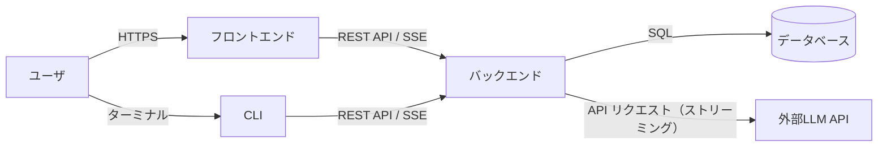
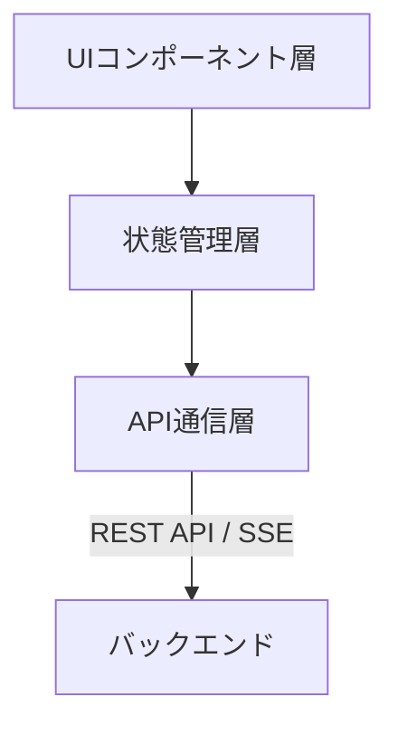
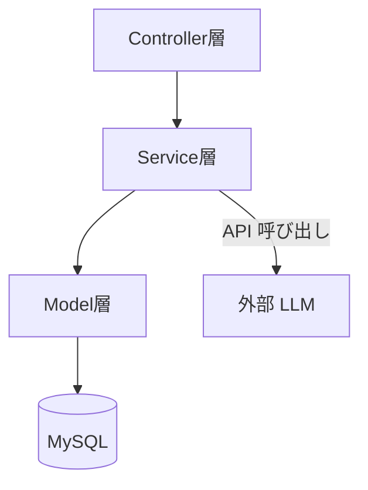
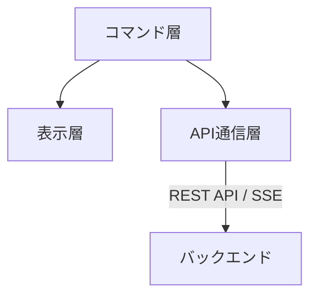
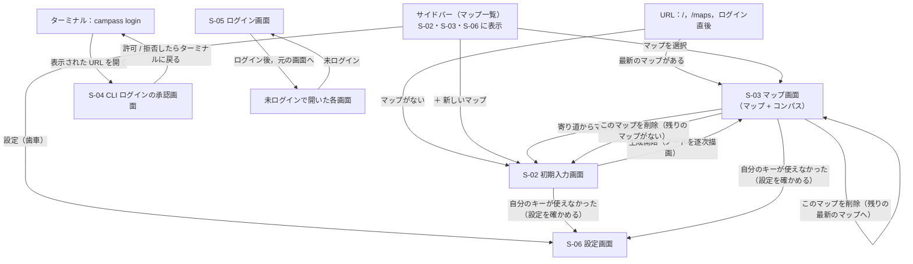
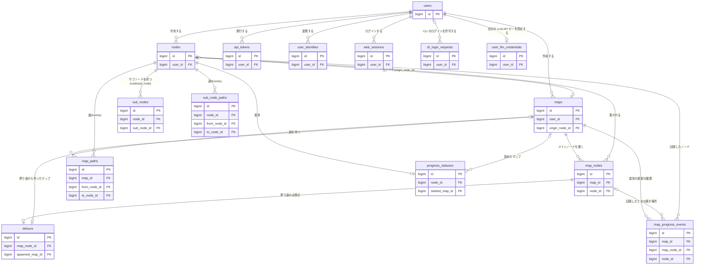

# 基本設計書：Campass

## 1. 文書概要

### 1.1 本書の位置づけ

本書は，「要件定義書（ReqDef.md）」の機能要件・非機能要件をどう実現するかの仕様を，具体的に定めるものである．システム構成，画面，CLI，データベース，処理，外部インターフェース（API，LLM，認証），テストの仕様を記載する．

* 仕様だけを書き，その仕様にした理由は書かない．理由が必要な箇所は「（理由：Design Doc x.y）」として Design Doc（`design_doc.md`）の該当の節を示す．
* API の形（パス，パラメータ，リクエストとレスポンスの JSON，ステータスコード，エラーの `code` の取り得る値，SSE のイベントの `data`）は `api/openapi.yaml` を正とし，本書は振る舞いを書く（7.1）．
* 用語は `GLOSSARY.md` に従う．

### 1.2 改訂履歴

| バージョン | 日付 | 概要 | 変更者 |
| :--- | :--- | :--- | :--- |
| v1.0.0 | 2026/07/13 | 新規作成 | 池田 琉俊 |
| v1.1.0 | 2026/10/06 | 星座型ビューを「学習マップ」に改称し，コンパス（F-013）を画面設計に追加 | 池田 琉俊 |
| v1.2.0 | 2026/10/06 | 一本道ビューを廃止し，S-03 を学習マップのみの画面に変更．syllabus_nodes の order_index を廃止し importance_score を追加 | 池田 琉俊 |
| v1.3.0 | 2026/10/06 | 4章を概要（ER図・テーブル一覧）のみとし，カラム定義は Design Doc 4.1.2 を正とする形に変更（`syllabus_edges`，`progress_statuses`，アセスメント関連テーブルを ER図に追加）．5.1 のストリーミング方式を SSE に統一 | 池田 琉俊 |
| v1.4.0 | 2026/10/06 | CLI クライアント（F-014）を追加．2.1 の全体構成に CLI を追加し，2.4 CLI構成，3.5 CLIコマンド一覧を新設．認証トークン用の `api_tokens` を ER図・テーブル一覧に追加 | 池田 琉俊 |
| v1.5.0 | 2026/10/08 | 用語を GLOSSARY.md に合わせて整理（ノートブック・学習マップ・シラバスを「マップ」に統一）．ノードをユーザーの持ち物としてマップ間で共有する構成に合わせ，画面一覧・遷移図・URL，CLIコマンド，ER図・テーブル一覧を更新．クロスノートブックリンクと Embedding API 連携（5.2）を廃止 | 池田 琉俊 |
| v1.6.0 | 2026/10/09 | 前提知識アセスメント（ReqDef F-004）の廃止に合わせ，CLI構成（2.4），画面一覧（3.1），CLIコマンド一覧（3.5），ER図・テーブル一覧（4章），マップ生成API連携（5.1）からアセスメントを削除 | 池田 琉俊 |
| v1.7.0 | 2026/10/09 | 生成中に接続が切れても生成を続ける方式（Design Doc 4.2.9）に合わせ，CLIコマンド一覧（3.5）に `campass delete` を追加し，マップ生成API連携（5.1）を更新 | 池田 琉俊 |
| v1.8.0 | 2026/10/09 | ノードの編集（ReqDef F-018）を追加．S-03 の概要（3.1）と CLIコマンド一覧（3.5）に編集を追記．現在地を進捗の履歴から導出する方式（Design Doc 4.2.8，ADR 0005）に合わせ，ER図とテーブル一覧（4章）から `maps.current_node_id` を削除して `map_progress_events` を追加 | 池田 琉俊 |
| v1.9.0 | 2026/10/11 | リポジトリを `backend/`・`frontend/`・`cli/` に分けた構成に合わせ，2.5 リポジトリ構成を新設 | 池田 琉俊 |
| v1.10.0 | 2026/10/11 | Google / GitHub でのログイン（ReqDef F-019）を追加．画面一覧（3.1）と画面遷移図（3.3）に S-05 ログイン画面を追加し，ER図・テーブル一覧（4章）に `user_identities` と `web_sessions` を追加して `users` の認証用カラムを削除．5.5 ログイン連携を新設．S-04 を CLI のログインの承認画面のために空けていることを 3.1 に注記 | 池田 琉俊 |
| v1.11.0 | 2026/10/11 | CLI のログインをデバイスコード方式（Design Doc 4.5.4）に決定．画面一覧（3.1）と画面遷移図（3.3）に S-04 CLI ログインの承認画面を追加して 3.1 の S-04 の注記を削除し，CLIコマンド一覧（3.5）の `campass login` を更新．ER図・テーブル一覧（4章）に `cli_login_requests` を追加 | 池田 琉俊 |
| v1.12.0 | 2026/10/11 | CLI の配布とビルドの方針（Design Doc 4.5.1，4.5.8）に合わせ，2.4 の CLI の依存を標準ライブラリと cobra に改め，CLIコマンド一覧（3.5）に `campass version` と `campass completion` を追加 | 池田 琉俊 |
| v1.13.0 | 2026/10/11 | マップ一覧画面（S-01）を廃止し，マップ一覧を S-02・S-03 に出すサイドバーに変更（Design Doc 4.4）．画面一覧（3.1）にサイドバーと `/`・`/maps`・ログイン直後の転送を追加し，S-03 にマップの注記と削除を移した．画面遷移図（3.3）とCLIコマンド一覧（3.5）の対応画面を整合 | 池田 琉俊 |
| v1.14.0 | 2026/10/12 | 5.4 を「オプトアウト設定」から「学習に使わせない API のプラン」に変更．リクエストに設定を付けることをやめ，本番のサービスでは学習に使わない契約のプランのキーだけを使うとした | 池田 琉俊 |
| v1.15.0 | 2026/10/12 | 自分の LLM API キーの設定（ReqDef F-020）を追加．画面一覧（3.1）と画面遷移図（3.3）に S-06 設定画面を追加し，サイドバーを S-06 にも出して下に設定の入口を置いた．ER図・テーブル一覧（4章）に `user_llm_credentials` を追加．APIキー管理方式（5.3）に利用者のキーの扱いを，学習に使わせない API のプラン（5.4）に利用者のキーが対象外であることを追記 | 池田 琉俊 |
| v2.0.0 | 2026/10/12 | 本書を仕様の正とし，Design Doc は理由だけを書く形に役割を分けた（#46）．Design Doc から，テーブル定義（Design Doc 4.1.2 → 5章），処理（4.2 → 6章），API の振る舞い（4.3.1 → 7.1），LLM API（4.3.2 → 7.2），画面の振る舞い（4.4 → 3章），CLI（4.5 → 4章，7.4），Web の認証（4.6 → 7.3），テスト方針（7章 → 8章）を移した．ReqDef 6章の技術スタックを 2.6 に移した．章立てを変え，CLI 設計を4章として独立させた．仕様そのものは変えていない | 池田 琉俊 |

---

## 2. システム構成

### 2.1 全体構成



| サブシステム | 役割 |
| :--- | :--- |
| フロントエンド | React によるSPA．マップ（コンパス付き）などのUIを担当． |
| CLI | Go によるコマンドラインクライアント（F-014）．フロントエンドと同じバックエンドAPIを利用し，業務ロジックとAPIキーを持たない（4章）． |
| バックエンド | Ruby on Rails によるAPIサーバー．業務ロジック（マップの生成，ノードの再利用，コンパスの導出，編集の検証），LLM APIキー（サービスのキーと，利用者が設定したキー）の秘匿管理，マップのデータの永続化を担当． |
| データベース | MySQL．マップ，ノード，ユーザー進捗等を永続保持． |
| 外部LLM API | マップのデータとゴール候補の生成を担当．バックエンドだけが呼ぶ（7.2）． |

* フロントエンドと CLI は，バックエンドだけと通信する．外部 LLM API を直接呼ばず，サービスの LLM API キーと OAuth のシークレットを持たない．
* フロントエンドとバックエンドは，同じ親ドメインのサブドメイン（例：`app.campass.example.com` / `api.campass.example.com`）で配信する（7.3）．

以降の2.2〜2.4では，上記サブシステムのうち「フロントエンド」「バックエンド」「CLI」それぞれの内部レイヤー構成を示す．

### 2.2 フロントエンド構成



| レイヤー | 役割 |
| :--- | :--- |
| UIコンポーネント層 | 画面表示・ユーザー操作の受付．初期入力，マップ画面等の各画面と，マップ一覧のサイドバーを構成する．バックエンドを直接呼ばない． |
| 状態管理層 | 画面をまたいで参照するアプリケーション状態（現在のマップ，ノード，コンパス等）を保持・更新する． |
| API通信層 | バックエンド API へのリクエスト送信，およびストリーミングレスポンス（マップの逐次生成）の受信を担当する． |

### 2.3 バックエンド構成



| レイヤ | 役割 |
| :--- | :--- |
| Controller層 | フロントエンドと CLI からのAPIリクエストを受け付け，レスポンス（通常/ストリーミング）を返却する．業務ロジックを持たない． |
| Service層 | マップ生成・ノードの再利用・コンパスの導出・編集の検証等のビジネスロジックを担当し，外部LLM APIとの連携を行う．マップの生成は，リクエストから切り離したバックグラウンドジョブで行う（6.7）． |
| Model層 | ActiveRecordを通じてMySQLとのデータ入出力を担当する． |

### 2.4 CLI構成



| レイヤー | 役割 |
| :--- | :--- |
| コマンド層 | サブコマンドと引数の解析，および対話入力（ゴール候補の選択，難易度の選択等）を担当する． |
| API通信層 | バックエンド API へのリクエスト送信（認証トークンと `User-Agent` の付与を含む），およびストリーミングレスポンス（マップの逐次生成）の受信を担当する． |
| 表示層 | バックエンドから受け取ったマップ・コンパス・ノード詳細をターミナル向けのテキストとして出力する．コンパスなどの導出は行わない． |

ディレクトリ構成と依存は 4.1，4.2 に示す．

### 2.5 リポジトリ構成

フロントエンド・バックエンド・CLI をリポジトリのルートの別々のディレクトリに置く．

```
/
├── backend/            バックエンド（Rails API）．Gemfile，Dockerfile など
├── frontend/           フロントエンド（React SPA）
├── cli/                CLI（Go）．内部の構成は 4.2
├── api/                API の形の定義（openapi.yaml．OpenAPI 3.0.3）
├── docs/               要件定義書・基本設計書・Design Doc・ADR
├── GLOSSARY.md, CLAUDE.md, README.md, .claude/, .github/
├── docker-compose.yml
├── .gitignore          ルートは .env だけ．Rails 用は backend/.gitignore
└── .env                API キーなど（git の管理外）
```

* 開発環境は Docker Compose で，サブシステムごとに `backend`（Ruby），`frontend`（Node.js LTS），`cli`（Go），`db`（MySQL 8.0）のサービスを持つ．各サービスは自分のディレクトリだけを `/app` にマウントする．
* `.env` は `backend` にだけ環境変数として渡す（7.2）．`frontend` と `cli` には渡さない．
* `api/openapi.yaml` は，フロントエンドと CLI が共通で参照する API の形の定義である（7.1）．

### 2.6 技術スタック

| サブシステム | 技術 |
| :--- | :--- |
| フロントエンド | React（SPA） |
| CLI | Go．依存は標準ライブラリと cobra（4.1） |
| バックエンド | Ruby on Rails 7.1（API モード） |
| データベース | MySQL 8.0 |
| 外部LLM API | Gemini（最初の実装．7.2） |

---

## 3. 画面設計

### 3.1 画面一覧

| 画面ID | 画面名 | URL | 概要 | 関連機能ID |
| :--- | :--- | :--- | :--- | :--- |
| S-02 | 初期入力画面 | `/maps/new` | 興味・ゴールの入力，ゴール候補の選択，難易度選択を行う．寄り道から作る場合は寄り道のテーマを興味として入力済みにする（3.4）． | F-001〜F-003，F-006，F-012 |
| S-03 | マップ画面 | `/maps/:mapId`（ノード選択中は `?node=:nodeId`） | メインノードと道をネットワーク図として可視化し，現在地と，コンパスで今進める場所を指し示す．ノードを選ぶと詳細パネル（概要，進捗，寄り道，登場する他のマップ）を開き，サブノードをドリルダウン展開する．元ノードや作成済みの寄り道からは別のマップへ移動できる．マップの削除と編集を行える（3.5）． | F-006，F-007，F-009，F-010，F-012，F-013，F-015，F-018 |
| S-04 | CLI ログインの承認画面 | `/cli/activate` | `campass login` が表示したコードを入力し，端末名と開始時刻を確かめて CLI のログインを許可・拒否する（3.6）． | F-014，F-019 |
| S-05 | ログイン画面 | `/login`（ログイン後に戻る画面は `?return_to=:path`） | 「Google でログイン」「GitHub でログイン」を選ぶ（3.7）． | F-019 |
| S-06 | 設定画面 | `/settings` | 自分の LLM API キーを設定する（3.8）．CLI からは設定できない． | F-020 |

* マップ一覧は独立した画面にせず，S-02・S-03・S-06 に出す開閉できる**サイドバー**とする（3.3．理由：ADR 0007）．
* `/`・`/maps`・ログイン直後（`return_to` がないとき．7.3 で `/maps` へ転送される）は，`GET /api/maps` を呼び，`updated_at` が最新のマップの S-03 へ移る．マップがなければ S-02 へ移り，「最初のマップを作りましょう」と案内する．`/maps` は転送だけを行い，画面を持たない．
* 未ログインでどの画面を開いても S-05 へ移り，ログインすると元の画面（`return_to`）へ戻る（3.7）．
* 画面項目定義とワイヤーフレームは未作成である．

### 3.2 画面遷移図



* S-04 も他の画面と同じく，未ログインなら S-05 へ移り，ログイン後に `/cli/activate` へ戻る．

### 3.3 サイドバー

マップ一覧（F-012）は，S-02・S-03・S-06 に出す開閉できるサイドバーとする．S-04 と S-05 には出さない．サイドバーは移動のためだけに使い，マップの情報を増やさない．

* 中身：
  * 上に「＋ 新しいマップ」を置き，S-02 へ移る．
  * その下にマップのタイトルを `GET /api/maps` の順のまま並べ，今開いているマップを強調する．選ぶとそのマップの S-03 へ移る．
  * 生成中のマップにはスピナー，失敗したマップには S-03 と同じ警告アイコンを付ける（3.5.1）．
  * 元ノードや寄り道からの注記，削除のボタン，進捗は出さない．注記は S-03 のマップのタイトルの下に，削除は S-03 の上部のメニューに置く．
  * いちばん下に，設定（S-06）への入口（歯車のアイコンと「設定」）を置く．S-06 を開いている間は，入口を強調する．
* 広い画面（幅 768px 以上）では，サイドバーをマップの左に**並べ**，マップの表示領域をその分だけ狭める．マップの上に重ねない（理由：Design Doc 4.7）．開閉しても，マップの見ている中心を保つ．開いていても，マップの操作（ノードの選択，ドラッグ，拡大縮小，詳細パネル，編集）はすべてふつうに使える．
* 狭い画面（幅 768px 未満）では，サイドバーをマップの上に**重ねる**．背景は暗くせず，見えている部分のマップは操作できる．マップを選んだときだけ自動で閉じる．
* 開閉は ☰ のボタンと，サイドバーの中の閉じるボタンだけで行う．`Esc` や外側を押しても閉じない．開いていてもフォーカスはサイドバーに閉じ込めない．☰ のボタンには開閉の状態を表す `aria-expanded` を付ける．
* 開閉の状態は `localStorage` に，広い画面と狭い画面で別々に覚え，画面を移っても，再読み込みしても保つ．初めては，広い画面では開いた状態，狭い画面では閉じた状態から始める．`localStorage` が使えないときは，この初期値で動く．
* 一覧の取得の仕方は 3.5.6 に示す．

### 3.4 S-02 初期入力画面

1. 興味を自由入力させる（F-001）．寄り道から新しいマップを作る場合は，寄り道のテーマを入力済みにする（F-006）．
2. `POST /api/goal_suggestions` を呼び，ゴール候補（F-002，6.2）が返ったら選択式で示す．ユーザーは候補から選ぶか，自由入力のまま次へ進む．
3. 難易度（ライト／スタンダード／ディープ）を選ばせる（F-003）．
4. 難易度を選ぶと `POST /api/maps` でマップを作って生成を始め，すぐに S-03 に移る（3.5）．生成を始める `POST /api/maps` を呼ぶのは S-02 だけである．

* 利用者のキーで失敗したゴール候補の提案（`422` の `user_api_key_invalid` / `user_api_key_quota_exceeded`，7.1）では，`message` に添えて S-06 への「設定を確かめる」を出す．
* マップがないときに `/`・`/maps` から移ってきた場合は「最初のマップを作りましょう」と案内する（3.1）．

### 3.5 S-03 マップ画面

* ノードを選んでいる状態は `?node=:nodeId` で表し，ブラウザの戻る・再読み込みで選択を保つ．ドリルダウンも同じパラメータで表す．
* 元ノードや寄り道から作ったマップでは，マップのタイトルの下に「Ruby の『オブジェクト指向』から」「Ruby の『Web アプリ開発』からの寄り道」のような注記を付ける．
* 上部のメニューに「このマップを削除」を置く（3.5.5）．

#### 3.5.1 生成から最初の表示までと，生成の状態

S-02 から移ってきたときは，次のように表示する．

1. マップは空で，「マップを作っています」と表示する．
2. `GET /api/maps/:id/generation` の SSE（7.1）につなぐ．`node` イベントが届くたびにノードを1つずつ描き，道でつなぐ．再利用された既知ノードは最初から埋まった状態で現れ，そこから新しいノードへ道がのびるアニメーションを出す（F-009）．
3. 生成中もノードを選んで詳細を読める．ただし，コンパスは生成が終わる（`done`）まで出さない（理由：Design Doc 4.4）．
4. 生成が終わる（`done`）とコンパスを表示する．
5. ユーザーが初めて S-03 を開いたときだけ，「現在地」「コンパス」「ノードを選ぶと詳細とサブノードが見られる」の3つを順に指す短い説明を重ねて出す（「次へ」「スキップ」付き）．2つ目以降のマップでは出さない．専用のオンボーディング画面は作らない．

生成はページを離れても続く（6.7）．S-03 を開いたときは `GET /api/maps/:id` の `status` で振る舞いを分ける．

| `status` | S-03 の振る舞い |
| :--- | :--- |
| `generating` | 保存済みのノードを描き，`GET /api/maps/:id/generation` の SSE につないで続きを受け取る．コンパスは出さない． |
| `ready` | 通常の表示． |
| `failed` | 保存済みのノードを描く．コンパスは出さない．黄色（濃いめの琥珀色）の警告アイコンと失敗の理由（`error.message`）を示し，マップを削除して作り直すよう案内する（削除ボタン）．`error.code` が `user_api_key_invalid` / `user_api_key_quota_exceeded` なら，S-06 への「設定を確かめる」も添える． |

* SSE で届くノードは ID をキーにして状態に持ち，同じ ID が届いたら上書きする．つなぎ直しで保存済みのノードがもう一度届いても，重複して描かない．終端イベントを受け取らずに接続が切れたら，同じ `GET` でつなぎ直す．
* 生成中に `error` を受け取ったら，`failed` と同じ表示に切り替える．
* サイドバーでは，生成中のマップにスピナーを，失敗したマップに S-03 と同じ黄色の警告アイコンを付ける．どちらも文字のバッジは出さず，`aria-label`（「作成中」「作成に失敗」）でスクリーンリーダーに状態を伝える．失敗は色や動きだけでなく，アイコンの形でも区別する．

#### 3.5.2 マップ

* 初期表示ではメインノードのみを描き，個々のノードの詳細（`summary` 等）は出さず，タイトルと道のみを見せる．
* 初期表示の視点は現在地とその周辺（現在地へ道がのびるノード，コンパス候補）に寄せ，全体はユーザーが能動的に広げて眺める．
* ノードを選ぶと詳細パネルを開く（`GET /api/maps/:mapId/nodes/:nodeId`）．詳細パネルには概要，進捗，寄り道（あれば），そのノードが登場する他のマップを示し，そこからサブノードを展開できる（F-007，6.5）．
* マップ間ノードには「他のマップと共通」の印を付ける．
* 同じマップの別のメインノードの中にも現れるメインノード（`also_inside`）には「『A』の中にもあります」の印を付ける（ADR 0006）．
* メインノードが0個のマップでは，「メインノードがありません．ノードを追加してください」と表示する．
* 元ノードには「中にマップがある」印を付け，選ぶとドリルダウンの代わりにそのマップへ移動する（F-017）．
* 寄り道は，まだマップを作っていない間は詳細パネルにだけ表示し，マップには描かない．寄り道からマップを作ったら，寄り道の出発点から点線でのびる行き止まりの入口として描き，選ぶとそのマップへ移動する．寄り道の入口は進捗を持たず，コンパスの計算にも使わない（F-006）．
* 別のマップへ移動した後は，ブラウザの戻ると，画面上部の「← 来たマップへ戻る」で戻る．パンくずリストは作らない（理由：Design Doc 4.7）．

#### 3.5.3 コンパス

* マップ上で現在地を明示し，コンパスが候補（6.6）をすべて指し示す．`importance_score` の最も高い候補（`candidates` の先頭）を強調する．
* コンパスの値（`current_node_id`，`candidates` とその並び，`is_goal_reached`）は API の応答をそのまま使い，フロントエンドでは導出しない．
* 候補を選ぶとそのノードの詳細を表示し，学習を開始できる（進捗を `in_progress` に更新）．候補でないノードも開始できる．
* 現在地がない場合（スタート地点）でも，候補の決め方は同じである．道がのびてこないノードや，手前がすべて既知ノードであるノードが候補になる．
* 進捗を更新したら，`PATCH /api/maps/:mapId/nodes/:nodeId/progress` が返したコンパスを使う．
* 全ノード完了時（`is_goal_reached = true`）は，ゴール到達を示す表示に切り替える．`origin_completion_suggestion` が返った場合は，元ノードを完了にするかを尋ねる．

#### 3.5.4 マップの編集（F-018）

* 編集は `ready` のマップでだけ行える．`generating` と `failed` のマップでは編集の操作を出さない．
* メインノードの追加は，マップ上の操作から行う．タイトルの入力中に `GET /api/nodes?q=&map_id=` で既存ノードを一覧に出し，選べば既存ノードを置き，選ばなければ新しく作る（概要は任意）．すでにメインノードのもの（`already_main`）は選べない状態で，別のメインノードの中にあるもの（`inside`）は「『A』の中にもあります」を添えて示す．
* ノードの内容の編集，マップから外す，重要度（高・中・低）の変更，サブノードとサブノード間の道の編集は，詳細パネルから行う．道はマップ上で2つのノードを選んで引く・消す．
* `409 confirmation_required` が返ったら，影響するマップの一覧と，削除される進捗のあるノードを示して確認し，同意されたら `confirmed=true` で送り直す．
* `422 cycle` が返ったら，循環するノードの並びを含む `message` を示し，マップは変えない．
* 編集の応答で返ったマップやノードをそのまま使う．循環の検証や後始末の判断はフロントエンドでは行わない．

#### 3.5.5 マップの削除

* 削除は，S-03 の上部のメニューの「このマップを削除」から行う．
* 削除の前に `GET /api/maps/:id/deletion_preview` の結果を示し，このマップで学習中にしたノードは他のマップで通常の学習中ノードとして扱われること（既知ノードにはならないこと）を注意として知らせる．
* 生成中のマップも削除できる．その場合は確認に「作成中です．削除すると作成も止まります」を添える．「中止」という言葉は使わない．
* 自分のタブで削除したときは，何も表示せずに，残りのうち `updated_at` が最新のマップの S-03 へ移る．残りのマップがなければ S-02 へ移る．
* 別の場所（別のタブや CLI）で削除されたマップは，次のときに気づく．
  * 開いている S-03 が SSE で `deleted` を受け取ったとき．`deleted` が届くのは，常に別の場所で削除されたときである（自分のタブで削除したときは，先に自分で接続を閉じて別の画面へ移るため）．
  * 開いている S-03 で API を呼んで `404` が返ったとき．
  * マップ一覧を取得したとき（3.5.6）．前回取得した一覧にあり，今回の一覧になく，このタブで削除したものでもないマップを，別の場所で削除されたものとみなす．
* 気づいたら，今いる画面のまま，別の場所で削除されたマップをまとめて1つのお知らせで示す（「別の画面で次のマップが削除されました：…」．OK で閉じる）．今開いているマップが削除されていたら，自分のタブで削除したときと同じ規則で移ってからお知らせを出す．マップごとにお知らせを出さない．エラーではないため，警告アイコンは使わない．
* 削除を知らせるためのプッシュは行わない．アプリを閉じている間に削除されたマップは知らせない（比べる前回の一覧がないため）．

#### 3.5.6 一覧と表示の同期

* マップ一覧（`GET /api/maps`）は，サイドバーが開いていて，タブが表示されている（`document.visibilityState === 'visible'`）間だけ，30秒ごとに取得する．サイドバーを開いたときと，画面に戻ってきたとき（下の判定．サイドバーが閉じていても）は，すぐに1回取得する．
* 開いている S-03 の内容は，**画面に戻ってきたときだけ** `GET /api/maps/:id` で取り直す．定期的なポーリングと，サーバーからのプッシュはしない（理由：Design Doc 4.7）．生成中のマップは SSE で受け取る（3.5.1）．
* 「画面に戻ってきた」は，次のどちらかが起きたときとする．
  * `document` の `visibilitychange` で `visibilityState` が `visible` になったとき（タブの切り替え）．
  * `window` の `focus` のとき（端末からブラウザのウィンドウに戻ったときは，`visibilitychange` が起きないため）．
  * 両方が続けて起きることがあるので，直前に取り直してから2秒以内なら取り直さない．
* 取り直した内容は，次の規則で反映する．
  1. マップ（ノード，道，印）とコンパスは，取り直した内容にそのまま置き換える．視点（見ている位置）と拡大率は保つ．
  2. 詳細パネルを開いていたら，そのノードの詳細（`GET /api/maps/:mapId/nodes/:nodeId`）も取り直す．
  3. 選んでいたノードがマップから外されていたら，詳細パネルを閉じ，`?node=` を消し，「このノードはマップから外されました」と知らせる．
  4. 編集の途中（まだ保存していない入力がある）で，取り直したそのノードの内容が入力を始めたときから変わっていたら，入力は消さず，「このノードは別の場所で変更されました」と表示して，「入力を捨てて最新を表示」を選べるようにする．変わっていなければ何も表示しない．
  5. マップ自体が削除されていたら（`404`），3.5.5 の規則（`updated_at` が最新のマップか S-02 へ移り，知らせる）に従う．
* 2か所から同じノードやマップを編集したときは，後から保存したほうが勝つ（6.8）．

### 3.6 S-04 CLI ログインの承認画面

1. 未ログインで `/cli/activate` を開くと，他の画面と同じく S-05 `/login?return_to=/cli/activate` へ移り，ログイン後に `/cli/activate` へ戻る（7.3）．
2. コードの入力欄を1つ置く．「ターミナルに表示されたコードを入力してください」と添える．URL からコードを受け取って入力済みにすることはしない（7.4）．
3. 入力したら `POST /api/auth/cli_login_requests/lookup` を呼び，確認画面に端末名（`name`．なければ「名前のない端末」）と開始時刻（`created_at`）を出す（例：「my-laptop からのログイン（10:00 に開始）を許可しますか？」）．「自分で `campass login` を実行していない場合は拒否してください」と添え，「許可」「拒否」を選ばせる．
4. 「許可」は `…/approve`，「拒否」は `…/deny` を呼ぶ．終わったら「ログインを許可しました．ターミナルに戻ってください」または「ログインを拒否しました」を表示する．
5. `404 invalid_user_code` が返ったら「コードが正しくないか，期限が切れています」と表示し，入力し直せるようにする．

### 3.7 S-05 ログイン画面

* 「Google でログイン」「GitHub でログイン」の2つのボタンだけを置く（F-019）．登録画面はなく，初めてのログインでユーザーを作る（7.3）．
* 各ボタンは，バックエンドの `POST /api/auth/google` / `POST /api/auth/github` への，CSRF トークンと `return_to` を含むフォーム送信とする（7.3）．
* アプリの起動時に `GET /api/session` を呼び，`401` なら S-05 `/login?return_to=<今のパス>` へ移る．ログイン後は `return_to` の画面へ戻る．
* ログインに失敗して戻った場合（`/login?error=:code`）は理由を示す．`email_not_verified` なら「確認済みのメールアドレスが必要です」と表示する．

### 3.8 S-06 設定画面

自分の LLM API キーを設定する画面（ReqDef F-020）．サイドバーの下の歯車から開く．

1. `GET /api/llm_providers` と `GET /api/llm_credential` を呼ぶ．
2. 未設定なら「今はサービスのキーで動いています」と示し，会社とモデルを選ぶ欄と，キーの入力欄を置く．会社とモデルは `GET /api/llm_providers` の候補から選ばせ，自由な入力は受け付けない．キーの入力欄は `type="password"`，`autocomplete="off"` とする．
3. 「保存」で `PUT /api/llm_credential` を呼ぶ．確かめている間は「キーを確かめています」と示す．成功したら入力欄を空にし，キーをフロントエンドの状態にも `localStorage` にも残さない．`422` / `502` が返ったら `message` を示し，保存されていないことを伝える．
4. 設定済みなら，会社，モデル，`••••` + `api_key_last4`，確かめた日時（`verified_at`）を示し，「入力し直す」と「削除」を置く．キーそのものは表示しない（バックエンドも返さない）．「入力し直す」は2と同じ欄を開き，会社・モデル・キーをすべて送り直す．
5. 「削除」は確認してから `DELETE /api/llm_credential` を呼び，「サービスのキーに戻しました」と示す．
6. 画面には常に「自分のキーで送った入力は，あなたと〇〇（選んでいる会社の名前）との契約の規約に従って扱われます」と示す（7.2 の学習に使わせない API のプランの対象外であるため）．
7. 「作成中のマップは，作成を始めたときのキーで最後まで作ります」と添える（6.7）．

* CLI からは設定できない（理由：Design Doc 4.10）．`PUT` / `DELETE /api/llm_credential` も Bearer トークンでは受け付けない（7.1）．
* 失敗したマップ（S-03）で S-06 へ案内する規則は 3.5.1 に従う．

---

## 4. CLI 設計（F-014）

### 4.1 方針

* CLI はフロントエンドと同列の「バックエンドAPIのクライアント」であり，7.1 の API のみを利用する．コンパス（6.6），道やサブノードの検証，既存ノードの再利用といった業務ロジックは持たず，バックエンドが返した結果をそのまま表示する（理由：Design Doc 4.8）．
* 外部LLM API を直接呼ばず，そのAPIキーも保持しない．
* 実行ファイルの依存は，Go の標準ライブラリと `github.com/spf13/cobra`（cobra が使う `spf13/pflag`・`inconshreveable/mousetrap` を含む）だけとする．コマンドの解析は cobra で行い，HTTP と SSE の受信は標準ライブラリ（`net/http`，`encoding/json`，`bufio` 等）で書く．ほかの外部パッケージは承認を得てから加える（理由：Design Doc 4.8）．
* OpenAPI の定義から型を作る oapi-codegen は，型の生成（`-generate types`）にだけ使う．開発のときだけ使うツールで，実行ファイルには入らない．
* 接続先のバックエンドは，ビルド時に埋め込んだ本番の URL（4.8）を既定とする．環境変数 `CAMPASS_API_URL` があれば，それで上書きする（開発中など）．
* すべてのリクエストに `User-Agent: campass-cli/<バージョン>` を付ける．古い CLI を断る仕組みは今は設けない（Design Doc 6章）．
* API のエラーを表示するときは，文言を CLI に持たず，レスポンスの `message` をそのまま表示する．終了コードやトークンファイルの削除など，CLI の動きは `code` で分ける（理由：Design Doc 4.6）．

### 4.2 構成

CLI はリポジトリのルートの `cli/` に置く（2.5）．開発時は Docker Compose の `cli` サービス（Go の公式イメージ）で `docker compose run --rm cli go test ./...` のように動かす．レイヤーの役割は 2.4 に示す．

```
cli/
├── go.mod
├── cmd/campass/main.go   # エントリポイント．cobra のルートコマンドを実行するのみ
└── internal/
    ├── command/          # コマンド層：cobra のサブコマンド定義・対話入力（version，completion を含む）
    ├── api/              # API通信層：REST，SSE 受信，トークンと User-Agent の付与
    ├── render/           # 表示層：マップ・コンパス・ノード詳細のテキスト出力
    ├── config/           # 接続先（埋め込みの既定値と CAMPASS_API_URL）とトークンの読み書き
    └── version/          # バージョン（ビルド時に -ldflags -X で埋め込む．既定は dev）
```

### 4.3 コマンド一覧

CLI は画面を持たないため，各画面に相当する操作をサブコマンドとして提供する．

| コマンド | 概要 | 対応する画面 | 関連機能ID |
| :--- | :--- | :--- | :--- |
| `campass login` / `campass logout` | 認証トークンの取得・破棄．`campass login` は URL とコードを表示し，ブラウザの S-04 で許可されるのを待ってトークンを受け取る（7.4） | S-04 | F-014 |
| `campass maps` | マップ一覧の表示 | サイドバー | F-012 |
| `campass new` | 興味の入力からマップ生成までを対話形式で行う．生成されたノードを1件ずつ表示する（4.4） | S-02 | F-001〜F-003，F-011 |
| `campass map <map_id>` | マップ（メインノードと道）とコンパスの表示（4.5） | S-03 | F-006，F-013 |
| `campass show <map_id> <node_id>` | ノードの詳細（概要，進捗，このマップでの寄り道，登場する他のマップ）とサブノード（ドリルダウン）の表示 | S-03 | F-007，F-015 |
| `campass start <map_id> <node_id>` / `campass done <map_id> <node_id>` | 指定したマップでの進捗の更新と，更新後のコンパスの表示 | S-03 | F-010，F-013 |
| `campass delete <map_id>` | 削除の影響を表示して確認したうえでのマップの削除（生成中のマップも削除できる） | S-03 | F-012 |
| `campass node add\|edit\|remove` | メインノードの追加（既存ノードの提案つき）・内容の編集・マップから外す（4.7） | S-03 | F-018 |
| `campass path add\|remove` | マップの道の追加・削除 | S-03 | F-018 |
| `campass sub add\|remove` / `campass sub path add\|remove` | サブノードとサブノード間の道の編集 | S-03 | F-018 |
| `campass importance <map_id> <node_id> high\|mid\|low` | 重要度の変更 | S-03 | F-018 |
| `campass version` | CLI のバージョンの表示．ローカルでのビルド（埋め込みなし）では `dev` と表示する | — | F-014 |
| `campass completion bash\|zsh\|fish\|powershell` | シェルの補完スクリプトの出力（cobra の機能） | — | F-014 |

LLM API キーの設定（S-06）に相当するコマンドはない（3.8）．

### 4.4 マップ作成の対話フロー（`campass new`）

6.1 のステップ1〜6を，ターミナル上の対話として順に行う．

1. 興味を自由入力させ，ゴール候補（F-002）が返った場合は番号付きで表示して選ばせる．再入力の扱いは 6.2 に従い，バックエンドが判定する．
2. 難易度（ライト／スタンダード／ディープ）を番号で選ばせる（F-003）．
3. `POST /api/maps` でマップを作って生成を始める．
4. `GET /api/maps/:id/generation` の SSE を受信し，ノードが1件届くたびにタイトルと種別（メイン／サブ）を1行で表示する（4.6）．再利用したノードには「共通」の印と進捗を付ける．
5. `done` を受け取ったら `GET /api/maps/:id` を呼び，マップとコンパスを表示する（4.5）．

* ゴール候補の提案や生成が `user_api_key_invalid` / `user_api_key_quota_exceeded`（7.1）で失敗したら，`message` に添えて，ブラウザで設定（S-06 `/settings`）を確かめるよう案内する．生成の失敗では，設定を直してから `campass delete` で削除して作り直せることも添える．
* 生成中に Ctrl+C を押しても，バックエンドの生成は続く（6.7）．CLI は終了する前に「生成は続いています．`campass map <map_id>` で確認できます」と表示する．

### 4.5 マップとコンパスのテキスト表示（`campass map`）

表示はコンパスを主とし，グラフは各ノードへ道がのびてくるノードとして示す．ノードを「学習する順番」に見える一列として表示しない（理由：Design Doc 4.4）．

```
コンパス
  現在地: 統計学の基礎 (#501)
  コンパス候補:
    ★ 線形代数の基礎 (#502)  重要度 0.90
      微分の基礎     (#503)  重要度 0.60

マップ
  #501 統計学の基礎    [完了]   共通: データ分析基礎
       └ 寄り道のマップ: ベイズ統計 (map #140)
  #502 線形代数の基礎  [未着手] ← 道: #501
  #503 微分の基礎      [未着手] ← 道: #501   マップあり: 微積分 (map #150)
  #504 確率の基礎      [完了]   中にもある: #501 統計学の基礎
```

* コンパス候補は `compass.candidates` の並び（6.6）のまま表示し，先頭の候補に印（★）を付ける．CLI では並べ替えない．
* マップの各行は，メインノードと，そのノードへ道がのびてくるノードを示す．行の並びは API レスポンスの順であり，学習順の意味を持たない．
* マップ間ノードには「共通:」として他のマップ名を付ける．同じマップの別のメインノードの中にも現れるメインノードには「中にもある:」としてそのメインノードを付ける（ADR 0006）．元ノードには「マップあり:」，寄り道から作ったマップは寄り道の出発点の下に字下げして示す（F-006，F-017）．まだマップを作っていない寄り道は `campass show` で表示する．
* `is_goal_reached` が `true` の場合は，候補の代わりにゴール到達を表示する．
* マップが `generating` の場合，`campass map` は `GET /api/maps/:id/generation` の SSE につなぎ，`campass new` と同じくノードを1行ずつ表示してから，`done` を受け取ったらマップとコンパスを表示する．
* マップが `failed` の場合は，保存済みのメインノードと失敗の理由（`error.message`）を表示し，コンパスは表示しない．`campass delete` で削除して作り直すことを案内する．
* `campass show <map_id> <node_id>` は `GET /api/maps/:mapId/nodes/:nodeId` の詳細と，`GET /api/nodes/:id/sub_nodes` のサブノードを同じ形式で表示する（F-007）．
* `campass start <map_id> <node_id>` / `campass done <map_id> <node_id>` は `PATCH /api/maps/:mapId/nodes/:nodeId/progress` を呼び，更新後のコンパスを表示する．`origin_completion_suggestion` が返った場合は，元ノードを `campass done` で完了にできることを案内する．
* `campass delete <map_id>` は `GET /api/maps/:id/deletion_preview` の内容を表示し，`y/N` で確認してから `DELETE /api/maps/:id` を呼ぶ．Web と同じく，生成中のマップには「作成中です．削除すると作成も止まります」を添える．

### 4.6 マップ生成のストリーミング受信

* SSE のレスポンスを `bufio.Scanner` で1行ずつ読み，空行までの `data:` 行をつなげて1イベントとし，JSON としてデコードする．`event:` 行のイベント名で処理を分岐する（形式は 7.1）．`node` は1イベントが1ノードに対応するため，デコードできたらすぐに表示する．
* `bufio.Scanner` の1行の上限（既定は64KB）を広げ，`summary` の長いノードも読めるようにする．
* `done` を受け取ったら受信を終えて `GET /api/maps/:id` に進む．`error` を受け取ったら `code` と `message` を表示し，`campass delete` で削除して作り直せることを案内して終了する．`deleted` を受け取ったら「マップが削除されました」と1行表示して終了する．CLI で表示中に `deleted` が届くのは，常に別の場所（Web や別のターミナル）で削除されたときである．
* つなぎ直すたびに保存済みのノードがもう一度届くため（7.1），表示済みのノード ID は表示しない．
* 終端イベントを受け取らずに接続が切れた場合は，生成が終わったとはみなさず，生成は続いていることと `campass map <map_id>` で確認できることを表示して終了する．
* `:` で始まるコメント行は無視する．未知のイベント名は，エラーにせず読み飛ばす．
* JSON としてデコードできないイベントは，黙って捨てずにエラーとして表示する．

### 4.7 ノードの編集（F-018）

Web と同じ操作（6.8）を，ID を指定するサブコマンドで行う．ID は `campass map` と `campass show` に `#501` の形で表示している．対話形式にはしない．

```
campass node add    <map_id> --title "..." [--summary "..."] [--new]   # メインノードの追加（新規）
campass node add    <map_id> --node <node_id>                         # 既存ノードを置く
campass node edit   <map_id> <node_id> [--title "..."] [--summary "..."]
campass node remove <map_id> <node_id>
campass path add    <map_id> <from_id> <to_id>
campass path remove <map_id> <from_id> <to_id>
campass sub add     <map_id> <node_id> (--title "..." [--summary "..."] [--new] | --node <node_id>)
campass sub remove  <map_id> <node_id> <sub_node_id>
campass sub path add|remove <map_id> <node_id> <from_id> <to_id>
campass importance  <map_id> <node_id> high|mid|low
```

* ノードに関わる操作（`node edit`，`sub …`）も `<map_id>` を取る．API がどのマップから操作したかを必要とする（6.8）．
* `node add` / `sub add` を `--title` で実行したときは，`GET /api/nodes?q=` で既存ノードを探す．一致があれば番号付きの一覧（最後に「新しく作る」）を出して選ばせ，一致がなければそのまま新しく作る．選べないノードと「中にもある:」の注記は Web と同じく示す．`--new` を付けたときは提案を出さずに新しく作る（スクリプトから使うため）．
* `409 confirmation_required` が返ったら，影響するマップと削除される進捗のあるノードを表示し，`campass delete` と同じく `y/N` で確認してから `confirmed=true` で送り直す．確認を飛ばすオプション（`--yes` 等）は設けない．
* `422 cycle` などのエラーは，`message` を表示して終了する．
* 成功したら，マップに関わる操作は `campass map` と同じ形でマップとコンパスを，ノードに関わる操作は `campass show` と同じ形でノードを表示する．

### 4.8 CLI の配布

**ビルドとリリース**

* タグ `cli/vX.Y.Z` を push すると，GitHub Actions で GoReleaser が動き，GitHub Releases にリリースを作る（タグの形の理由：Design Doc 4.8）．
* バージョンはセマンティックバージョニングとする．最初は `cli/v0.1.0` とし，API が固まるまでは `0.x` とする．
* 対象は Linux / macOS / Windows × amd64 / arm64 の6つとする．Linux と macOS は `.tar.gz`，Windows は `.zip` にまとめ，`SHA256SUMS` を添付する．
* `-ldflags -X` で，バージョンと本番の API の URL を埋め込む．URL は GitHub Actions のリポジトリ変数から取る（秘密の値ではないため，シークレットにはしない）．
* 実装時に確かめること：GoReleaser の無料版で `cli/` の付いたタグを扱えるか．扱えなければ，Actions の中でタグを整形してから GoReleaser に渡す．

**配布**

* GitHub Releases：上の6つのアーカイブと `SHA256SUMS`．
* `go install github.com/ryuma-1/Campass/cli/cmd/campass@latest`．
* Homebrew：公開リポジトリ `ryuma-1/homebrew-tap` に GoReleaser が Formula を書き込む（書き込み用のトークンは Actions のシークレットに置く）．`brew install ryuma-1/tap/campass` で入れる．
* deb / rpm：GoReleaser（nfpm）で作って Releases に添付するだけとし，apt / dnf のリポジトリは作らない．
* Windows は `.zip` と `go install` だけとする．
* Homebrew と deb / rpm には，`campass completion` で出力した補完スクリプトを同梱する．

**署名**

* 実行ファイルには署名しない．macOS の Gatekeeper（`xattr -d com.apple.quarantine <実行ファイル>` か，システム設定から許可する）と Windows の SmartScreen（「詳細情報」→「実行」）の警告を回避する手順をリリースノートに載せる．
* 実装時に確かめること：Homebrew で入れたときに macOS の警告が出るか．

---

## 5. データベース設計

### 5.1 データの持ち方

マップはグラフ（有向非巡回グラフ）であり，DB上は **ノード・道方式** のグラフ構造として MySQL のテーブルで保持する（理由：Design Doc 4.1）．ノードはユーザーの持ち物であり（ADR 0003），次のように「内容」と「マップごとの位置づけ」を分けて持つ．

* **共有するもの**: ノードの内容（`nodes`），サブノードの関係（`sub_nodes`）と，同じノードの中のサブノード間の道（`sub_node_paths`），進捗（`progress_statuses`）．
* **マップごとに持つもの**: どのノードがメインノードか（`map_nodes`），その重要度，メインノード間の道（`map_paths`），寄り道（`detours`），そのマップで行った進捗の更新の履歴（`map_progress_events`）．

並び順のような派生データは保持せず，コンパス候補は進捗と道から，現在地は進捗の履歴から，都度導出する（6.6）．

* `map_nodes` は「あるマップに置かれたメインノード」を表す．サブノードは `map_nodes` に置かず，`sub_nodes` によってどのマップでも同じものが見える．あるマップで `map_nodes` にあるノードはそのマップのメインノードであり，そうでなくサブノードとして見えるノードはそのマップのサブノードである．
* `map_paths` は同じマップのメインノード間の道であり，マップごとに非巡回であることを生成時に検証する（6.4）．道はマップごとに持つため，同じノードでもマップによって道が異なってよい．
* `sub_nodes` と `sub_node_paths` はノードの内容の一部としてマップ間で共有する．あとから作ったマップがサブノードを追加すると（6.4），元のマップでもドリルダウンで見えるようになる．
* `map_progress_events` は，あるマップから行った進捗の更新（開始・完了・未着手に戻す）の記録である．記録したときのメインノードの置き場所（`map_nodes`）を指し，現在地はここから導出する（6.6，ADR 0005）．

### 5.2 ER図

主キー・外部キーのみを示す．



### 5.3 テーブル一覧

| テーブル | 役割 | 関連機能 |
| :--- | :--- | :--- |
| `users` | ユーザー情報（名前とメールアドレス．パスワードは持たない） | F-019 |
| `user_identities` | ユーザーと連携した Google / GitHub のアカウント | F-019 |
| `web_sessions` | ブラウザのログインのセッション（ハッシュ値のみ保持） | F-019 |
| `api_tokens` | CLI 用の認証トークン（ハッシュ値のみ保持） | F-014 |
| `cli_login_requests` | CLI のログイン要求．ブラウザ（S-04）で許可されるのを待ち，許可されたらトークンを発行する（デバイスコードはハッシュ値のみ保持） | F-014 |
| `user_llm_credentials` | ユーザーが設定した自分の LLM API キー（1人1つ）と，その会社・モデル．キーは暗号化して保持する | F-020 |
| `maps` | ゴールごとの作業スペース．ゴール・難易度・生成状態・元ノードを持つ | F-001〜F-003，F-012，F-013，F-017 |
| `nodes` | ノードの内容（タイトル・概要）．ユーザーの持ち物で，複数のマップに登場できる | F-011，F-015 |
| `map_nodes` | マップに置かれたメインノードと，そのマップでの重要度 | F-011，F-013，F-015，F-018 |
| `map_paths` | マップごとのメインノード間の道 | F-011，F-013 |
| `sub_nodes` | ノードとそのサブノードの関係（マップ間で共有） | F-007，F-016 |
| `sub_node_paths` | 同じノードの中のサブノード間の道（マップ間で共有） | F-007 |
| `detours` | メインノードごとの寄り道と，そこから作ったマップ | F-006 |
| `progress_statuses` | ノードごとの進捗（マップ間で共有）と，学習を始めたマップ | F-010，F-013，F-015 |
| `map_progress_events` | マップごとの進捗の更新（開始・完了・未着手に戻す）の履歴．現在地の導出に使う | F-013，F-018 |

### 5.4 テーブル定義

本節のテーブル定義を正とする．

**`users`**

| カラム名 | 型 | 制約 | 説明 |
| :--- | :--- | :--- | :--- |
| `id` | BIGINT UNSIGNED | PK, AUTO_INCREMENT | |
| `name` | VARCHAR(255) | NOT NULL | ユーザー名．初めてログインしたときに，Google / GitHub のプロフィールの名前（なければメールアドレスの @ の前）を入れる（7.3） |
| `email` | VARCHAR(255) | NOT NULL, UNIQUE | メールアドレス．初めてログインしたときの確認済みのメールアドレス．別のアカウントを同じユーザーにまとめるときに使う（7.3） |
| `created_at` / `updated_at` | DATETIME | NOT NULL | |

パスワードは持たない（ReqDef F-019）．ログインは `user_identities` の Google / GitHub のアカウントで行う．

**`user_identities`**（ユーザーと連携した Google / GitHub のアカウント，7.3）

| カラム名 | 型 | 制約 | 説明 |
| :--- | :--- | :--- | :--- |
| `id` | BIGINT UNSIGNED | PK, AUTO_INCREMENT | |
| `user_id` | BIGINT UNSIGNED | FK → `users.id`, NOT NULL, INDEX | |
| `provider` | ENUM('google','github') | NOT NULL | |
| `provider_uid` | VARCHAR(255) | NOT NULL | Google / GitHub でのアカウントの ID．ログインの判定に使う（7.3） |
| `created_at` / `updated_at` | DATETIME | NOT NULL | |
| UNIQUE制約 | | `(provider, provider_uid)` | 1つのアカウントは1人のユーザーにだけ連携する |

**`web_sessions`**（ブラウザのログインのセッション，7.3）

| カラム名 | 型 | 制約 | 説明 |
| :--- | :--- | :--- | :--- |
| `id` | BIGINT UNSIGNED | PK, AUTO_INCREMENT | |
| `user_id` | BIGINT UNSIGNED | FK → `users.id`, NOT NULL, INDEX | |
| `token_digest` | CHAR(64) | NOT NULL, UNIQUE | セッショントークンの SHA-256 ハッシュ（16進）．平文は Cookie にだけ入れ，DBには保存しない |
| `user_agent` | VARCHAR(255) | NULLABLE | ログインしたブラウザの User-Agent |
| `last_used_at` | DATETIME | NOT NULL | 最後に使った時刻．書き込みは1日に1回まで（7.3） |
| `expires_at` | DATETIME | NOT NULL | 有効期限．最後に使ってから30日（7.3） |
| `created_at` / `updated_at` | DATETIME | NOT NULL | |

**`api_tokens`**（CLI 用の認証トークン，7.4）

| カラム名 | 型 | 制約 | 説明 |
| :--- | :--- | :--- | :--- |
| `id` | BIGINT UNSIGNED | PK, AUTO_INCREMENT | |
| `user_id` | BIGINT UNSIGNED | FK → `users.id`, NOT NULL, INDEX | |
| `token_digest` | CHAR(64) | NOT NULL, UNIQUE | トークンの SHA-256 ハッシュ（16進）．平文は発行時のレスポンスでのみ返し，DBには保存しない |
| `name` | VARCHAR(255) | NULLABLE | 発行元の識別名（例：ホスト名）．ユーザーが自分のトークンを見分けるために使う |
| `last_used_at` | DATETIME | NULLABLE | 最終利用時刻．発行後まだ使っていなければ NULL．書き込みは1日に1回まで（7.4） |
| `expires_at` | DATETIME | NOT NULL | 有効期限．最後に使ってから30日のスライド式で，発行時は発行時刻 + 30日．絶対的な上限はない（7.4） |
| `created_at` / `updated_at` | DATETIME | NOT NULL | |

**`cli_login_requests`**（CLI のログイン要求．ブラウザで許可されるのを待つ，7.4）

| カラム名 | 型 | 制約 | 説明 |
| :--- | :--- | :--- | :--- |
| `id` | BIGINT UNSIGNED | PK, AUTO_INCREMENT | |
| `device_code_digest` | CHAR(64) | NOT NULL, UNIQUE | `device_code` の SHA-256 ハッシュ（16進）．平文は作成時のレスポンスでのみ返し，DBには保存しない |
| `user_code` | CHAR(9) | NOT NULL, UNIQUE | 利用者がブラウザに打つコード（`XXXX-XXXX`）．使い捨てで，同じ値を二度使わない |
| `name` | VARCHAR(255) | NULLABLE | CLI のマシン名．S-04 の確認に出し，発行するトークンの `api_tokens.name` にする |
| `user_id` | BIGINT UNSIGNED | FK → `users.id`, NULLABLE, INDEX | 許可したユーザー．許可されるまで NULL |
| `status` | ENUM('pending','approved','denied','consumed') | NOT NULL, DEFAULT 'pending' | `consumed` はトークンを CLI に渡し終えた状態 |
| `last_polled_at` | DATETIME | NULLABLE | CLI が最後にトークンを受け取りに来た時刻．間隔より早い受け取りを `slow_down` にするために使う |
| `expires_at` | DATETIME | NOT NULL | 有効期限．作成から10分 |
| `created_at` / `updated_at` | DATETIME | NOT NULL | `created_at` はログインを始めた時刻として S-04 に出す |

**`user_llm_credentials`**（利用者が設定した自分の LLM API キー，ReqDef F-020，7.2）

| カラム名 | 型 | 制約 | 説明 |
| :--- | :--- | :--- | :--- |
| `id` | BIGINT UNSIGNED | PK, AUTO_INCREMENT | |
| `user_id` | BIGINT UNSIGNED | FK → `users.id`, NOT NULL, UNIQUE | 1人1つ．入力し直すと同じ行を書き換える |
| `provider` | VARCHAR(32) | NOT NULL | 会社（今は `gemini`）．実装済みの会社だけを受け付ける（アプリケーション層で候補の設定ファイルと照らす．7.1）．ENUM にしない（理由：Design Doc 4.1） |
| `model` | VARCHAR(255) | NOT NULL | モデル．その会社の候補（設定ファイル）にあるものだけを受け付ける |
| `api_key` | TEXT | NOT NULL | API キー．Active Record Encryption で暗号化して保存する（7.2）．TEXT とする（理由：Design Doc 4.1）．どの API の応答にも含めない |
| `api_key_last4` | CHAR(4) | NOT NULL | キーの末尾4文字．平文で持ち，S-06 でどのキーを設定したかを見分けるために使う |
| `verified_at` | DATETIME | NOT NULL | 保存の前にキーとモデルを確かめた日時（7.2） |
| `created_at` / `updated_at` | DATETIME | NOT NULL | |

* 行がない利用者はサービスのキーを使う．削除（`DELETE /api/llm_credential`）は行を消す（7.1）．

**`maps`**

| カラム名 | 型 | 制約 | 説明 |
| :--- | :--- | :--- | :--- |
| `id` | BIGINT UNSIGNED | PK, AUTO_INCREMENT | |
| `user_id` | BIGINT UNSIGNED | FK → `users.id`, NOT NULL, INDEX | |
| `title` | VARCHAR(255) | NOT NULL | マップの表示名（LLM提案 or ユーザー編集） |
| `goal_text` | TEXT | NOT NULL | ユーザーが入力・確定した学習ゴールの原文 |
| `difficulty` | ENUM('light','standard','deep') | NOT NULL | F-003 の難易度選択値．生成のやり直しと，後のフェーズの F-016 で深さの目安に使う |
| `status` | ENUM('generating','ready','failed') | NOT NULL, DEFAULT 'generating' | マップ生成の進行状態（6.7） |
| `generation_error_code` | ENUM('parse_failed','invalid_map','llm_api_error','user_api_key_invalid','user_api_key_quota_exceeded','internal_error','timed_out') | NULLABLE | `failed` になった理由．`error` イベントの `code`（7.1）と同じ値．利用者向けの文言は保存せず，応答時にコードから作る |
| `generation_heartbeat_at` | DATETIME | NULLABLE | 生成ジョブが最後にノードを保存した時刻．ジョブが消えたことの検知に使う（6.7） |
| `origin_node_id` | BIGINT UNSIGNED | FK → `nodes.id`, NULLABLE, UNIQUE, ON DELETE SET NULL | 元ノード（F-017）．UNIQUE により，1つのノードから作れるマップは1つだけ |
| `created_at` / `updated_at` | DATETIME | NOT NULL | `updated_at` は，このマップから変更を加えたときに更新する（下の注記）．マップ一覧の並び順と，最新のマップへの転送に使う（5.5，3.1） |

寄り道から作ったマップは `detours.spawned_map_id` から参照する．`origin_node_id` を持つマップが同時に寄り道から作ったマップになることはない（アプリケーション層で検証する）．

**`nodes`**（ノードの内容．ユーザーの持ち物）

| カラム名 | 型 | 制約 | 説明 |
| :--- | :--- | :--- | :--- |
| `id` | BIGINT UNSIGNED | PK, AUTO_INCREMENT | |
| `user_id` | BIGINT UNSIGNED | FK → `users.id`, NOT NULL, INDEX | ノードはユーザー単位で共有する（他ユーザーとは共有しない） |
| `title` | VARCHAR(255) | NOT NULL | |
| `summary` | TEXT | NOT NULL | 概要文．LLM が作ったノードでは AI による概要（F-011），ユーザーが作ったノードでは任意入力で空文字を許す（F-018） |
| `created_at` / `updated_at` | DATETIME | NOT NULL | |

**`map_nodes`**（マップに置かれたメインノード）

| カラム名 | 型 | 制約 | 説明 |
| :--- | :--- | :--- | :--- |
| `id` | BIGINT UNSIGNED | PK, AUTO_INCREMENT | |
| `map_id` | BIGINT UNSIGNED | FK → `maps.id`, NOT NULL, ON DELETE CASCADE | |
| `node_id` | BIGINT UNSIGNED | FK → `nodes.id`, NOT NULL, INDEX | |
| `importance_score` | FLOAT | NOT NULL, DEFAULT 0 | このゴールの中での重要度（0〜1）．LLM が付与し，ユーザーは高・中・低の3段階で変更できる（6.8）．コンパス候補の強調順に使う（6.6） |
| `created_at` / `updated_at` | DATETIME | NOT NULL | |
| UNIQUE制約 | | `(map_id, node_id)` | |

**`map_paths`**（マップごとのメインノード間の道）

| カラム名 | 型 | 制約 | 説明 |
| :--- | :--- | :--- | :--- |
| `id` | BIGINT UNSIGNED | PK, AUTO_INCREMENT | |
| `map_id` | BIGINT UNSIGNED | FK → `maps.id`, NOT NULL, ON DELETE CASCADE | |
| `from_node_id` | BIGINT UNSIGNED | FK → `nodes.id`, NOT NULL, INDEX | 道の元（先に学ぶノード）．同じマップの `map_nodes` にあること |
| `to_node_id` | BIGINT UNSIGNED | FK → `nodes.id`, NOT NULL, INDEX | 道の先．同じマップの `map_nodes` にあること |
| UNIQUE制約 | | `(map_id, from_node_id, to_node_id)` | 同一方向の重複を禁止 |

**`sub_nodes`**（サブノードの関係．マップ間で共有）

| カラム名 | 型 | 制約 | 説明 |
| :--- | :--- | :--- | :--- |
| `id` | BIGINT UNSIGNED | PK, AUTO_INCREMENT | |
| `node_id` | BIGINT UNSIGNED | FK → `nodes.id`, NOT NULL, INDEX | サブノードを持つノード |
| `sub_node_id` | BIGINT UNSIGNED | FK → `nodes.id`, NOT NULL, INDEX | サブノード |
| UNIQUE制約 | | `(node_id, sub_node_id)` | |

**`sub_node_paths`**（同じノードの中のサブノード間の道．マップ間で共有）

| カラム名 | 型 | 制約 | 説明 |
| :--- | :--- | :--- | :--- |
| `id` | BIGINT UNSIGNED | PK, AUTO_INCREMENT | |
| `node_id` | BIGINT UNSIGNED | FK → `nodes.id`, NOT NULL, INDEX | どのノードの中の道か |
| `from_node_id` | BIGINT UNSIGNED | FK → `nodes.id`, NOT NULL | 道の元．`node_id` のサブノードであること |
| `to_node_id` | BIGINT UNSIGNED | FK → `nodes.id`, NOT NULL | 道の先．`node_id` のサブノードであること |
| UNIQUE制約 | | `(node_id, from_node_id, to_node_id)` | |

**`detours`**（寄り道）

| カラム名 | 型 | 制約 | 説明 |
| :--- | :--- | :--- | :--- |
| `id` | BIGINT UNSIGNED | PK, AUTO_INCREMENT | |
| `map_node_id` | BIGINT UNSIGNED | FK → `map_nodes.id`, NOT NULL, UNIQUE, ON DELETE CASCADE | 寄り道が出ているメインノード．UNIQUE により1つのメインノードにつき最大1つ（F-006） |
| `title` | VARCHAR(255) | NOT NULL | 寄り道のテーマ |
| `reason` | TEXT | NOT NULL | ゴールとの関係（ノードの詳細に表示する） |
| `spawned_map_id` | BIGINT UNSIGNED | FK → `maps.id`, NULLABLE, UNIQUE, ON DELETE SET NULL | この寄り道から作ったマップ．NULL の間はノードの詳細にだけ表示し，作成後はマップ画面に行き止まりの入口として描く |
| `created_at` / `updated_at` | DATETIME | NOT NULL | |

**`progress_statuses`**（進捗．マップ間で共有）

| カラム名 | 型 | 制約 | 説明 |
| :--- | :--- | :--- | :--- |
| `id` | BIGINT UNSIGNED | PK, AUTO_INCREMENT | |
| `node_id` | BIGINT UNSIGNED | FK → `nodes.id`, NOT NULL, UNIQUE | 1ノード1レコード．どのマップでも同じ進捗 |
| `status` | ENUM('not_started','in_progress','completed') | NOT NULL, DEFAULT 'not_started' | |
| `started_map_id` | BIGINT UNSIGNED | FK → `maps.id`, NULLABLE, ON DELETE SET NULL | 学習中にしたマップ．既知ノードの判定に使う（6.6）．NULL の学習中ノードは，どのマップでも「そのマップで始めた」ものとして扱う |
| `milestone_artifact_url` | VARCHAR(2048) | NULLABLE | F-010 のマイルストーン成果物リンク |
| `completed_at` | DATETIME | NULLABLE | |
| `created_at` / `updated_at` | DATETIME | NOT NULL | |

**`map_progress_events`**（マップごとの進捗の更新の履歴．現在地の導出に使う．ADR 0005）

| カラム名 | 型 | 制約 | 説明 |
| :--- | :--- | :--- | :--- |
| `id` | BIGINT UNSIGNED | PK, AUTO_INCREMENT | 記録の順番にも使う |
| `map_id` | BIGINT UNSIGNED | FK → `maps.id`, NOT NULL, ON DELETE CASCADE | 進捗を更新したマップ |
| `map_node_id` | BIGINT UNSIGNED | FK → `map_nodes.id`, NULLABLE, ON DELETE SET NULL, INDEX | 記録したときのメインノードの置き場所．マップから外すと NULL になり，現在地の計算に使わなくなる．置き直しても新しい置き場所の行になるため，古い記録は戻らない |
| `node_id` | BIGINT UNSIGNED | FK → `nodes.id`, NOT NULL, ON DELETE CASCADE | 進捗を更新したノード．外した後も，将来の履歴表示でどのノードの記録か分かるように持つ |
| `event` | ENUM('started','completed','reset') | NOT NULL | 開始・完了・未着手に戻した |
| `created_at` | DATETIME | NOT NULL | 追記のみで更新しない．`updated_at` は持たない |
| INDEX | | `(map_id, id)` | |

### 5.5 `maps.updated_at` を更新するとき

`maps.updated_at` を更新するのは，このマップに副作用を与えた次のときである．`maps` の行の変更（Rails が自動で更新する）に加え，`maps` の行が変わらない変更でも明示的に更新する．

* 生成：ノードの保存（6.7）と，`status` の変更（`ready`，`failed`．`timed_out` を含む）．
* 進捗：このマップからの進捗の更新（`map_progress_events` への記録．6.6）．
* 編集：このマップからの編集（6.8）．メインノード・道・重要度の変更と，`map_id` にこのマップを指定した共有の編集（内容，サブノード，サブノード間の道）．

読むだけの操作では更新しない．また，共有のノード（ノードの内容，サブノード，サブノード間の道，進捗）が他のマップからの操作で変わっても，そのノードが登場するマップの `updated_at` は更新しない．更新するのは操作したマップだけで，開いていないマップが最新になることはない．たとえば次の場合，他のマップは最新にならない．

* 他のマップから，共有のノードの内容・サブノード・サブノード間の道を編集した．
* 他のマップから，共有のノードの進捗を更新した．
* 他のマップの生成で，既存ノードを再利用してサブノードを足した（6.4）．
* 元ノードから作ったマップでメインノードを置いた・外したため，元ノードのサブノードが変わった（6.8）．元ノードがあるマップは最新にならない．
* 他のマップを削除し，どこからも参照されなくなったノードが消えた．

実装では，共有のテーブル（`nodes`，`sub_nodes`，`sub_node_paths`，`progress_statuses`）の変更から `maps` へ更新を伝えない（Rails の `touch: true` で関連するマップをまとめて更新しない）．操作したマップ（API の `mapId` / `map_id`，生成中のマップ）の `updated_at` だけを明示的に更新する．

### 5.6 循環の防止と削除の規則

* `map_paths`，`sub_node_paths`，`sub_nodes` はDBレベルでは循環を防止できないため，6.4 の生成時バリデーションと 6.8 の編集時の検証で非巡回性を保証する．
* マップを削除すると，`map_nodes`，`map_paths`，`detours`，`map_progress_events` は連鎖削除される．ノードは，どのマップの `map_nodes` にも，どのノードの `sub_nodes` にも残らなくなった場合に，アプリケーション層で削除する（サブノードも同じ規則で辿って削除する）．他のマップに登場するノードとその進捗は残す．
* 生成中（`generating`）のマップも削除できる．途中まで保存したノードは，上の規則で `ready` のマップと同じように扱う．削除と生成ジョブのノード保存はどちらも最初に `maps` の行をロックし，同時に起きても順番に処理する（6.7）．
* マップを削除する前に，そのマップで学習中にしたノード（`started_map_id` がそのマップ）を利用者に知らせる（7.1 の `GET /api/maps/:id/deletion_preview`）．削除後，それらのノードは他のマップで「そのマップで始めた」学習中ノードとして扱われ，既知ノードにはならない．
* メインノードをマップから外したときや，サブノードをノードから外したとき（F-018）も，どこにも残らなくなったノードは同じ規則で削除する（6.8）．

---

## 6. 処理設計

### 6.1 主要ユースケースフロー

ReqDef 4.2 のタイムライン形式の進行制御に対応する，代表的な一連の処理フローを示す．

1. ユーザーが学びたいことを自由入力する（F-001）．寄り道から新しいマップを作る場合は，寄り道のテーマが入力済みになる（F-006）．
2. バックエンドがLLMに「入力が具体的なゴールとして十分か」を判定させ，曖昧であれば3件のゴール候補を生成する（F-002）．ユーザーは候補から選択，または自由入力のまま次へ進む．
3. ユーザーが学習の深さ（ライト／スタンダード／ディープ）を選択する（F-003）．この選択値は 6.3 のパラメータに変換して LLM へのプロンプトに渡す．
4. 難易度を選ぶとマップ画面に移り，バックエンドがLLMへマップ生成をリクエストする．プロンプトにはユーザーの既存ノードの一覧を含め，同じ内容は新しく作らずに再利用させる（F-011，F-015）．ストリーミングでノードを受信しながら，逐次DBへ永続化する．生成はリクエストから切り離したバックグラウンドジョブで行うため，ユーザーがマップ画面を離れても最後まで続く（6.7）．
5. 受信したノードを，フロントエンドがマップ上に順次描画する．再利用された既知ノードは最初から埋まった状態で現れ，そこから新しいノードへ道がのびる（F-009）．
6. 生成が終わるとコンパスが現れる．ユーザーはコンパス候補から次に学ぶノードを選び（F-013，6.6），ノードをドリルダウンしてサブノードを見たり（F-007），マイルストーンで成果物提示を行ったりしながら学習を進める（F-010）．進捗を更新すると，そのマップの現在地とコンパス候補が再計算される．
7. 興味を持った寄り道や，1つのノードでは収まらないノードからは，新しいマップを作れる（F-006，F-017）．作ったマップには，元のマップのノードや寄り道の入口から移動できる．
8. ユーザーは，LLM が作ったマップを自分で編集できる（F-018，6.8）．ノードの追加・外す・内容の書き換え，道とサブノードの編集，重要度の変更を行える．

### 6.2 ゴール具体化・提案（F-002）

ユーザー入力の抽象度をLLMに判定させ，「具体的な学習ゴールとして成立するか」を `is_concrete: boolean` で返させる．`false` の場合，同一プロンプト内で3件のゴール候補（`title`, `description`）を生成させ，選択式UIに渡す．ユーザーが独自ゴールを再入力した場合は再判定を1回のみ行い，2回目以降は判定せず入力をそのままゴールとして採用する．

```
function resolveGoal(rawInput, retryCount = 0):
    result = callLLM(GOAL_CLASSIFY_TEMPLATE, input=rawInput)
    # result: { is_concrete: bool, candidates: [{title, description}] (最大3件) }

    if result.is_concrete == true:
        return Goal(text=rawInput, source="user_direct")

    if retryCount >= 1:
        # 2周目以降は判定をスキップし、そのまま採用
        return Goal(text=rawInput, source="user_forced")

    presentToUser(result.candidates)  # 選択式UIへ
    return AWAIT_USER_SELECTION       # ユーザー選択 or 再入力を待つ
```

### 6.3 難易度選択によるプロンプト制約（F-003）

「ライト／スタンダード／ディープ」の選択値を，マップ生成プロンプトの `max_depth`（ドリルダウン階層数），`node_count_target`（メインノード数の範囲），サブノード数の目安という3つのパラメータにマッピングする．マッピング値はソースコードから切り離し，7.2 で述べるプロンプトテンプレート管理の対象とする．寄り道は難易度に関係なく，1つのメインノードにつき最大1つ（勧める価値がある場合のみ）とする（F-006）．

初期値の目安（プロンプトテンプレート側の設定ファイルで管理する想定値）:

| 難易度 | `max_depth` | `node_count_target`（メインノード） | サブノード数の目安 |
| :--- | :--- | :--- | :--- |
| ライト | 1（ドリルダウンなし相当） | 5〜8 | なし |
| スタンダード | 2 | 8〜15 | 各メインノードに2〜3個 |
| ディープ | 3 | 15〜25 | 各メインノードに3〜4個．`importance_score` が0.8以上のメインノードは，サブノードの中身（3階層目）も書く |

* **`node_count_target` は範囲**: プロンプトでは「メインノードを必ず N 個以上 M 個以下にする」と指示し，範囲外の出力は検証エラーとする（6.4．理由：Design Doc 4.2）．
* **サブノード数の目安**: `max_depth`（入れ子の上限）とは別に，目安をプロンプトで指示する．目安は検証しない（理由：Design Doc 4.2）．

### 6.4 マップの動的生成（F-011，F-015）

LLMへは，ゴール・難易度パラメータに加え，**ユーザーの既存ノードの一覧**（ID，タイトル，そのノードのサブノードの ID）を含むプロンプトを送信する．LLMは同じ内容のノードを新しく作らず，既存ノードの ID を指定して再利用する（ADR 0003）．既存ノードは完了しているかどうかに関係なく再利用の対象とする．出力はJSON Schema による構造化出力（またはツール呼び出し形式）で形式を強制し，パース失敗時のリトライ（最大2回）をバックエンド側に実装する．

下の「構造化出力に特有の点」以外の規則は，今の構造化出力の方式でも，ツール呼び出しでノードを組み立てる方式（#26 で検討中）でも使う（規則の根拠：Design Doc 4.2）．

LLM の出力は，メインノードの配列とし，各メインノードは次の項目を持つ．

| 項目 | 説明 |
| :--- | :--- |
| `ref` | 出力内での仮 ID．道やサブノードの参照に使う |
| `existing_node_id` | 既存ノードを再利用する場合のノード ID．新規の場合は `null` |
| `title` / `summary` | 新規ノードの場合のみ使う |
| `from` | このマップでこのノードへ道がのびてくるメインノードの `ref` の配列．「知らないと理解できない前提」だけを表す．並行して学べるノードは並べ，一列につなげない（プロンプトで指示する．理由：Design Doc 4.2） |
| `importance_score` | このゴールの中での重要度（0〜1） |
| `sub_nodes` | サブノードの配列．各要素はメインノードと同じく `ref`，`existing_node_id`，`title`，`summary`，`from`（同じノードの中のサブノードの `ref`），`sub_nodes` を持つ（`max_depth` まで入れ子） |
| `detour` | 寄り道（`title`，`reason`）．勧める価値がない場合は `null`（F-006） |

* **再利用したノードのサブノード**: 再利用したノードの既存のサブノードは，生成で消さずに残す．LLM は再利用したノードについても，既存のサブノードを含めて中身全体を `sub_nodes` に書いてよい（既存のサブノードは `existing_node_id` で指す．理由：Design Doc 4.2）．保存のときは次のようにする．
  * すでにある包含関係（`sub_nodes`）とサブノード間の道（`sub_node_paths`）は無視し，重複させない．新しいものだけを足す．
  * 出力に書かれなかった既存のサブノードや道は消さない．生成でノードの中身を減らさない．
  * 足した道で `sub_node_paths` が循環したら，検証エラーとする（下のバリデーション）．

  追加したサブノードは `sub_nodes` に保存され，そのノードが登場する他のマップでもドリルダウンで見えるようになる（ADR 0003）．既存のサブノードと重複しないよう，再利用候補のノードについてはサブノードも一覧に含めて渡す．
* **元ノードからのマップ（F-017）**: 元ノード X からマップを作る場合，X の既存のサブノードを優先して再利用させる．生成したメインノードのうち X のサブノードでないものは，X のサブノードとしても `sub_nodes` に追加する．「元ノードから作ったマップのノードは，元ノードのサブノード」という関係（GLOSSARY.md）をデータ上も成り立たせる．
* **ゴール**: 生成の検証では，出力の最後のメインノードをゴールのノードとみなす．どのメインノードも，道をたどってそのノードへ行けなければならない（ゴールへつながらないノードを作らないよう，プロンプトでも指示する）．この見なしは生成時の検証だけに使い，順番やゴールのノードは保存しない（ゴール到達は 6.6 のとおりすべてのメインノードの完了で決める）．
* **分岐の形**: 3つ以上に分かれる形を無理に作らせない．並べて学べるノードは，`from` が空のメインノードとして出してよい．
* **サブノードと道の区別**: 「あるノードを，そのノード自身のサブノードへ道で結ぶ」ような出力は，プロンプトで避けるよう指示する．ただし検証エラーにはしない（理由：Design Doc 4.2）．同じマップでメインノードが別のメインノードの中にも現れること自体は許す（ADR 0006）．
* **バリデーション**: 次のいずれかに当てはまる出力は検証エラーとし，再生成させる（最大2回）．該当する道やサブノードを黙って除去・修正しない．
  * このマップの `map_paths` が循環する．
  * あるノードの中の `sub_node_paths` が循環する．
  * `sub_nodes` が循環する（例：X が Y のサブノードであり，Y が X のサブノードでもある）．既存ノードの再利用によって起こり得る．
  * 未知の `ref` や，ユーザーの持ち物でない `existing_node_id` を参照している．
  * ゴールへ道をたどって行けないメインノードがある．
  * メインノードの数が `node_count_target` の範囲（6.3）の外にある．
* **構造化出力に特有の点**: 今の方式（JSON Schema による構造化出力）でだけ当てはまる点を次に示す．
  * スキーマは，`sub_nodes` を `max_depth` まで入れ子に展開した形で渡す（Gemini の `responseJsonSchema`）．
  * 件数（メインノード数・サブノード数）は，JSON Schema の `minItems` / `maxItems` では強制しない．件数はプロンプトで指示し（理由：Design Doc 4.2），メインノード数だけを上のバリデーションで確かめる．
  * 再生成（最大2回）では，前回の出力と検証エラーを会話の続きとして渡す．（理由：Design Doc 4.2）．ノード単位で保存・送信したあとにいつ再生成できるかは未決である（Design Doc 6章）．
* **プロンプト長**: 既存ノードの一覧は，まずユーザーの全ノードを渡す．ノード数が増えてプロンプトが長くなりすぎた場合の絞り込み方法は Design Doc 6章の論点とする．

### 6.5 ドリルダウン展開（F-007）

マップの初期表示ではメインノード（`map_nodes`）のみを描画し，ユーザーがノードを選んだ際に，そのサブノード群とその間の道を `GET /api/nodes/:id/sub_nodes`（7.1）で取得し，そのノードの内部として展開する．サブノード群もマップと同じくグラフのまま表示する．サブノードはマップ間で共有されるため，どのマップから開いても同じ結果になる．元ノード（そこから作ったマップがあるノード）を選んだ場合は，ドリルダウンの代わりにそのマップへ移動する（F-017）．

### 6.6 現在地とコンパスの決定（F-013）

コンパスは「マップ上の現在地から，今進める場所（コンパス候補）をすべて指す」ものであり，順序情報や座標は持たない．コンパス候補は，そのマップの `map_paths` と共有の `progress_statuses` から都度導出する．対象はそのマップのメインノード（`map_nodes`）とする．現在地は，そのマップの進捗の更新の履歴（`map_progress_events`）から導出する（ADR 0005）．

```
function resolveCompass(mapId):
    map   = loadMap(mapId)
    nodes = loadMainNodes(mapId)  # map_nodes

    # 既知ノード: 他のマップで学習中のもの（完了済みは別に扱う）
    # started_map_id が NULL の学習中ノードは「このマップで始めた」ものとみなす
    knownInProgress(n) = n.progress.status == "in_progress"
                         and n.progress.started_map_id != null
                         and n.progress.started_map_id != mapId
    satisfied(n) = n.progress.status == "completed" or knownInProgress(n)

    # コンパス候補: 未完了で既知ノードでなく，道でつながる手前のノードがすべて満たされている
    candidates = nodes where node.progress.status != "completed"
                     and not knownInProgress(node)
                     and all(satisfied(from) for from in pathSources(mapId, node))

    currentNodeId = resolveCurrentNode(mapId)

    # メインノードが0個のマップは，「すべて完了」を中身なしに満たしてもゴール到達にしない
    if nodes.empty:
        return { currentNodeId: null, candidates: [], isGoalReached: false }

    if all(node.progress.status == "completed" for node in nodes):
        return { currentNodeId: currentNodeId, candidates: [], isGoalReached: true }

    # 強調表示のため importance_score の高い順，同点は id 順で並べる
    sortBy(candidates, -node.importanceScore, node.id)
    return { currentNodeId: currentNodeId, candidates: candidates, isGoalReached: false }

function resolveCurrentNode(mapId):
    # 外したメインノードの記録は map_node_id が NULL になっているので使わない
    events = map_progress_events where map_id == mapId and map_node_id != null

    # 置き場所ごとに最新の記録だけを見る．未着手に戻したものは現在地にしない
    latest = for each map_node_id in events: the event with the largest id
    active = latest where event.event in ("started", "completed")

    # 最も新しい開始・完了の記録のノード．なければスタート地点
    return active.max_by(id)?.node_id or null
```

* **既知ノード**: あるマップに登場するノードのうち，他のマップで学習中または完了のもの．完了したノードはどのマップで完了したかに関係なく，候補にならず，道の手前としても満たしたものとして扱う．学習中のノードは，`started_map_id` が今のマップでなければ既知ノードとして候補から外し，道の手前としては満たしたものとして扱う．今のマップで学習中にしたノードは，今まさに取り組んでいるものとして候補に含める．
* 候補が複数ある場合はすべてを示し，どれに進むかはユーザーが選ぶ．`importance_score` は強調表示のためだけに使い，候補の絞り込みには使わない．
* **コンパスは案内であり，制限ではない**: 候補でないノードも，ユーザーが選べば開始できる．未完了のメインノードがすべて他のマップで学習中の場合など，ゴール未達でも候補が空になることがある．
* **ゴール到達**: そのマップのメインノードが1つ以上あり，すべて完了したとき．完了はいつもユーザーが決め，システムが自動で完了にすることはない．マップに元ノードがある場合，ゴール到達時に元ノードの完了を提案する（`PATCH` のレスポンスの `origin_completion_suggestion`，7.1）．ゴール到達後にメインノードを追加すると未到達に戻るが（6.8），完了にした元ノードの進捗は変えない．
* **空のマップ**: メインノードをすべて外したマップ（6.8）は，ゴール到達ではなく，候補も空とする．
* **現在地の更新**: `PATCH /api/maps/:mapId/nodes/:nodeId/progress` で，そのマップのメインノードを開始・完了・未着手に戻したとき，`map_progress_events` にそのマップの記録（`started` / `completed` / `reset`）を追加する．現在地は `resolveCurrentNode` で導出し直す．サブノードの進捗の更新や，他のマップでの更新では記録しないため，このマップの現在地は動かない．ノードを学習中にしたときは `progress_statuses.started_map_id` に `mapId` を記録し，未着手に戻したときは NULL に戻す．
* **現在地が戻る場合**: 現在地のノードを未着手に戻したり，マップから外したりすると（6.8），その前に開始・完了したノードが現在地になる．記録は消さずに残し，将来の履歴表示に使えるようにする（ADR 0005）．
* サブノードの進捗も記録できるが，現在地・コンパス候補・ゴール到達の判定には使わない．
* 現在地・候補はバックエンドで決定し，フロントエンドでは再計算しない．進捗更新のたびに再計算し，レスポンスに最新のコンパス情報を含める．

### 6.7 生成ジョブと接続の切断（F-011）

マップ生成は，クライアントとの SSE 接続から切り離したバックグラウンドジョブで行う（ADR 0004）．Web でページを離れたり再読み込みしたりしても，CLI で Ctrl+C を押しても（バックエンドからはどちらも「SSE 接続が切れた」に見える），生成は最後まで続ける．

* **ジョブの実行方式**: ActiveJob の `:async` アダプタ（Rails 標準．Web サーバーのプロセス内のスレッドプール）で動かす（理由：Design Doc 4.3）．プロセスの再起動・デプロイで消えたジョブは，下のハートビートで `failed` として検知する．
* **DB を唯一の正とする**: ジョブは 6.4 のとおりノードを1つずつ検証して DB に保存するだけで，クライアントへは送らない．SSE（7.1 の `GET /api/maps/:id/generation`）は DB から保存済みのノードを読んで送る．途中で失敗しても，保存したノードはロールバックしない（理由：Design Doc 4.3）．
* **ノードの保存**: ノード1つ分（`nodes`，`map_nodes`，`map_paths`，`sub_nodes`，`sub_node_paths`，`detours`）を1つのトランザクションで保存する．トランザクションの最初に `maps` の行を `SELECT … FOR UPDATE` でロックし，次のどちらかならノードを保存せずに LLM のストリームを閉じて終了する．
  * マップが削除されていた：ログに記録して静かに終える（`failed` にはしない）．
  * `status` が `generating` でなくなっていた（ハートビート切れで `failed` にされた後に，遅れて動いたジョブ）．
  
  保存したら `maps.generation_heartbeat_at` を現在時刻に更新する．マップの削除（5.6）も同じ行を先にロックする．ノード1つ分の書き込みは，全部入るか全部入らないかのどちらかになる．
* **失敗の検知（2段構え）**:
  1. ジョブの中で例外が起きたら，`rescue` / `ensure` で `maps.status = failed` と `generation_error_code` を保存する．例外の詳細はサーバーログにだけ出す．
  2. プロセスごと消えた場合，ジョブは何も書けない．そこで，`generating` のまま `generation_heartbeat_at` から一定時間（初期値5分．運用で調整する）経ったマップを，ジョブが消えたものとみなして `failed`（`timed_out`）にする．この判定は，SSE のループと，マップを読む API（`GET /api/maps`，`GET /api/maps/:id`）が呼ばれたときに行う．
* **使う LLM のキー（ReqDef F-020）**: ジョブは始まったときに一度だけ利用者の `user_llm_credentials` を読み（なければサービスのキー），その会社・モデル・キーで LLM のクライアントを作って最後まで使い続ける（7.2）．生成の途中で利用者がキーを変えたり消したりしても，その生成には影響しない．キーの平文はジョブの引数に入れず，ジョブにはマップだけを渡す（理由：Design Doc 4.3）．
* **完了**: 全ノードを保存したら `status = ready` にする．コンパスは `ready` になってから返す（理由：Design Doc 4.4）．
* **失敗したマップ**: 保存済みのノードはそのまま見られるが，コンパスは出さない．生成のやり直しや再開は行わず，削除して作り直すことを案内する（理由：Design Doc 4.3）．既存ノードの再利用（6.4）により，始めたノードの進捗は新しいマップに引き継がれる．
* **生成の中止はない**: マップを残したまま生成だけを止める操作は設けない．不要になったマップは，生成中でも削除できる（5.6）．

### 6.8 ノードの編集（F-018）

LLM が作ったマップを，ユーザーが Web と CLI（4.7）から編集できるようにする．業務ロジック（検証，後始末，確認が必要かの判定）はすべてバックエンドが持ち，クライアントは結果を表示するだけとする．

**操作と影響範囲**

| 操作 | 影響範囲 | 内容 |
| :--- | :--- | :--- |
| ノードの内容の編集 | 全マップ | タイトルと概要を書き換える．ノードは共有なので，そのノードが登場するすべてのマップに反映される．共有の解除はしない（Design Doc 6章） |
| メインノードの追加 | このマップ | 新しいノードを作って置くか，自分の既存ノードを置く．新しいノードの概要は任意入力（空文字を許す） |
| メインノードを外す | このマップ | ノードそのものではなく，このマップでの置き場所（`map_nodes`）を消す．最後の1つも外せる |
| 道の追加・削除 | このマップ | `map_paths` を追加・削除する |
| サブノードの追加・外す | 全マップ | `sub_nodes` を追加・削除する．追加は新しく作るか既存ノードを選ぶ |
| サブノード間の道の追加・削除 | 全マップ | `sub_node_paths` を追加・削除する |
| 重要度の変更 | このマップ | 高・中・低を選ぶ．`importance_score` には 0.9 / 0.5 / 0.1 を保存する |

寄り道の追加・編集・削除と，ノードを全マップから一度に消す操作は設けない．どこにも残らなくなったノードは，下の後始末で自動的に削除する．

**編集できるマップ**

* 編集は `ready` のマップでだけ行える（理由：Design Doc 4.5）．
* 全マップに反映される操作（内容，サブノード，サブノード間の道）も，どのマップから操作したか（`map_id`）を受け取り，そのマップが `ready` であることを確かめる．
* マップに関わる操作は，生成ジョブ・マップの削除と同じく，最初に `maps` の行を `SELECT … FOR UPDATE` でロックする（6.7）．

**既存ノードの提案**

* メインノードやサブノードを追加するとき，入力中のタイトルに部分一致する自分のノードを提案する（`GET /api/nodes?q=`）．他ユーザーのノードは含めない．
* 選べば既存ノードを置き，選ばなければ新しく作る．提案に LLM や Embedding は使わない（理由：Design Doc 4.5）．
* すでにこのマップのメインノードであるノードは，選べない状態で示す（`map_nodes` は同じマップに同じノードを2回置けない）．このマップの別のメインノードの中にあるノードは選べるが，「『A』の中にもあります」と示し，そのノードへ道をつなぐ選択肢に気づけるようにする（ADR 0006）．

**検証**

* 次の編集は保存せず，`422` とエラーコード `cycle` を返す．応答には循環するノードの並び（例：A → B → A）を含める．該当する道やサブノードを黙って除去・修正しない．
  * このマップの `map_paths` が循環する道の追加（自分自身への道も含む）．
  * あるノードの中の `sub_node_paths` が循環する道の追加．
  * `sub_nodes` が循環するサブノードの追加（例：X を Y のサブノードにするとき，Y がすでに X の中にある）．
* 道の両端は，`map_paths` ならこのマップのメインノード，`sub_node_paths` ならそのノードのサブノードでなければならない．
* 生成時の検証（6.4）と同じ基準を使う．同じマップでメインノードが別のメインノードの中にも現れることは許す（ADR 0006）．

**後始末**

* **メインノードを外す**:
  * このマップでそのノードに出入りする道（`map_paths`）を消す．前後の道をつなぎ直さない（理由：Design Doc 4.5）．
  * そのメインノードの寄り道（`detours`）は連鎖削除する．寄り道から作ったマップは残るが，このマップからの入口はなくなる．
  * そのメインノードの記録（`map_progress_events.map_node_id`）は NULL になり，現在地はその前に開始・完了したノードに戻る（6.6）．
  * どのマップの `map_nodes` にも，どのノードの `sub_nodes` にも残らなくなったノードは，マップ削除と同じ規則（5.6）で，サブノードを辿って進捗ごと削除する．
* **サブノードを外す**: そのノードの中でサブノードに出入りする `sub_node_paths` を消し，どこにも残らなくなったサブノードは同じ規則で削除する．他のマップのメインノードや，他のノードのサブノードとして残っているものは消さない．
* **元ノードから作ったマップ**（F-017）: メインノードを追加したら元ノードのサブノードにも加え，外したら元ノードのサブノードからも外す（生成時の 6.4 と同じ関係を保つ）．F-017 の詳細（Design Doc 6章）と合わせて確定する．
* **ゴール到達後の編集**: 未完了のメインノードを追加するとゴール未到達に戻る．完了にした元ノードの進捗は変えない（6.6）．

**実行前の確認**

次のいずれかに当たる操作は，すぐには実行せず，`409` とエラーコード `confirmation_required` に影響の内容を添えて返す．クライアントは内容を示して利用者に確認し，同意されたら `confirmed=true` を付けて同じリクエストを送り直す．確認の要否はバックエンドが判定し，Web と CLI で同じにする．

* 操作したマップ以外のマップにも反映される（他のマップに登場するノードの内容・サブノード・サブノード間の道の編集，元ノードのサブノードの変更）．影響するマップの一覧を示す．
* 進捗（学習中または完了）のあるノードが削除される．削除されるノードの一覧を示す．

**同時の編集**

* 2か所（2つのタブ，ブラウザと CLI）から同じノードやマップを編集したときは，**後から保存したほうが勝つ**．古い内容を見て編集したかどうかは確かめない．
* 初期リリースでは衝突を防がない（理由：Design Doc 4.5．防ぎ方は Design Doc 6章）．Web は画面に戻ってきたときに最新を取り直し，保存していない入力があれば別の場所で変更されたことを示す（3.5.6）．

---

## 7. 外部インターフェース設計

### 7.1 クライアント（フロントエンド・CLI）–バックエンドAPI

API の形（パス，パラメータ，リクエストとレスポンスの JSON，ステータスコード，エラーの `code` の取り得る値，SSE のイベントの `data`）の正は `api/openapi.yaml`（OpenAPI 3.0.3）とし，本節は各 API の目的，振る舞い，エラーコードの意味と文言の対応を書く．JSON の例は書かず，`api/openapi.yaml` の `operationId` と `components/schemas` の名前で参照する（理由：Design Doc 4.6）．API の形を変えるときは，`api/openapi.yaml` と本節を同じ変更で直す．形がまだ決まっていない箇所（`POST /api/goal_suggestions`，`GET /api/maps/:id/deletion_preview`，`GET /api/nodes/:id/sub_nodes` の形など）は #43 で決める．

REST API を基本としつつ，マップ生成のみストリーミング（Server-Sent Events）で提供する．フロントエンドと CLI（4.5）は同じ API を利用する．ブラウザは Cookie セッション（7.3），CLI は `Authorization: Bearer <token>` ヘッダー（7.4）で認証する．ログインしていない（どちらでもユーザーを特定できない）リクエストには，ログイン用の API（`POST /api/auth/:provider`，`GET /api/auth/:provider/callback`，`POST /api/auth/cli_login_requests`，`POST /api/auth/cli_login_requests/token`）を除いて `401` を返す．

| エンドポイント | `operationId` | 概要 |
| :--- | :--- | :--- |
| `POST /api/auth/:provider` | `startWebLogin` | Web のログインを始める（F-019，7.3）．`provider` は `google` / `github`．SPA の CSRF トークン付きのフォーム送信で呼び，Google / GitHub のログイン画面へ転送する．`return_to` を受け取る． |
| `GET /api/auth/:provider/callback` | `webLoginCallback` | Google / GitHub からの戻り先（7.3）．ユーザーを探すか作り，ログインの Cookie を付けて `FRONTEND_ORIGIN` + `return_to` へ転送する． |
| `GET /api/session` | `getSession` | ログイン中のユーザーと CSRF トークンを返す（7.3）．未ログインなら `401`． |
| `DELETE /api/session` | `deleteSession` | ログアウト．その端末のセッションだけを消す（7.3）． |
| `POST /api/auth/cli_login_requests` | `createCliLoginRequest` | CLI のログインを始める（7.4）．認証なし．CLI のマシン名 `name` を受け取り，`device_code`，`user_code`，`verification_uri`，`expires_in`，`interval` を返す． |
| `POST /api/auth/cli_login_requests/token` | `pollCliLoginToken` | CLI がトークンを受け取りに来る（7.4）．認証なし．`device_code` を受け取り，許可されていればトークンを発行して返す．まだなら状態を返す． |
| `POST /api/auth/cli_login_requests/lookup` | `lookupCliLoginRequest` | S-04 の確認に出す内容（端末名と開始時刻）を返す（3.6）．Web のログインが必要．`user_code` を受け取る． |
| `POST /api/auth/cli_login_requests/approve` | `approveCliLoginRequest` | CLI のログインを許可する（S-04）．Web のログインが必要．`user_code` を受け取る． |
| `POST /api/auth/cli_login_requests/deny` | `denyCliLoginRequest` | CLI のログインを拒否する（S-04）．Web のログインが必要．`user_code` を受け取る． |
| `DELETE /api/auth/tokens/current` | `revokeCurrentToken` | リクエストに使ったトークンを失効させる（7.4）． |
| `GET /api/llm_providers` | `listLlmProviders` | 自分の LLM API キーに選べる会社とモデルの候補（ReqDef F-020）． |
| `GET /api/llm_credential` | `getLlmCredential` | 自分の LLM API キーの設定の状態（F-020）．会社，モデル，`api_key_last4`，`verified_at` を返し，未設定なら `null`．キーそのものは返さない． |
| `PUT /api/llm_credential` | `putLlmCredential` | 自分の LLM API キーを確かめてから保存する（F-020，7.2）．`provider`，`model`，`api_key` を受け取る．Web のログイン（Cookie セッション）でだけ受け付ける． |
| `DELETE /api/llm_credential` | `deleteLlmCredential` | 自分の LLM API キーを削除し，サービスのキーに戻す（F-020）．Web のログイン（Cookie セッション）でだけ受け付ける． |
| `GET /api/maps` | `listMaps` | ログインユーザーのマップ一覧を取得（F-012）．元ノードや寄り道の出発点の情報を含める． |
| `POST /api/maps` | `createMap` | マップを作り，同時に生成を開始する（F-011）．ゴールと難易度を受け取り，元ノードから作る場合は `origin_node_id`，寄り道から作る場合は `detour_id` を指定する（F-006，F-017）．マップは `generating` で作られ，生成ジョブ（6.7）を起動して `201` を返す．生成の様子は `GET /api/maps/:id/generation` で受け取る． |
| `DELETE /api/maps/:id` | `deleteMap` | マップの削除．ノードの扱いは 5.6 に従う．生成中のマップも削除でき，生成ジョブは止まる（6.7）． |
| `GET /api/maps/:id/deletion_preview` | `getMapDeletionPreview` | 削除前の確認．そのマップで学習中にしたノードと，他のマップに残るノードの数を返す（5.6）． |
| `POST /api/goal_suggestions` | `createGoalSuggestions` | 入力に対するゴール候補提案（F-002）．マップを作る前に呼ぶため，マップを指定しない． |
| `GET /api/maps/:id/generation` (SSE) | `streamMapGeneration` | 生成の様子を受け取る（F-011）．保存済みのノードをすべて送った後，新しく保存されたノードを送り，終端イベントで閉じる．何度つなぎ直してもよい．イベント形式は本節の「SSE イベント形式」を参照． |
| `GET /api/maps/:id` | `getMap` | マップ画面の表示内容．生成の状態，メインノードと道，作成済みの寄り道の入口，元ノードから作ったマップへのリンク，コンパス情報（6.6）を返す．コンパス情報は `ready` のときだけ返す． |
| `GET /api/maps/:mapId/nodes/:nodeId` | `getMapNode` | ノードの詳細．概要，進捗，このマップでの寄り道，そのノードが登場する他のマップ，元ノードとして作ったマップを返す． |
| `GET /api/nodes/:id/sub_nodes` | `getSubNodes` | ドリルダウン（F-007）．指定ノードのサブノード群とその間の道をグラフとして取得する．サブノードはマップ間で共有されるため，マップを指定しない． |
| `PATCH /api/maps/:mapId/nodes/:nodeId/progress` | `updateNodeProgress` | ノードの進捗ステータス更新（F-010）．どのマップから操作したかを `mapId` で受け取り，そのマップの進捗の履歴（`map_progress_events`）への記録と `started_map_id` の更新を行う（6.6）．レスポンスに更新後のコンパス情報を含める． |
| `GET /api/nodes?q=:text&map_id=:mapId` | `searchNodes` | 既存ノードの提案（F-018）．タイトルに部分一致する自分のノードを返す．`map_id` を指定すると，そのマップで既にメインノードか，どのメインノードの中にあるかを添える（6.8）． |
| `POST /api/maps/:mapId/nodes` | `addMainNode` | メインノードの追加（F-018）．既存ノードを置く場合は `node_id`，新しく作る場合は `title` と `summary`（任意）を受け取る．`importance`（`high` / `mid` / `low`）は任意で，省略時は `mid`． |
| `PATCH /api/maps/:mapId/nodes/:nodeId` | `updateMainNodeImportance` | 重要度の変更（F-018）．`importance`（`high` / `mid` / `low`）を受け取る． |
| `DELETE /api/maps/:mapId/nodes/:nodeId` | `removeMainNode` | メインノードをマップから外す（F-018）．後始末は 6.8 に従う． |
| `POST /api/maps/:mapId/paths` / `DELETE /api/maps/:mapId/paths?from=:fromId&to=:toId` | `addMapPath` / `removeMapPath` | このマップの道の追加・削除（F-018）．追加は `from_node_id` と `to_node_id` を受け取る． |
| `PATCH /api/nodes/:id` | `updateNode` | ノードの内容（`title`，`summary`）の編集（F-018）．操作したマップを `map_id` で受け取る． |
| `POST /api/nodes/:id/sub_nodes` / `DELETE /api/nodes/:id/sub_nodes/:subNodeId?map_id=:mapId` | `addSubNode` / `removeSubNode` | サブノードの追加・外す（F-018）．追加は `node_id`（既存ノード）または `title` と `summary`（新規），および `map_id` を受け取る． |
| `POST /api/nodes/:id/sub_node_paths` / `DELETE /api/nodes/:id/sub_node_paths?from=:fromId&to=:toId&map_id=:mapId` | `addSubNodePath` / `removeSubNodePath` | ノードの中のサブノード間の道の追加・削除（F-018）．追加は `from_node_id`，`to_node_id`，`map_id` を受け取る． |

**`POST /api/maps`**（`createMap`．形は `MapCreate` / `MapCreated`）

* `title` は，ゴール候補（F-002）を選んだ場合はその候補のタイトル，自由入力のまま進んだ場合は入力した文とする．
* マップの作成と生成の開始を1回のリクエストにまとめる．生成前の状態は持たない（`status` は作成時から `generating`）．生成をやり直す API はない（6.7）．

**`GET /api/session`**（`getSession`．形は `Session` / `UnauthorizedError`）

* ログイン中ならユーザー（`id`，`name`，`email`）と `csrf_token` を返す．未ログインなら `401`（`code`: `unauthenticated`，文言「ログインしてください．」）とし，`csrf_token` も返す．
* `message` は他のエラーと同じく「コード→文言」の対応表から作る（`unauthenticated`，`invalid_csrf`）．S-05 に示すログインの失敗の理由（`email_not_verified`，`auth_failed`，7.3）も同じ対応表に置く．
* `csrf_token` は Rails 標準の CSRF トークンである．SPA は書き込み系（POST / PATCH / DELETE）のリクエストに `X-CSRF-Token` ヘッダーとして付ける（7.3）．未ログインでも返す（S-05 のログインのフォーム送信（`POST /api/auth/:provider`）に使う）．
* CSRF トークンがない・合わない，または `Origin` が `FRONTEND_ORIGIN` と一致しない書き込みには `403`（`code`: `invalid_csrf`）を返す（7.3）．

**Bearer トークンが使えない場合の `401`**（形は `UnauthorizedError`）

ログイン用の API を除くすべてのエンドポイントで共通である．`Authorization: Bearer <token>` を付けたリクエストで次に当たるときに返す．

| `code` | 返す条件 | 文言 |
| :--- | :--- | :--- |
| `token_expired` | トークンの `expires_at` を過ぎている | ログインの有効期限が切れました．campass login を実行してください． |
| `invalid_token` | トークンに一致する `api_tokens` の行がない（誤ったトークン，または `campass logout` で失効させた） | ログインしていないか，ログアウトされています．campass login を実行してください． |

* `message` は他のエラーと同じく「コード→文言」の対応表から作る．CLI はこの `message` をそのまま表示する（7.4）．
* `Authorization` ヘッダーがあるリクエストは Bearer トークンだけで判定するため（7.3），Cookie セッションがあってもこの `401` になる．

**`POST /api/auth/cli_login_requests`**（`createCliLoginRequest`．形は `CliLoginRequestCreate` / `CliLoginRequestCreated`）

* `device_code` は CLI だけが知るランダムな長い値で，DB には SHA-256 ハッシュだけを保存する（5.4）．
* `verification_uri` は `FRONTEND_ORIGIN` + `/cli/activate` とする．`user_code` は URL に含めない（7.4）．

**`POST /api/auth/cli_login_requests/token`**（`pollCliLoginToken`．形は `CliLoginTokenRequest` / `TokenIssued` / `CliLoginTokenError`）

許可された場合は `200` で `token` と `expires_at` を返す（形は CLI のトークンの発行として共通である）．まだトークンを渡せない場合は `400` で，`code` に RFC 8628 と同じ状態を返す．

| `code` | 返す条件 | 文言 |
| :--- | :--- | :--- |
| `authorization_pending` | `pending` で期限内．まだ許可も拒否もされていない | ブラウザでの許可を待っています． |
| `slow_down` | 前回の受け取り（`last_polled_at`）から `interval` 秒たっていない．`slow_down` を返したときも `last_polled_at` を更新する | 受け取りの間隔が短すぎます． |
| `access_denied` | `denied` | ログインが拒否されました． |
| `expired_token` | 期限切れ，すでに `consumed`，または `device_code` に一致する要求がない | 期限切れです．もう一度 campass login を実行してください． |

* トークンは，許可されたときではなく，CLI がこの API で受け取りに来たときに作る．`approved` の要求の行をロックし，`api_tokens` に1行足して要求を `consumed` にするまでを1つのトランザクションで行う．トークンの平文はこのレスポンスでだけ返し，2回目以降は `expired_token` になる．
* `message` は他のエラーと同じく「コード→文言」の対応表から作る．CLI は `access_denied` と `expired_token` ではこの `message` をそのまま表示する（7.4）．

**`POST /api/auth/cli_login_requests/lookup` / `approve` / `deny`**（`lookupCliLoginRequest` / `approveCliLoginRequest` / `denyCliLoginRequest`．形は `UserCodeRequest` / `CliLoginRequestLookup` / `InvalidUserCodeError`）

* `lookup` は要求の `name`（端末名）と `created_at`（開始時刻）を返す．
* `approve` は要求に `user_id` を入れて `approved` に，`deny` は `denied` にし，どちらも `204` を返す．
* 3つとも，`user_code` に一致する要求がない，期限切れ，`pending` でない場合は `404`（`code`: `invalid_user_code`）を返す．
* `user_code` は前後の空白を除き，大文字にそろえ，ハイフンがなくても受け付ける．
* 3つとも Web のログイン（Cookie セッション，7.3）でだけ受け付け，Bearer トークンのリクエストには `401` を返す．書き込みと同じく CSRF トークンと `Origin` を確かめる．`lookup` も POST とする（理由：Design Doc 4.9）．

**`GET /api/llm_providers`**（`listLlmProviders`．形は `LlmProviders`）

* 返すのは実装済みの会社（LLM の抽象インタフェースの実装がある会社．7.2）だけとする．今は Gemini だけである．
* モデルの候補は，バックエンドの設定ファイル（例：`backend/config/llm_providers.yml`．名前は実装に任せる）で会社ごとに決める．自由なモデル名は受け付けない（理由：Design Doc 4.10）．

**`GET` / `PUT` / `DELETE /api/llm_credential`**（`getLlmCredential` / `putLlmCredential` / `deleteLlmCredential`．形は `LlmCredentialPut` / `LlmCredentialResponse` / `LlmCredentialError`）

* `GET` と `PUT` は同じ形（`LlmCredentialResponse`）を返す．未設定なら `llm_credential` が `null`．
* キーそのものは，どの応答（`PUT` の成功とエラーの応答を含む）にも含めない．変えるときは，会社・モデル・キーをすべて入力し直して `PUT` する．
* `PUT` は保存の前に，選んだ会社の実装で「キーとモデルを確かめる」（7.2）．確かめられたら `verified_at` を現在時刻にして保存する（設定済みなら置き換える）．確かめられなければ保存せず，既存の設定も変えずに次のエラーを返す．`message` は他のエラーと同じく「コード→文言」の対応表から作る．

  | HTTP ステータス | `code` | 意味 |
  | :--- | :--- | :--- |
  | `422` | `api_key_invalid` | 会社がキーを受け付けない（無効なキー，権限がない） |
  | `422` | `model_not_available` | 選んだ会社・モデルが候補（`GET /api/llm_providers`）にない，またはそのキーで使えるモデルの一覧にない |
  | `502` | `llm_api_error` | 会社の API に接続できない，または会社側の障害で確かめられなかった |

* 候補にない会社・モデルは，会社の API を呼ぶ前に `422 model_not_available` にする．
* `PUT` と `DELETE` は Web のログイン（Cookie セッション，7.3）でだけ受け付け，Bearer トークンのリクエストには `401` を返す．CLI からは設定させない（理由：Design Doc 4.10）．書き込みなので，CSRF トークンと `Origin` を確かめる．`GET /api/llm_credential` と `GET /api/llm_providers` は読むだけなので，どちらの認証でも受け付ける．
* 保存のときの `api_key_invalid` は「いま入力したキー」を確かめた結果で，呼び出しのときの `user_api_key_invalid`（下の「SSE イベント形式」）は「保存してあるキー」が使えなかった結果である（コードを分ける理由：Design Doc 4.10）．
* `DELETE /api/llm_credential` は行を消して `204` を返す（未設定でも `204`）．以後の呼び出しはサービスのキーに戻る．生成中のマップは，始まったときのキーで続く（6.7）．

**`POST /api/goal_suggestions` のエラー**（`createGoalSuggestions`．形は `UserApiKeyError` / `LlmApiError`）

* 利用者のキー（7.2）で LLM を呼んで失敗したときは，`422` で `code` に `user_api_key_invalid` / `user_api_key_quota_exceeded` を返す．意味と文言は，本節の「SSE イベント形式」のエラーコードの表と同じ「コード→文言」の対応表から作る．サービスのキーでは呼び直さない．クライアントは S-06 で設定を確かめるよう案内する（3.4）．
* それ以外の LLM の呼び出しの失敗は `502` で `code` に `llm_api_error` を返す．

**`GET /api/maps`**（`listMaps`．形は `MapList`）

* `updated_at` の新しい順に返す（同じなら `id` の大きい順）．`updated_at` の意味は 5.5 に従う．
* `status` が `failed` のマップは `error`（`code`，`message`）を持つ．`message` はエラーコードの対応表（本節の「SSE イベント形式」）から作る．
* このAPIを呼んだときに，ハートビートが切れた `generating` のマップを `failed`（`timed_out`）にしてから返す（6.7）．

**`GET /api/maps/:id`**（`getMap`．形は `MapView`）

* `status` は `generating` / `ready` / `failed` のいずれか．`compass` は `ready` のときだけ返し，それ以外は `null` とする．`error` は `failed` のときだけ `code` と `message` を持ち，それ以外は `null` とする．ハートビートの判定は `GET /api/maps` と同じく行う（6.7）．
* `generating` のマップでは，`graph` はその時点までに保存されたメインノードと道である．
* `other_map_count` が1以上のノードはマップ間ノードであり，マップ画面で「他のマップと共通」の印を付ける．
* `origin_of_map_id` は，そのノードを元ノードとして作ったマップ．選ぶとドリルダウンの代わりにそのマップへ移動する．
* `spawned_detour_map` は，そのノードの寄り道から作ったマップ．行き止まりの入口として描く．まだマップを作っていない寄り道はここに含めず，ノードの詳細で返す．
* `also_inside` は，このマップでそのノードを中に含む（深さを問わずサブノードに持つ）別のメインノード．空でなければ「『A』の中にもあります」の印を付ける（ADR 0006）．
* `compass.current_node_id` は，進捗の履歴から導出した現在地である（6.6）．メインノードが0個のマップでは `graph.nodes` が空で，`is_goal_reached` は `false` になる．

**`GET /api/maps/:mapId/nodes/:nodeId`**（`getMapNode`．形は `NodeDetail`）

* 概要，進捗，このマップでの寄り道（作ったマップがあれば `spawned_map_id`），そのノードが登場する他のマップ，元ノードとして作ったマップを返す．

**`PATCH /api/maps/:mapId/nodes/:nodeId/progress`**（`updateNodeProgress`．形は `ProgressUpdate` / `ProgressUpdated`）

* `origin_completion_suggestion` は，この更新でマップがゴールに到達し，マップに元ノードがある場合にだけ返す（それ以外は `null`）．クライアントは元ノードの完了を提案し，完了にするかはユーザーが決める（6.6）．

**ノードの編集（F-018）のレスポンス**（形は `MapView` / `SubNodeGraph` / `MapNotReadyError` / `ConfirmationRequiredError` / `CycleError` / `AlreadyPlacedError`）

* マップに関わる操作（`/api/maps/:mapId/nodes`，`/api/maps/:mapId/paths`）は，成功すると `GET /api/maps/:id` と同じ形のマップ全体（`graph` と `compass`）を返す．
* ノードに関わる操作（`/api/nodes/:id`，`/api/nodes/:id/sub_nodes`，`/api/nodes/:id/sub_node_paths`）は，成功すると `GET /api/nodes/:id/sub_nodes` と同じ形で，そのノードの内容とサブノードを返す．
* 失敗と確認は次の形で返す．`message` は SSE のエラーと同じく「コード→文言」の対応表から作る．

  | HTTP ステータス | `code` | 意味 |
  | :--- | :--- | :--- |
  | `409` | `map_not_ready` | 操作したマップが `ready` でない（6.8） |
  | `409` | `confirmation_required` | 実行前の確認が必要．`confirmed=true` を付けて送り直すと実行する（6.8） |
  | `422` | `cycle` | 道・サブノード・サブノード間の道が循環する（6.8） |
  | `422` | `already_placed` | 置こうとしたノードが，すでにこのマップのメインノードである |
  | `404` | — | マップやノードがない，または他ユーザーのもの |

**`GET /api/nodes?q=:text&map_id=:mapId`**（`searchNodes`．形は `NodeSuggestions`）

* `already_main` が `true` のノードは選べない状態で示す．`inside` は，このマップでそのノードを中に含むメインノードである．

**循環と確認のエラー**

* `cycle` は，循環するノードの ID の並び（最初と最後が同じ）を `cycle` に入れ，`message` にもタイトルの並びを入れる（例：「この道を引くと循環します：線形代数の基礎 → 行列の積 → 線形代数の基礎」）．
* `confirmation_required` は，`message`（「この操作は次の内容に影響します．」）と，`confirmation` の `affected_maps` と `deleted_nodes` を返す．
* `affected_maps` は操作したマップ以外に反映されるマップ，`deleted_nodes` はこの操作で削除される，進捗のあるノードである．該当がなければ空の配列とする．

**`GET /api/maps/:id/generation` SSE イベント形式**（`streamMapGeneration`．各イベントの `data` の形は `NodeEvent` / `DoneEvent` / `ErrorEvent` / `DeletedEvent`）

レスポンスの `Content-Type` は `text/event-stream` とする．各イベントは `event:` 行と `data:` 行（JSON を1行で記載）からなり，空行で区切る（4.6 の CLI の受信方式と同じ）．CLI は `Authorization: Bearer <token>` で認証する（7.4）．ブラウザは `new EventSource(url, { withCredentials: true })` でつなぎ，ログインの Cookie で認証する（7.3）．

SSE は生成ジョブ（6.7）から直接ではなく，DB から読んで送る．接続するたびに次の順で送る．

1. そのマップに保存済みのノードを，保存した順にすべて `node` イベントで送る．
2. マップが `generating` の間は，DB を一定間隔で読み，新しく保存されたノードを `node` イベントで送る．あわせて `status` とハートビート（6.7）を確かめる．
3. マップが `ready` / `failed` になった，または削除されたら，終端イベント（`done` / `error` / `deleted`）を送って閉じる．接続したときにすでに `ready` / `failed` なら，1の後すぐに終端イベントを送る．

そのため，同じノードがつなぎ直しのたびに届く．クライアントはノードを ID をキーにして持ち，同じ ID が届いたら上書きする（CLI は表示済みの ID を表示しない）．`id:` 行と `Last-Event-ID` による途中からの再開は使わない．存在しない（削除済みの）マップには `404` を返す．

| イベント名 | 送信タイミング | 概要 |
| :--- | :--- | :--- |
| `node` | 保存済みのノードを送るとき | 完成した1ノード（メインノードまたはサブノード）．トークン断片は送らない（7.2）． |
| `done` | マップが `ready` になったとき | 終端イベント． |
| `error` | マップが `failed` になったとき | 終端イベント． |
| `deleted` | マップが削除されたとき | 終端イベント．エラーではない． |

* `node` の `data`（`NodeEvent`）は1ノードの内容，メインノードかサブノードか，道がのびてくるノード（`from`），重要度，再利用したか，現在の進捗，寄り道を持つ．ID はすべて DB 保存後の ID とする．`GET /api/maps/:id` のノード表現と共通する項目は，同じ名前・意味とする．`progress` は再利用した既知ノードでは学習中・完了で届くことがあり，F-009 の演出に使う．
* 再利用したノードの既存のサブノードは，そのノードの `node` イベントの後に，`reused: true` の `node` イベントとして送る．
* `done` の `data`（`DoneEvent`）は送ったノード数を持つ．
* `error` の `data`（`ErrorEvent`）は `code`，`message`，`retryable` を持つ．`code` は `maps.generation_error_code` に保存した値である．`message` は利用者に表示してよい文言で，バックエンドが持つ「コード→文言」の対応表から作る（SSE と REST で共通）．内部例外の詳細や API キーは含めず，それらはサーバーログにだけ出す．文言は保存せず，応答のたびにコードから作る（理由：Design Doc 4.6）．`retryable` は，クライアントがマップを削除して作り直すことを勧めてよいかを示す（同じマップでの生成のやり直しはない．6.7）．

  | `code` | 意味 | `retryable` |
  | :--- | :--- | :--- |
  | `parse_failed` | LLM 出力のパースに失敗し，リトライ上限（最大2回，6.4）を超えた | `true` |
  | `invalid_map` | 道やサブノードの循環，未知の参照，ゴールへつながらないノード，メインノード数が範囲外など 6.4 の検証エラー．該当する道やサブノードを黙って除去・修正しない | `true` |
  | `llm_api_error` | LLM API の呼び出しに失敗した | `true` |
  | `user_api_key_invalid` | 利用者が設定した API キーが使えなかった（会社がキーを受け付けない，権限がない，保存したキーを復号できない．7.2）．サービスのキーには切り替えない | `true` |
  | `user_api_key_quota_exceeded` | 利用者が設定した API キーで，利用の上限に達した，または支払いの問題で呼び出せなかった．サービスのキーには切り替えない | `true` |
  | `internal_error` | 上記以外のサーバー内部エラー | `false` |
  | `timed_out` | 生成ジョブが一定時間ノードを保存せず，消えたものとみなした（ハートビート切れ．6.7） | `true` |

* `parse_failed` の文言は「マップの生成結果を解析できませんでした．このマップを削除して，もう一度作り直してください．」，`llm_api_error` の文言は「生成サービスに接続できませんでした．」とする．
* `user_api_key_invalid` の文言は「設定した API キーが使えませんでした．設定を確かめてください．」，`user_api_key_quota_exceeded` の文言は「設定した API キーの利用の上限に達したか，支払いに問題があります．設定を確かめてください．」とする．どちらも，設定を直してからマップを削除して作り直せるため `retryable` は `true` とする（3.5.1 で S-06 へ案内する）．
* `deleted` の `data`（`DeletedEvent`）は `map_id` を持つ．文言の対応表には含めない．

* `done`，`error`，`deleted` は終端イベントであり，サーバーはどれかを送った後に接続を閉じる．クライアントは終端イベントを受け取らずに接続が切れた場合，生成が終わったとはみなさず，同じ `GET` でつなぎ直してよい．接続が切れても生成は続く（6.7）．（理由：Design Doc 4.3，ADR 0004）
* 接続維持のため，サーバーはコメント行（`: keep-alive`）を送ってよい．クライアントはコメント行を無視する．

### 7.2 バックエンド–LLM API

* プロンプトテンプレートと難易度の対応表（6.3）はソースコードから切り離して管理する（ReqDef 5.4）．YAML等の外部ファイル，または LangChain/LangSmith 等のオーケストレーションツールで版を管理し，無停止でA/Bテスト・チューニングできるようにする．
* **学習に使わせない API のプラン（ReqDef 5.3）**: 本番のサービスの API キーは，入出力を学習に使わない契約のプランのものだけを使う．リクエストに設定を付けることも，送信前の検証もしない（Gemini API にはリクエストごとの項目がない）．開発中（テスト用のデータしか送らない）は問わない．
  * **Gemini**: 本番のキーは，請求先のアカウントを有効にした Cloud プロジェクトで作る（有料のサービスとして呼ぶ．規約の確認：Design Doc 4.10）．
  * **OpenAI / Anthropic**: 2社目として足すとき（「2社目の LLM」）に，各社の今の規約を確かめて追記する．
  * **デプロイの手順での確認（運用の決まり）**: 本番にデプロイするときと本番の API キーを替えるときに，そのキーが学習に使わない契約のプランのもの（Gemini なら請求先を有効にしたプロジェクトのキー）であることを確かめる．`LLM_PROVIDER` を替えるときは，そのプロバイダの規約を先に確かめる．
  * **利用者の API キー（ReqDef F-020）**: 利用者が自分のキーで送る分は，この約束の対象外とする．入出力は利用者とその会社との契約の規約に従って扱われ，S-06 でそのことを示す（3.8）．利用者のキーはデプロイの手順でも確かめない．
* ストリーミングレスポンスは，LLM側のトークン単位のストリームをバックエンドで「1ノード分のJSONが確定した時点」でバッファリングし直し，ノード単位で DB に保存する．クライアントへは，SSE が DB から読んだノードをノード単位のイベントとして送る（6.7）．トークン断片は送らない．イベント名とペイロードの形式は 7.1 の「SSE イベント形式」に定める．
* **LLM の抽象インタフェース**: バックエンドに LLM を呼ぶための抽象インタフェースを置く．役割は次の2つだけとする．ノードの切り出し，検証，保存はインタフェースの外に置き，LLM の種類に関係なく共通にする（理由：Design Doc 4.10）．使うキーとモデルは，実装を作るときに外から渡す（サービスのキーか利用者のキーかを，実装は知らない）．名前や形は実装に任せる．生成ジョブのテスト（8章）は，このインタフェースの偽物を使う．
  * **生成する**: システムプロンプト，会話の履歴，JSON Schema（またはツール）を受け取り，結果のテキストの断片をストリームで返す．
  * **キーとモデルを確かめる**（ReqDef F-020）: キーが有効か，選んだモデルがそのキーで使えるかを返す．利用者のキーを保存する前（7.1 の `PUT /api/llm_credential`）に呼ぶ．確かめ方は会社ごとに違うため，会社ごとの実装に置く．Gemini はモデルの一覧の API（`GET /v1beta/models`）を呼び，`nextPageToken` があれば続きもたどって，選んだモデルが一覧にあるかを見る．上限や支払いの問題で実際にモデルを動かせるかは確かめない．最初の生成で失敗したら `user_api_key_quota_exceeded` で知らせ，S-06 で設定を見直すよう案内する（3.8）．
* **最初の実装（Gemini）**: Gemini の REST API を Faraday で直接呼ぶ（`streamGenerateContent?alt=sse`，`systemInstruction`，`responseJsonSchema`）．キーは URL のクエリ（`?key=`）ではなく `x-goog-api-key` ヘッダーで渡す．`google-genai` gem（0.1.1）は使わないが，Gemfile からは外さない（理由：Design Doc 4.10）．
* **LLM の選び方**: サービスのキーで呼ぶ LLM は，環境変数 `LLM_PROVIDER`（初期値 `gemini`）と `LLM_MODEL`（初期値 `gemini-3.1-flash-lite`）で選んだ1社とする．サービスの API キーは会社ごとの環境変数に置く（今は `GEMINI_API_KEY`）．利用者のキー（ReqDef F-020）では，実装済みの会社と，会社ごとに設定ファイルで決めた候補のモデルから選べる（7.1 の `GET /api/llm_providers`）．
* **キーの使い分け（ReqDef F-020）**:
  * 利用者が `user_llm_credentials` を持っていれば，その利用者のすべての LLM の呼び出し（マップの生成，ゴール候補の提案）に，そのキーと会社・モデルを使う．なければサービスのキーを使う．
  * 利用者のキーが使えなかったときは，サービスのキーに切り替えずに失敗にする（理由：Design Doc 4.10）．会社の応答を `user_api_key_invalid`（キーが無効，権限がない）と `user_api_key_quota_exceeded`（利用の上限，支払いの問題）に分ける（7.1）．分け方は会社ごとの実装で決める．Gemini では，キーが無効・権限がないことを示す応答（`API_KEY_INVALID`，`PERMISSION_DENIED`）を前者に，`429 RESOURCE_EXHAUSTED` を後者に当てる（実装時に実際の応答で確かめる）．どちらも再試行（6.4）しない．
  * 保存したキーを復号できない（暗号化の鍵をなくした．下の「利用者のキーの保存」）ときも `user_api_key_invalid` とし，S-06 で設定し直してもらう．
  * 生成ジョブは，始まったときのキーを最後まで使い続ける（6.7）．ゴール候補の提案は，リクエストのときのキーを使う．
* **利用者のキーの保存（ReqDef F-020）**:
  * `user_llm_credentials.api_key` は Rails 標準の Active Record Encryption で，非決定的な暗号化で保存する（理由：Design Doc 4.10）．
  * Rails の3つの鍵（primary key，deterministic key，key derivation salt）を，環境変数 `ACTIVE_RECORD_ENCRYPTION_PRIMARY_KEY`，`ACTIVE_RECORD_ENCRYPTION_DETERMINISTIC_KEY`，`ACTIVE_RECORD_ENCRYPTION_KEY_DERIVATION_SALT` で渡す（値は `bin/rails db:encryption:init` で作る）．他の秘密と同じく `.env` からバックエンドにだけ渡し，DB とは別に保管する．鍵をなくすと保存したキーは読めなくなり，その呼び出しは `user_api_key_invalid` になる（上）．
  * キーはどの API の応答にも含めない（会社，モデル，末尾4文字，確かめた日時だけを返す．7.1）．`config.filter_parameters` に `api_key` を明示して足し，リクエストのログに出さない．例外のメッセージ，ログ，エラーの応答にもキーを含めない．エラーの応答は「コード→文言」の対応表から作り，会社の応答の本文や例外のメッセージをそのまま返さない（7.1）．キーはジョブの引数にも入れない（6.7）．
  * フロントエンドは，S-06 で送った後にキーを状態や `localStorage` に残さない（3.8）．CLI からは設定できない．
* **サービスのキーと秘密の置き場所**: サービスの LLM API キーと OAuth のクライアントID・シークレットは，環境変数（`.env` → `backend` コンテナ，2.5）でだけ持ち，リポジトリにコミットしない．フロントエンドと CLI には渡さない．
* **2社目の LLM**: OpenAI や Anthropic を足すときは，Gemini と同じようにプロトタイプでスキーマや件数の扱い（6.4 の「構造化出力に特有の点」）を確かめてから実装する．複数の LLM をまとめて扱う LiteLLM（プロキシとして使う案）は，そのときに検討する．

### 7.3 Web の認証（F-019）

ブラウザのログインは Google と GitHub のアカウントで行い，ログイン後は DB に置く Cookie セッションで認証する．CLI のトークン（7.4）とは別の仕組みとし，バックエンドはどちらでもユーザーを特定できるようにする（理由：Design Doc 4.9）．

**ログインと利用者**

* ログインは Google と GitHub のアカウントだけで行う．Campass はパスワードを持たない（`users` に `password_digest` はない）．
* 登録画面はない．初めてログインしたときにユーザーを作り，`users.name` にはプロフィールの名前（なければメールアドレスの @ の前）を入れる．
* ログインの判定は `user_identities` の `provider` + `provider_uid` で行う．メールアドレスでは判定しない（理由：Design Doc 4.9）．
* Google / GitHub が「確認済み」とするメールアドレスだけを使う．Google は `email_verified` が `true` のメールアドレス，GitHub はメールアドレス一覧（スコープ `user:email`）のうち `verified` のものとする（既存のユーザーとまとめるときはそのどれかが一致すればよく，ユーザーを作るときは `primary` のものを優先する）．確認済みのメールアドレスがないアカウントではログインさせず，S-05 に「確認済みのメールアドレスが必要です」と表示する．
* ログインのたびに次の順でユーザーを決める．
  1. `(provider, provider_uid)` の `user_identities` があれば，そのユーザーとする．
  2. なければ，確認済みのメールアドレスのどれかが既存の `users.email` と一致するユーザーに，`user_identities` を1行足してまとめる．Google と GitHub で同じメールアドレスを使っていれば，どちらでログインしても同じユーザーになる．
  3. それもなければ，ユーザーと `user_identities` を作る．
* 確認していないメールアドレスでは，ユーザーをまとめない（理由：Design Doc 4.9）．

**セッション**

* Cookie には，ランダムな長いセッショントークン（例：`SecureRandom.urlsafe_base64(32)`）だけを入れる．DB の `web_sessions.token_digest` にはその SHA-256 ハッシュを保存し，平文は保存しない（`api_tokens` と同じ）．
* 有効期限は最後に使ってから30日とする．使うと `last_used_at` と `expires_at` を更新して延ばす（スライド式）．更新は CLI のトークン（7.4）と同じく1日に1回までとし，`last_used_at` が1日以上前のときだけ書き込む．絶対的な上限は設けない．期限切れのセッションは使わず，`401` を返す．期限切れの行は消さない（掃除は Design Doc 6章）．
* ログアウト（`DELETE /api/session`）は，その端末の `web_sessions` の行を消し，Cookie を消す．同じユーザーの他の端末のセッションと CLI のトークンには触れない．
* バックエンドは「Cookie セッション または Bearer トークン（CLI，7.4）」でユーザーを特定する．`Authorization` ヘッダーがあるリクエストは Bearer トークンだけで判定し，Cookie は見ない．
* omniauth がログインの途中で一時的に使う値（`state`，Google の PKCE の値，`return_to`）は，Rails 標準の Cookie セッション（暗号化された Cookie）に置く．Rails の API モードでは外れているセッションと Cookie のミドルウェア（`ActionDispatch::Cookies`，`ActionDispatch::Session::CookieStore`）を戻し，`ActionController::API` に含まれない `ActionController::Cookies` と `ActionController::RequestForgeryProtection` もコントローラーに読み込む．ログインが済んだら，この一時的なセッションはリセットする．ログインの状態そのものは，この Cookie ではなく `web_sessions` で持つ．

**配信とセキュリティ**

* フロントエンドとバックエンドは，同じ親ドメインのサブドメインで配信する（例：`app.campass.example.com` / `api.campass.example.com`）．まったく別のドメインには置かない（理由：Design Doc 4.9）．
* フロントエンドのオリジンは環境変数 `FRONTEND_ORIGIN` で持つ．
* **Cookie の属性**: ログインの Cookie と Rails 標準のセッションの Cookie は，`Domain` 属性を付けず `api.` にだけ付く．`HttpOnly`・`Secure`・`SameSite=Lax` とする．`Secure` は開発環境（`http://localhost`）でだけ外す．`Strict` にはしない（理由：Design Doc 4.9）．
* **CORS**: `rack-cors` で，`FRONTEND_ORIGIN` だけを Cookie つき（`credentials`）で許可する．許可するメソッドは GET / POST / PATCH / DELETE，ヘッダーは `Content-Type` と `X-CSRF-Token` とする．
* **CSRF**: Rails 標準の CSRF トークンを `GET /api/session` のレスポンス本文で返す（7.1）．SPA は書き込み系（POST / PATCH / DELETE）のリクエストに `X-CSRF-Token` を付ける．加えて，書き込み系では `Origin` ヘッダーが `FRONTEND_ORIGIN` と一致するかを確かめる．どちらかが合わなければ `403`（`invalid_csrf`）を返す．Bearer トークンのリクエストと，認証なしの CLI のログイン要求の作成と受け取り（`POST /api/auth/cli_login_requests`，`…/token`，7.4）は，CSRF の検査の対象外とする（理由：Design Doc 4.9）．
* **クライアント**: SPA は `fetch` に `credentials: 'include'` を付け，SSE は `new EventSource(url, { withCredentials: true })` でつなぐ（7.1）．
* **開発環境**: React（`localhost:5173`）と Rails（`localhost:3000`）を別オリジンのまま動かし，`FRONTEND_ORIGIN=http://localhost:5173` として本番と同じ CORS の設定で開発する．
* Google / GitHub のクライアントID・シークレット（`GOOGLE_CLIENT_ID`，`GOOGLE_CLIENT_SECRET`，`GITHUB_CLIENT_ID`，`GITHUB_CLIENT_SECRET`）は，LLM APIのキーと同じくバックエンドの環境変数でだけ持ち，フロントエンドには渡さない．

**ログインの流れ**

未ログインで `/cli/activate` を開いた場合を例にする．

1. SPA が `GET /api/session` を呼び，`401` なら S-05 `/login?return_to=/cli/activate` に移る．
2. 「Google でログイン」「GitHub でログイン」は，`api.` の `POST /api/auth/google` / `POST /api/auth/github` への，CSRF トークン付きのフォーム送信とする（`omniauth-rails_csrf_protection`．GET では始められない．理由：Design Doc 4.9）．フォームには `return_to` を含め，バックエンドは一時的なセッションに覚えて Google / GitHub のログイン画面へ転送する．
3. Google / GitHub でログインすると，`api.` の `GET /api/auth/:provider/callback` に戻る．`state` を確かめ，上の「ログインと利用者」の規則でユーザーを探すか作り，`web_sessions` に1行足してログインの Cookie を付ける．Google では PKCE を有効にする．
4. `FRONTEND_ORIGIN` + `return_to` へ転送する．`return_to` は `/` で始まり `//` で始まらないパスだけを受け付け，それ以外（絶対 URL，`//evil.example.com` など）や指定なしは `/maps` にする．転送先のオリジンは利用者の入力から決めず，常に `FRONTEND_ORIGIN` とする（理由：Design Doc 4.9）．
5. ログインに失敗した場合（確認済みのメールアドレスがない，`state` が合わない，Google / GitHub で拒否された）は，`FRONTEND_ORIGIN` + `/login?error=:code` へ転送し，S-05 に理由を表示する．`code` は `email_not_verified`（「確認済みのメールアドレスが必要です」）と `auth_failed` とする．

* omniauth の既定のパス（`/auth/:provider`）は，`path_prefix` を `/api/auth` にして上の API に合わせる．
* GitHub はスコープ `user:email` を指定し，メールアドレス一覧から確認済みのものを取る．

### 7.4 CLI の認証（F-014，F-019）

CLI はパスワードを扱わない．`campass login` は，ブラウザで Web にログインして許可してもらう方式（RFC 8628 のデバイスコード方式）でトークンを受け取る．Web のログイン方法には依存せず，Web にログインページがあることだけを前提とする（理由：Design Doc 4.9）．

1. `campass login` は `POST /api/auth/cli_login_requests`（認証なし）を呼ぶ．`name` には `os.Hostname()` で取ったマシン名を入れる．レスポンスは `device_code`，`user_code`，`verification_uri`，`expires_in`，`interval`（7.1）．
2. CLI は `verification_uri` と `user_code` を表示し，ブラウザを開こうとする（`os/exec` で macOS は `open`，Linux は `xdg-open`，Windows は `rundll32 url.dll,FileProtocolHandler` を呼ぶ）．開けなければ，表示した URL を手で開くよう案内する．

   ```
   ブラウザで次の URL を開き，コードを入力してください．
     URL:    https://app.campass.example.com/cli/activate
     コード: WDJB-MJHT
   ```

3. 利用者はブラウザで S-04 `/cli/activate` を開き，コードを入力して，端末名と開始時刻を確かめてから許可する（3.6）．未ログインなら S-05 でログインしてから戻る．
4. CLI は `interval` 秒（5秒）ごとに `POST /api/auth/cli_login_requests/token`（認証なし）に `device_code` を送る．
   * `authorization_pending`：そのまま待つ．
   * `slow_down`：間隔を5秒延ばして待つ．
   * `access_denied`，`expired_token`：レスポンスの `message`（7.1）を表示して終わる．
   * `200`：`token` と `expires_at` を受け取り，下のとおり保存して終わる．
5. 待っている間に Ctrl+C を押されたら（`os/signal` で受け取る），改行を出して終了コード 130 で終わる．

* `verification_uri` に `user_code` を含めない．利用者には，自分のターミナルに表示されたコードを打たせる（理由：Design Doc 4.9）．
* `user_code` は8文字の `XXXX-XXXX` とし，打ち間違えやすい文字（`0`/`O`，`1`/`I` など）と数字・母音を避けた20文字（`BCDFGHJKLMNPQRSTVWXZ`）から作る．使い捨てで，同じ値を二度使わない．
* ログイン要求の有効期限は10分とする（`expires_in` = 600）．
* トークンは，許可されたときではなく，CLI が受け取りに来たときに作る（7.1）．一度だけ返し，要求を `consumed` にする．バックエンドはトークンの SHA-256 ハッシュのみを `api_tokens` に保存し，平文は保存しない．`api_tokens.name` には要求の `name` を入れる．
* CLI はトークンを `os.UserConfigDir()` 配下の `campass/credentials.json` に，所有者のみ読み書きできる権限（0600）で保存する．
* 以後のリクエストには `Authorization: Bearer <token>` を付ける．
* トークンの有効期限は最後に使ってから30日とする（スライド式）．発行時に `expires_at` = 発行時刻 + 30日 とする．Bearer トークンで認証できたリクエストでは，`last_used_at` が NULL か1日以上前のときだけ，`last_used_at` = 現在時刻，`expires_at` = 現在時刻 + 30日 に更新する（理由：Design Doc 4.9）．期限は最後に記録された利用から30日となり，実際の最後の利用からは最大1日早く切れ得る．絶対的な上限は設けず，使い続けていればずっと有効とする．
* `expires_at` を過ぎたトークンには `401`（`code`: `token_expired`），一致する行がないトークン（誤ったトークン，`campass logout` で失効させたトークン）には `401`（`code`: `invalid_token`）を返す（7.1）．期限切れの行は消さず，使えないとするだけにする（掃除は Design Doc 6章）．
* CLI は `401`（`token_expired`，`invalid_token`）を受けたら，ローカルのトークンファイル（`campass/credentials.json`）を消し，レスポンスの `message`（7.1）を表示して終了コード 1 で終わる．
* CLI は API のエラーの文言を自分で持たず，レスポンスの `message` をそのまま表示する（4.1）．
* `401` を受けても，CLI は自動で `campass login` を始めない（理由：Design Doc 4.8）．
* `campass logout` は `DELETE /api/auth/tokens/current` でトークンを失効させてから，ローカルのファイルを削除する．
* CLI は Cookie セッションではなくトークンで認証する（理由：Design Doc 4.9）．

---

## 8. テスト設計

* **API の形のテスト**（7.1）: API の形の正は `api/openapi.yaml` のスキーマだけとし，作る側と使う側で次のように分けて確かめる（理由：Design Doc 4.11）．
  * バックエンド（作る側）: `committee` で，テストのリクエストとレスポンスがスキーマに合うかを検証する．バックエンドが返すものの形を保証する．
  * フロントエンドと CLI（使う側）: 型をスキーマから生成する（フロントエンドは `openapi-typescript`，CLI は `oapi-codegen -generate types`）．テストのフィクスチャ（固定の JSON）は各テストに場面ごとに書き，Prism の検証の中継（Compose のテスト用のサービス）を必ず通す．クライアントが送るリクエストとフィクスチャのレスポンスのどちらかがスキーマに合わなければ，テストが落ちる．クライアントの読み方と送り方を保証する．フィクスチャは共有の例にしない．
  * 内容の正しさ（コンパスの候補とその並び，再利用など）はスキーマでは確かめられないため，バックエンドのテストと E2E テストで確かめる．
  * 実装のときに確かめること: SSE（`text/event-stream`）を Prism と `committee` が検証できるか．できなければ，SSE のイベントの `data`（`NodeEvent` などのスキーマ）の確かめ方を決める issue を起票する．あわせて，どこからも `$ref` されない SSE のイベントのスキーマからも型を生成するかを確かめ，できなければ issue を起票する．
  * OpenAPI の版: `api/openapi.yaml` は 3.0.3 で書く（理由と，3.1 以上に上げる条件：Design Doc 4.6）．
* **マップ生成の構造検証**: LLMの出力に対し，JSON Schemaバリデーション，`map_paths`・`sub_node_paths`・`sub_nodes` の循環の検出，未知の参照の検出，ゴールへつながらないメインノード（孤立ノードを含む）の検出，メインノード数が `node_count_target` の範囲（6.3）の外にある出力の検出を自動テストで行う（6.4）．
* **既存ノードの再利用のテスト**: 既存ノードを再利用した出力から，`map_nodes`・`sub_nodes`・`progress_statuses` が正しく作られること（新しいノードを作らないこと，既存の進捗を引き継ぐこと，追加したサブノードが他のマップのドリルダウンにも現れること，他ユーザーのノードを参照できないこと）を検証する．元ノードからのマップで，生成したメインノードが元ノードのサブノードにも追加されることも確認する．
  * 再利用したノードの既存のサブノードを `sub_nodes` に書き直したフィクスチャで，`sub_nodes` と `sub_node_paths` が重複せず，出力に書かれなかった既存のサブノードと道も削除されないこと．
* **再生成のテスト**（6.4）: 検証エラーになる出力を返す LLM のスタブを使い，再生成のリクエストの会話に前回の出力と検証エラーが入ること，再試行が最大2回で止まることを検証する．
* **実際の LLM での手動確認**: 再利用したノードに中身全体を書かせる変更と，前回の出力と検証エラーを渡す再生成は，プロトタイプでも実際の Gemini では動かしていない．実装後に，実際の呼び出しで手動で確かめる（自動テストでは実際の LLM API を呼ばない）．
* **難易度パラメータのマッピングテスト**: 「ライト／スタンダード／ディープ」それぞれの選択が，意図した `max_depth`，`node_count_target` の範囲，サブノード数の目安（6.3）のプロンプト制約に正しく変換されるかを検証する．
* **ストリーミングのE2Eテスト**: 生成の途中で SSE 接続を切り，6.7・7.1・3.5 の振る舞いを確認する．LLM の応答は，固定のフィクスチャをノード単位で少しずつ返すスタブで置き換える．
  * 接続を切っても生成ジョブが止まらず，マップが最後には `ready` になること．
  * 同じ `GET /api/maps/:id/generation` でつなぎ直すと，保存済みのノードがすべて届いた後に続きのノードが届き，`done` で閉じること．
  * つなぎ直しで同じノードがもう一度届いても，UI に重複して描かれないこと（ノード ID による上書き）．
  * 途中までのノードが UI に正しく反映されること．ページを再読み込みして S-03 を開き直した場合も，保存済みのノードが描かれ，続きを受け取れること．
  * 生成が終わる（`done`）までコンパスが出ないこと．
  * ジョブが失敗したら `error` で閉じ，S-03 が失敗の表示（警告アイコンと理由，削除の案内．コンパスなし）に切り替わること．
  * 生成中のマップを別のタブで削除すると，S-03 が `deleted` を受け取り，残りのうち `updated_at` が最新のマップか，なければ S-02 へ移り，削除の知らせが出ること．
* **生成ジョブのテスト**（6.7，ADR 0004）: 生成ジョブをバックエンド単体で検証する．テストは Rails 標準の Minitest で書き，実際の LLM API は呼ばない．
  * 確かめる振る舞い:
    * ハートビート: `generating` のまま `generation_heartbeat_at` から上限（5分）を過ぎたマップが，SSE のループ，`GET /api/maps`，`GET /api/maps/:id` のどれでも `failed`（`timed_out`）になること．上限の直前（例：4分59秒）では `generating` のままであること．
    * 行ロック: ジョブのノード保存とマップの削除が同時に起きても，ノード1つ分の書き込みは全部入るか全部入らないかのどちらかになること．削除が先なら，ジョブは LLM のストリームを閉じ，`failed` にせず静かに終わり，共有のノードにサブノードを足さないこと．
    * 遅れたジョブ: `timed_out` で `failed` にされた後に動いたジョブが，`status` を確かめてノードを保存せずに止まること．
    * 例外: ジョブが例外で止まると，`status = failed` と `generation_error_code` が保存されること．例外のメッセージは DB にもレスポンスにも出ず，ログにだけ出ること．
    * 文言: SSE の `error` と REST の `error.message` が，同じ「コード→文言」の対応表（7.1）から作られること．
    * 生成中のマップの削除: 5.6 の削除の規則どおりに，他のマップに登場するノードと進捗が残り，どこにも登場しなくなったノードが削除されること．
  * 時刻: `ActiveSupport::Testing::TimeHelpers` の `travel_to` / `travel` で時刻を進め，実際には待たない．ハートビートの上限は設定値にし，テストはその値から上限の直前と直後の境目を作る．
  * 並行実行: 順番を固定して再現する（理由：Design Doc 4.11）．
    1. ジョブを別スレッドで動かし，`maps` の行をロックした直後で一時停止させる．一時停止は Rails に入っている `concurrent-ruby` の `Concurrent::Event` などで作る．
    2. その間にメインスレッドでマップの削除を始め，ロックが解けるまで待たされることを確かめる．
    3. ジョブを再開させ，ノード1つ分がすべて保存されてから削除が進むことを確かめる．
    4. 逆の順（削除が先にロックを取り，ジョブが待たされる）も同じように作り，ジョブが保存せずに静かに終わることを確かめる．

    このテストは実際の MySQL（Docker Compose の `db`）で動かす．このテストだけテストごとにトランザクションで巻き戻す機能（`use_transactional_tests`）を切り，テスト自身が作ったデータを終わったら片付ける（理由：Design Doc 4.11）．
  * LLM のスタブ: LLM のクライアントをジョブの外から差し替えられる形にし，テストでは次のことができる偽物を使う．フィクスチャはストリーミングの E2E テストと同じものを使い回す．
    * 固定のフィクスチャをノード単位で少しずつ返す．
    * 途中で例外を起こす．
    * `close` が呼ばれたかを記録する．
  * 必要な差し込み口: 生成ジョブには，LLM のクライアントを外から渡せることと，テストからだけ使える「`maps` の行をロックした直後」で一時停止させる差し込み口を用意する．ハートビートの上限は設定値にする．名前や形は実装に任せる．
* **コンパス決定ロジックのテスト**: 進捗状態の異なるマップ（未着手のみ・途中まで完了・`in_progress` が複数・サブノードのみ完了・全完了）と，分岐・合流を含むグラフに対して，6.6 の `current_node_id` / `candidates`（内容と並び順）/ `is_goal_reached` が期待どおりになるかを検証する．マップ間ノードについては，他のマップで学習中・完了のノード（既知ノード）が候補から外れ，道の手前として満たされること，このマップで学習中にしたノードは候補に残ること，`started_map_id` が NULL の学習中ノードが既知ノードにならないことを検証する．
* **現在地と進捗更新のテスト**: `PATCH /api/maps/:mapId/nodes/:nodeId/progress` で，そのマップの現在地だけが動き，同じノードが登場する他のマップの現在地は動かないこと，現在地のノードを未着手に戻すと前に開始・完了したノードが現在地になること，`started_map_id` が記録・解除されること，ゴール到達時に元ノードがあれば `origin_completion_suggestion` が返り，元ノードが自動で完了にならないことを確認する．
* **ノードの編集のテスト**（6.8）:
  * 道・サブノード・サブノード間の道が循環する編集が `422 cycle` で拒否され，何も保存されないこと．
  * 現在地のノードを外すと前に開始・完了したノードが現在地になり，外したノードを置き直しても古い記録が現在地に使われないこと．すべて外すとスタート地点に戻り，ゴール到達にならないこと．
  * メインノードを外すと道と寄り道が消え，どこにも残らなくなったノードだけが削除されること．他のマップのメインノードや，他のノードのサブノードとして残るものは削除されないこと．
  * 他のマップに反映される編集と，進捗のあるノードが削除される編集が，`confirmed` なしでは `409 confirmation_required` になり，何も変わらないこと．
  * `ready` 以外のマップでの編集が `409 map_not_ready` になること．他ユーザーのノードを置いたり編集したりできないこと．
  * 既存ノードの提案が自分のノードだけを返し，`already_main` と `inside` が正しいこと．
  * 元ノードから作ったマップでメインノードを追加・外すと，元ノードのサブノードも同じように変わること．
  * 2か所から同じノードを続けて編集すると，後から保存した内容が残り，`409` にならないこと（同時の編集）．
* **マップの `updated_at` のテスト**（5.5）: 生成でのノードの保存と `status` の変更，このマップからの進捗の更新と編集で，このマップの `updated_at` が更新されること．同じノードが登場する他のマップの `updated_at` は，共有のノードの編集，進捗の更新，再利用でのサブノードの追加，元ノードのサブノードの変更，マップの削除によるノードの削除のどれでも変わらないこと．`GET /api/maps` が `updated_at` の新しい順（同じなら `id` の大きい順）に返ること．
* **開いている S-03 の同期のテスト**（3.5.6）: API の応答は固定の JSON で置き換え，時刻は差し替えて実際に待たない．
  * `visibilitychange` で `visible` になったときと，`window` の `focus` のときに `GET /api/maps/:id` を取り直すこと．両方が2秒以内に続けて起きても1回だけ取り直すこと．それ以外のとき（定期的）には取り直さないこと．サイドバーの一覧も同じ判定ですぐに取得すること．
  * 取り直したマップとコンパスに置き換わり，視点と拡大率が変わらないこと．詳細パネルを開いていれば，そのノードの詳細も取り直すこと．
  * 選んでいたノードが外されていたら，詳細パネルが閉じ，`?node=` が消え，「このノードはマップから外されました」が出ること．
  * 保存していない入力があり，そのノードが別の場所で変わっていたら，入力が残り，「このノードは別の場所で変更されました」が出て，「入力を捨てて最新を表示」で最新に置き換わること．変わっていなければ何も出ないこと．
  * 取り直しが `404` なら，`updated_at` が最新のマップか S-02 へ移り，削除の知らせが出ること．
* **マップ削除のテスト**: 他のマップに登場するノードと進捗が残り，どこにも登場しなくなったノードが削除されること，`deletion_preview` がそのマップで学習中にしたノードを返すことを確認する．
* **セキュリティテスト**: APIキーがフロントエンドのレスポンス・ソースマップ等に含まれていないことのスキャン．学習に使わせないことは，テストではなくデプロイの手順で確かめる（7.2）．
* **Web の認証のテスト**（7.3）: Google / GitHub の応答は omniauth のテスト用の設定（モック）で置き換え，実際の Google / GitHub は呼ばない．
  * 初めてのログインでユーザーと `user_identities` が作られ，`users.name` にプロフィールの名前（なければメールアドレスの @ の前）が入ること．2回目以降は `provider` + `provider_uid` で同じユーザーになり，メールアドレスが変わっていても同じユーザーになること．
  * 確認済みのメールアドレスが既存の `users.email` と一致すれば同じユーザーにまとめ，新しいユーザーを作らないこと．確認済みのメールアドレスがなければログインさせず，ユーザーも作らないこと．
  * `return_to` が `/maps/123` ならそこへ，`//evil.example.com`，`https://evil.example.com/` のような絶対 URL，`/` で始まらない値，指定なしなら `/maps` へ転送されること．転送先のオリジンが常に `FRONTEND_ORIGIN` であること．
  * Cookie セッションの書き込みが，CSRF トークンなし・違うトークン・`Origin` 違いでは `403` で拒否され，何も変わらないこと．Bearer トークンのリクエストは CSRF トークンなしで通ること．
  * 最後に使ってから30日を過ぎたセッションは `401` になり，期限内に使うと期限が延びること．前回の更新から1日以内なら `last_used_at` と `expires_at` を書き込まないこと．
  * ログアウトでその端末のセッションだけが消え，同じユーザーの別の端末のセッションと CLI のトークンは使えること．
  * `FRONTEND_ORIGIN` 以外のオリジンからのリクエストに，CORS の許可（`Access-Control-Allow-Origin`）が返らないこと．
  * DB に保存されるのがセッショントークンのハッシュだけで，平文が残らないこと．
* **CLI のテスト**: Go 標準の `testing` と `net/http/httptest` で作ったテスト用サーバーに固定の JSON を返させ，CLI 単体で検証する（実際のバックエンド・LLM API は呼ばない）．リクエストとレスポンスは Prism の検証の中継を通す（本章の「API の形のテスト」）．SSE 受信については，1イベントが複数の `data:` 行に分かれる場合，途中で接続が切れる場合，デコードできないイベントが来る場合を検証する．マップの表示については，コンパス候補が API の並びのまま表示されることを検証する．ノードの編集については，`409 confirmation_required` で `y/N` の確認を出し，`y` のときだけ `confirmed=true` で送り直すこと，`--new` を付けると提案を出さないことを検証する．トークンファイルが 0600 で保存されることも確認する．
  * バージョンと接続先（4.1，4.2）については，`campass version` が埋め込んだバージョンを表示し，埋め込みがなければ `dev` と表示すること，すべてのリクエストに `User-Agent: campass-cli/<バージョン>` が付くこと，`CAMPASS_API_URL` があれば埋め込んだ既定の URL より優先されることを検証する．
  * ログイン（7.4）については，テスト用サーバーに `…/token` の応答を順に返させ，`authorization_pending` では `interval` ごとに受け取りを続けること，`slow_down` で間隔が5秒延びること，`access_denied` と `expired_token` でテスト用サーバーが返した `message` を表示して終わること，`200` でトークンを保存すること，待っている間の Ctrl+C で改行を出して終了コード 130 で終わることを検証する．待つ時間は差し替えられるようにし，テストで実際に待たない．ブラウザを開けなくても URL とコードが表示されることも確認する．
  * トークンの期限切れ（7.4）については，テスト用サーバーに `401` の `token_expired` と `invalid_token` を返させ，テスト用サーバーが返した `message` を表示し，トークンファイルを消して終了コード 1 で終わること，`campass login` を始めない（`cli_login_requests` を呼ばない）ことを検証する．
* **CLI のログインのテスト**（バックエンド，7.1）: `…/token` が4つの状態と成功を条件どおりに返すこと，トークンが一度だけ返り2回目は `expired_token` になること，DB に `device_code` とトークンの平文が残らないこと，`approve` / `deny` / `lookup` が Web のログインなしや Bearer トークンでは `401`，期限切れや `pending` でない要求では `404` になることを検証する．
  * トークンの有効期限（7.4）については，時刻を差し替えて，発行時の `expires_at` が発行時刻 + 30日になること，使えば `last_used_at` と `expires_at` が延びること，前回の更新から1日以内なら書き込まないこと，30日使わないと `401` の `token_expired` になること，失効させたトークンと存在しないトークンは `401` の `invalid_token` になることを検証する．
* **利用者の API キーのテスト**（ReqDef F-020，7.1，7.2）: 会社の API はスタブで置き換え，実際の LLM API は呼ばない．
  * キーが含まれない: `GET` / `PUT` / `DELETE /api/llm_credential` の成功とエラーの応答，`POST /api/goal_suggestions` のエラー，`GET /api/maps` と `GET /api/maps/:id` の `error`，SSE の `error` のどれにも，保存したキーの平文が含まれないこと．DB の `api_key` の値が平文と違う（暗号化されている）こと．
  * ログに出ない: `PUT /api/llm_credential` のリクエストのログで `api_key` が隠れること（`filter_parameters`）．LLM の呼び出しが例外で失敗したときのログにもキーが出ないこと．
  * 確かめられないキーは保存されない: 「キーとモデルを確かめる」のスタブが無効なキー・一覧にないモデル・接続の失敗を返すと，それぞれ `422 api_key_invalid`，`422 model_not_available`，`502 llm_api_error` になり，行が作られず，既存の設定も変わらないこと．候補にない会社・モデルは，会社の API を呼ばずに `422 model_not_available` になること．Bearer トークンの `PUT` と `DELETE` は `401` になること．
  * 利用者のキーで呼ぶ: キーを設定した利用者のマップの生成とゴール候補の提案で，LLM のクライアントが利用者の会社・モデル・キーで作られること．スタブが無効・上限を返すと `user_api_key_invalid` / `user_api_key_quota_exceeded` で失敗し，サービスのキーで呼び直さないこと．保存したキーを復号できないときも `user_api_key_invalid` になり，サービスのキーに切り替えないこと．
  * 始まったときのキーで続く: 生成ジョブをノードの保存の間で一時停止させ（生成ジョブのテストの差し込み口），キーを変える・消してから再開すると，残りのノードも始まったときのキーで生成されること．
  * 削除するとサービスのキーに戻る: `DELETE /api/llm_credential` の後の呼び出しが，`LLM_PROVIDER` / `LLM_MODEL` とサービスのキーで作られること．
* **負荷テスト**: ReqDef 5.2 の想定同時接続数（通常100 DAU，ピーク1,000 DAU）を基準としたマップ生成APIの負荷試験．
